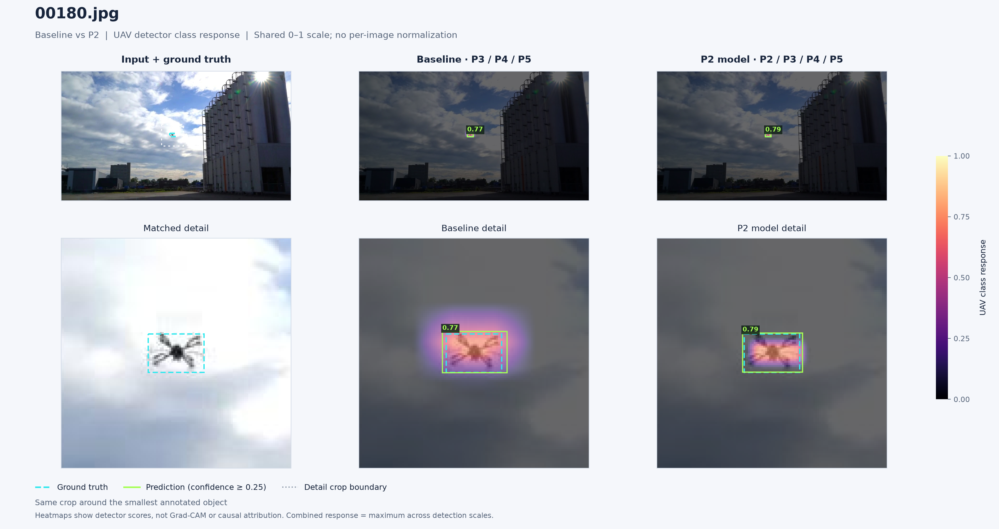
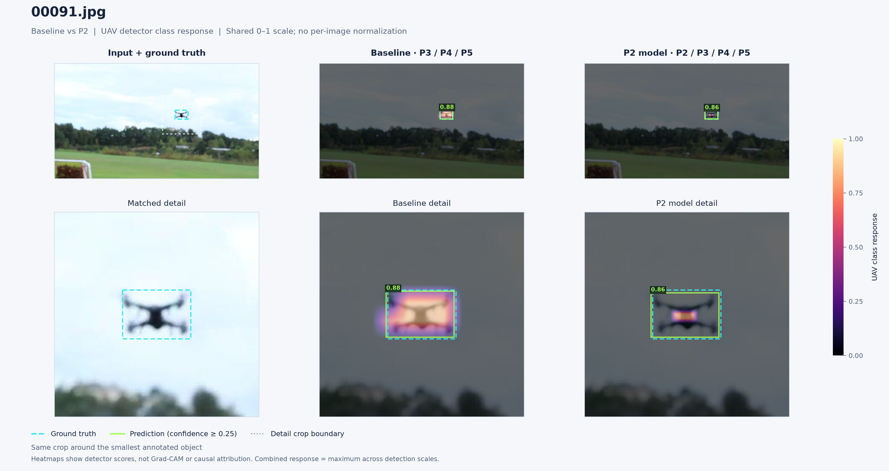
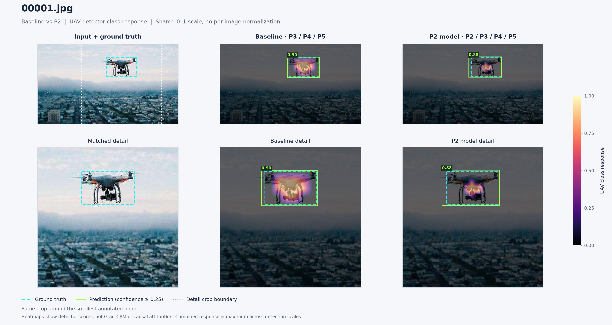
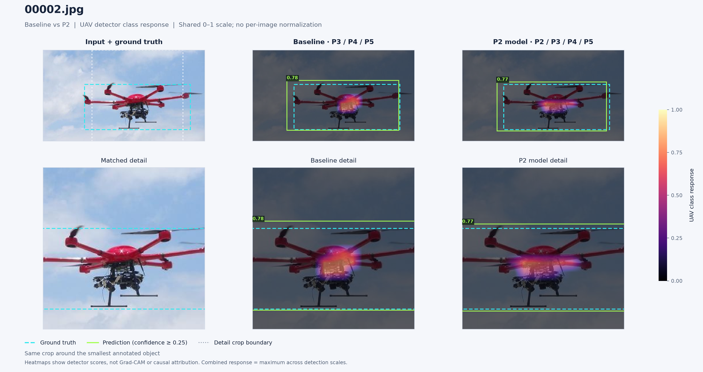

# Baseline vs P2 detection heatmaps

Heatmaps show UAV class scores at detection-grid locations, on a shared 0–1 scale. The combined response is the maximum across scales. Cyan dashed boxes are ground truth; lime boxes are predictions. Both models use the same input and inference settings.

These visualizations do not establish an accuracy gain or isolate the causal effect of P2. See manifest.json for checkpoint hashes, inference settings, per-scale peaks and predictions.

## 00180.jpg

[PDF](01_00180_comparison.pdf) · [Per-scale heatmaps](01_00180_scales.png)

## 00091.jpg

[PDF](02_00091_comparison.pdf) · [Per-scale heatmaps](02_00091_scales.png)

## 00001.jpg

[PDF](03_00001_comparison.pdf) · [Per-scale heatmaps](03_00001_scales.png)

## 00002.jpg

[PDF](04_00002_comparison.pdf) · [Per-scale heatmaps](04_00002_scales.png)
