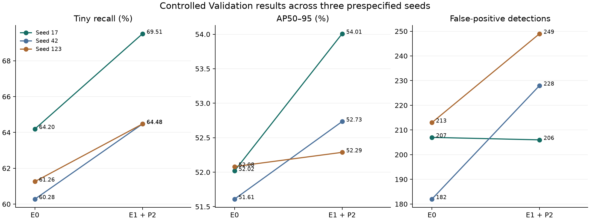

# Controlled P2 results across three seeds

Evidence cutoff 20 November 2026. **OFFICIAL CONTROLLED** endpoint measurements and their derived arithmetic summaries.

[Dashboard](RESEARCH_PROGRESS_DASHBOARD.md) · [Master results](RESULTS_MASTER_TABLE.md) · [Full-precision per-run data](../06_results/controlled_yolo26_v3_three_seed_audit_20261120/per_run.csv) · [Full-precision statistics](../06_results/controlled_yolo26_v3_three_seed_audit_20261120/aggregate_statistics.csv) · [Verification and source hashes](../06_results/controlled_yolo26_v3_three_seed_audit_20261120/verification.json)

## Measurement population and protocol

All six completed runs use the same 1,827 Clean_v2 Validation images and 1,867 annotated UAVs. Tiny/Small/Medium/Large GT denominators are 715/765/289/98. The comparison uses each run’s last.pt at epoch 100. Training seeds are 17, 42 and 123. E0 has strides 8/16/32, and E1 has strides 4/8/16/32. The intervention is the whole declared P2 architecture variant.

The sealed settings use 960 px, physical batch 4, nominal batch 16, accumulation 4, MuSGD, AMP and two workers, with common public-backbone initialization. Evaluation uses standard NMS 0.70, maxDet 300, batch 1, AP floor 0.001, operating confidence 0.25 and matching IoU 0.50. AP uses the project’s pinned 101-point precision-envelope evaluator over IoU 0.50–0.95. Size categories use original-image box area with boundaries 1,024, 9,216 and 65,536 px². Size recalls are operating-point metrics.

[Sealed execution identity](../configs/paper/YOLO26_LAPTOP_V3_LOCK.json) · [Approved analysis plan](../configs/paper/analysis_plan_yolo26_v1.json) · [Evaluator](../src/drone_detection/paper_metrics.py)

\n\nThe Tiny-recall endpoints for seeds 42 and 123 coincide at 64.48%.

[Vector PDF figure](../06_results/controlled_yolo26_v3_three_seed_audit_20261120/paired_results.pdf)\n\n## Individual official endpoints

| Arm / seed | AP50 % | AP50–95 % | P % | R % | F1 % | Tiny % | Small % | Medium % | Large % | TP | FP | FN | FP/image |
| --- | --- | --- | --- | --- | --- | --- | --- | --- | --- | --- | --- | --- | --- |
| E0 / 17 | 80.53 | 52.02 | 87.29 | 76.16 | 81.35 | 64.20 | 86.01 | 78.89 | 78.57 | 1422 | 207 | 445 | 0.11330 |
| E0 / 42 | 78.78 | 51.61 | 88.26 | 73.27 | 80.07 | 60.28 | 82.75 | 78.55 | 78.57 | 1368 | 182 | 499 | 0.09962 |
| E0 / 123 | 79.54 | 52.08 | 86.59 | 73.65 | 79.59 | 61.26 | 82.61 | 78.20 | 80.61 | 1375 | 213 | 492 | 0.11658 |
| E1 / 17 | 82.46 | 54.01 | 87.63 | 78.15 | 82.62 | 69.51 | 86.14 | 77.51 | 80.61 | 1459 | 206 | 408 | 0.11275 |
| E1 / 42 | 81.06 | 52.73 | 86.12 | 75.79 | 80.63 | 64.48 | 85.75 | 77.16 | 76.53 | 1415 | 228 | 452 | 0.12479 |
| E1 / 123 | 80.55 | 52.29 | 85.02 | 75.68 | 80.08 | 64.48 | 84.71 | 79.93 | 74.49 | 1413 | 249 | 454 | 0.13629 |

## Paired changes for every declared seed

Deltas use full-precision source values before rounding.

| Seed | ΔAP50 pp | ΔAP50–95 pp | ΔTiny pp | ΔSmall pp | ΔMedium pp | ΔLarge pp | ΔTP | ΔFP | ΔFN |
| --- | --- | --- | --- | --- | --- | --- | --- | --- | --- |
| 17 | +1.93 | +1.99 | +5.31 | +0.13 | -1.38 | +2.04 | 37 | -1 | -37 |
| 42 | +2.28 | +1.12 | +4.20 | +3.01 | -1.38 | -2.04 | 47 | 46 | -47 |
| 123 | +1.01 | +0.21 | +3.22 | +2.09 | +1.73 | -6.12 | 38 | 36 | -38 |

## Three-seed summary

All arms and contrasts use n=3 and sample SD with ddof=1. Rates in the two arm columns are percentages. Rate differences and their SD are percentage points. Count rows are arithmetic means over three evaluations of the same population.

| Metric | E0 mean ± sample SD | E1 mean ± sample SD | E1−E0 mean ± sample SD | Difference unit |
| --- | --- | --- | --- | --- |
| AP50 | 79.62 ± 0.87 | 81.36 ± 0.99 | +1.74 ± 0.66 | pp |
| AP50–95 | 51.90 ± 0.26 | 53.01 ± 0.89 | +1.11 ± 0.89 | pp |
| Precision | 87.38 ± 0.84 | 86.26 ± 1.31 | -1.12 ± 1.29 | pp |
| Recall | 74.36 ± 1.57 | 76.54 ± 1.39 | +2.18 ± 0.29 | pp |
| F1 | 80.34 ± 0.91 | 81.11 ± 1.33 | +0.77 ± 0.43 | pp |
| Tiny recall | 61.91 ± 2.04 | 66.15 ± 2.91 | +4.24 ± 1.05 | pp |
| Small recall | 83.79 ± 1.93 | 85.53 ± 0.74 | +1.74 ± 1.47 | pp |
| Medium recall | 78.55 ± 0.35 | 78.20 ± 1.51 | -0.35 ± 1.80 | pp |
| Large recall | 79.25 ± 1.18 | 77.21 ± 3.12 | -2.04 ± 4.08 | pp |
| TP | 1388.33 ± 29.37 | 1429.00 ± 26.00 | +40.67 ± 5.51 | count per Validation evaluation |
| FP | 200.67 ± 16.44 | 227.67 ± 21.50 | +27.00 ± 24.76 | count per Validation evaluation |
| FN | 478.67 ± 29.37 | 438.00 ± 26.00 | -40.67 ± 5.51 | count per Validation evaluation |
| FP_per_image | 0.10983 ± 0.00900 | 0.12461 ± 0.01177 | +0.01478 ± 0.01355 | FP/image |

Each contrast is E1(seed) − E0(seed). The SD of the paired contrast comes directly from the three signed differences. The same images recur across seeds. These repetitions measure training variability. They do not create independent image populations or recover video-level uncertainty.

## False-positive analysis

These are **geometric** categories. Background means zero overlap with any annotated GT under the fixed matcher. Semantic identity of the predicted region requires visual adjudication.

| Seed | Background E0 → E1 | Localization E0 → E1 | Duplicate E0 → E1 | ΔFP total |
| --- | --- | --- | --- | --- |
| 17 | 144 → 146 | 54 → 53 | 9 → 7 | -1 |
| 42 | 113 → 166 | 64 → 49 | 5 → 13 | 46 |
| 123 | 150 → 193 | 57 → 50 | 6 → 6 | 36 |

The mean net increase of 27 FP comprises **+32.67 Background, −7.67 Localization and +2.00 Duplicate** counts per evaluation. Class-confusion and invalid-box counts remain zero. The subtype sums reconcile with each seed total. The FP change is −1, +46 and +36 across the three seeds. Those are net count changes. They do not identify exactly that number of unique new boxes or affected images.

The complete FP ledger contains all 602 E0 and 683 E1 false positives across three repeated evaluations, with source paths, boxes, scores and geometric categories. The per-image table preserves both increases and decreases, and the GT transitions preserve recoveries and regressions.

[All FP review rows](../06_results/controlled_yolo26_v3_three_seed_audit_20261120/fp_review.csv) · [Per-image changes](../06_results/controlled_yolo26_v3_three_seed_audit_20261120/per_image_changes.csv) · [Subtype counts](../06_results/controlled_yolo26_v3_three_seed_audit_20261120/fp_subtype_changes.csv)

The targeted qualitative review covers 36 E1 predictions, selecting four distinct images with the highest FP confidence within each of Background, Localization and Duplicate for each seed. Selection favors high-confidence examples. The observed cases include building-edge distractors, extent/offset disagreement around small targets and duplicate detections. Ambiguous objects require adjudication. This assistant inspection supports case discussion. Population-level semantic prevalence and UAV-free negative status require verified annotations.

All shown images have current Validation membership, including filenames with historical train_ or test_ prefixes. They remain development diagnostics.

[Sample review](../06_results/controlled_yolo26_v3_three_seed_audit_20261120/fp_sample_review.csv) · [Seed 17 sheet](../06_results/controlled_yolo26_v3_three_seed_audit_20261120/fp_sample_seed17.png) · [Seed 42 sheet](../06_results/controlled_yolo26_v3_three_seed_audit_20261120/fp_sample_seed42.png) · [Seed 123 sheet](../06_results/controlled_yolo26_v3_three_seed_audit_20261120/fp_sample_seed123.png)

## Target recoveries and losses

GT identity is paired by current Validation image and GT index after checking identical coordinates and size labels.

| Seed | Size | Recovered GT | Lost GT | Net TP change |
| --- | --- | --- | --- | --- |
| 17 | Tiny | 55 | 17 | 38 |
| 17 | Small | 20 | 19 | 1 |
| 17 | Medium | 9 | 13 | -4 |
| 17 | Large | 4 | 2 | 2 |
| 42 | Tiny | 55 | 25 | 30 |
| 42 | Small | 41 | 18 | 23 |
| 42 | Medium | 8 | 12 | -4 |
| 42 | Large | 4 | 6 | -2 |
| 123 | Tiny | 55 | 32 | 23 |
| 123 | Small | 36 | 20 | 16 |
| 123 | Medium | 10 | 5 | 5 |
| 123 | Large | 2 | 8 | -6 |

## Integrity and implementation findings

The audit replayed all AP thresholds and operating-point metrics directly from the saved predictions with the pinned scorer. It reproduced every row of predictions.csv, objects.csv and images.csv and checked per-size and FP subtype CSVs. Comparisons passed tolerance 1e-12. Validation images and labels were rehashed against the release manifest. Target geometry was reconstructed using the original Decimal parser and export ordering. No metric discrepancy was found. A separate NumPy implementation of IoU, greedy matching and the sampled precision envelope also matched every AP threshold for all six runs within 1e-12. [Independent check](../06_results/controlled_yolo26_v3_three_seed_audit_20261120/independent_ap_check.json) · [Independent check source](../06_results/controlled_yolo26_v3_three_seed_audit_20261120/independent_ap_check.py)

All six last.pt and raw-prediction hashes match evaluator metadata. Sealed inputs, shared initial-backbone identity, effective training settings, 100 committed epoch events and the matching Validation population passed the audit. Source hashes were checked again at the end. Trusted local training checkpoints were loaded on CPU to inspect epoch, identity and actual update counts. Computation used existing predictions.

| Run | last.pt SHA-256 | Actual optimizer steps | Resume events | Evaluation completed UTC | Source |
| --- | --- | --- | --- | --- | --- |
| E0-17 | 731439097963251e71df1c5d326fd0ff169d7c3741902556713fbf2e8267a798 | 39352 | 1 | 2026-11-17T06:39:17.594872+00:00 | [summary.json](../04_experiments/controlled_yolo26_v3/E0_Y26/seed_17/evaluation/val/summary.json) |
| E0-42 | 6ec091fc66b0edd4fe9327aa21e86a86f391b02bc858920e68d17bfa938c4313 | 39351 | 1 | 2026-11-19T02:07:09.711741+00:00 | [summary.json](../04_experiments/controlled_yolo26_v3/E0_Y26/seed_42/evaluation/val/summary.json) |
| E0-123 | 1290dde2bb1871eba30f133d3d4500af08fac5cbd169aa7dfd6c6b833257d3b7 | 39351 | 0 | 2026-11-20T00:48:30.075612+00:00 | [summary.json](../04_experiments/controlled_yolo26_v3/E0_Y26/seed_123/evaluation/val/summary.json) |
| E1-17 | 7434f6c5c083992b16dfd9c9b818e8a8909afb8047ecd389cbab1a6a17c01f18 | 39353 | 4 | 2026-11-18T06:35:26.505674+00:00 | [summary.json](../04_experiments/controlled_yolo26_v3/E1_Y26_P2/seed_17/evaluation/val/summary.json) |
| E1-42 | 419980e0e44fa9ce4d12b7f234843b20b8a6a61748e80f0478d907d3c14a29e1 | 39351 | 0 | 2026-11-19T15:45:26.936591+00:00 | [summary.json](../04_experiments/controlled_yolo26_v3/E1_Y26_P2/seed_42/evaluation/val/summary.json) |
| E1-123 | 908ec08f1fd674f448dbbd6eb2283faa40785b7a59cbed7d74604653015bd5f8 | 39353 | 0 | 2026-11-20T19:16:09.668972+00:00 | [summary.json](../04_experiments/controlled_yolo26_v3/E1_Y26_P2/seed_123/evaluation/val/summary.json) |

Actual optimizer counts range from **39,351 to 39,353**, with paired E1−E0 differences **+1, 0 and +2**. Scheduled settings match. Native AMP behavior and recorded interruption/resume histories can affect actual update counts and stochastic progression. The audit cannot attribute individual skipped updates to a cause because a per-attempt skip ledger is unavailable. Report the matched nominal schedule and this measured detail when describing control quality.

Trainer-native last-row metrics retain their separate monitoring fields. They use another evaluator/operating context.

## Thesis wording

Across the three prespecified training seeds on the fixed Clean_v2 Validation population, the declared P2 architecture increased Tiny-UAV recall in every paired run, with a mean paired increase of **4.24 ± 1.05 percentage points**. Mean paired AP50 and AP50–95 increases were **1.74 ± 0.66** and **1.11 ± 0.89 percentage points**, respectively. E1 produced a mean of **40.67 fewer missed objects** and **27.00 more false-positive detections** per evaluation. The results support a recall benefit with a false-positive trade-off under the studied protocol. External generalization and verified negative-only performance remain open.

عبر بذور التدريب الثلاث المحددة مسبقًا، وعلى مجموعة التحقق الثابتة Clean_v2، حسّن متغير المعمارية المزود بمستوى P2 استرجاع الطائرات متناهية الصغر في المقارنات الثلاث، بمتوسط فرق مقترن قدره **4.24 ± 1.05 نقطة مئوية**. وبلغ متوسط التحسن في AP50 وAP50–95 **1.74 ± 0.66** و**1.11 ± 0.89 نقطة مئوية** على الترتيب. وانخفض عدد الأهداف الفائتة بمتوسط **40.67 هدفًا** لكل تقييم، مع زيادة الإنذارات الكاذبة بمتوسط **27.00 إنذارًا**. تشير علامة ± إلى الانحراف المعياري العيني للفروق بين البذور الثلاث.

## Scope and remaining evidence

Validation was used during development. Clean_v2 Test has prior descriptive exposure, and historical Train contributes images to its current membership. The audit supports protocol-qualified scene-group-aware evaluation. Native recording identities and independent external confirmation remain unresolved.

Seed SD measures training variability. A statistical-significance finding, sequence-level interval, official inference latency and negative-only false-alarm rate require their respective designs and measurements.

## Reproducing the numerical audit

Run from the repository with its existing project Python environment, using a new output directory.

    .\.venv\Scripts\python.exe tools/audit_controlled_yolo26.py --output 06_results/controlled_yolo26_v3_three_seed_audit_rerun

The CSVs retain fractions at full available precision. Multiply rate fractions by 100 for percent and percentage-point presentation. Count deltas remain counts. Round after aggregation.
