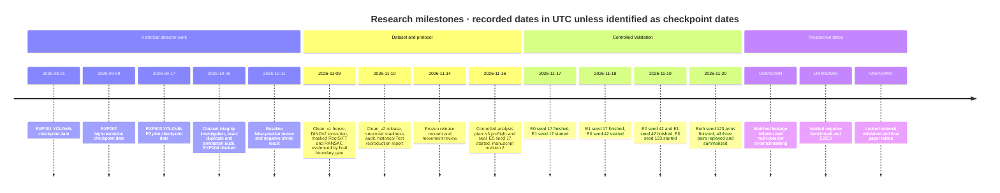
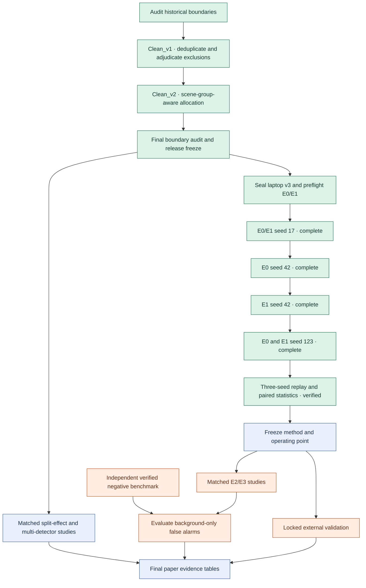

# Research progress dashboard

**As of 21 November 2026** · [Offline visual board](research_progress_dashboard.html) · [Editable registry](experiment_registry.csv) · [Master results](RESULTS_MASTER_TABLE.md) · [Three-seed thesis results](CONTROLLED_P2_THREE_SEED_RESULTS.md) · [Questions and evidence](research_questions_and_evidence.md) · [Scientific claims](SCIENTIFIC_CLAIMS_STATUS.md) · [Editable flowcharts](RESEARCH_PROGRESS_FLOWCHART.md)

> **Main paper direction** · Leakage-aware re-benchmarking of small-UAV detection  
> **Primary contribution** · Evaluation integrity through scene-group-aware dataset reconstruction  
> **Secondary case study** · The whole YOLO26s high-resolution P2 variant  
> **Controlled status** · Six of six runs evaluated and replayed. All three seed pairs complete. **Next dependency: a sufficient allocation-separated source and verified E2/E3 data.**
> **Next executable study** · E0@1280 resolution control is prospectively defined. The synthetic AMP loss/backward preflight passed with only 50.2 MB allocated-memory margin, so training remains unauthorized pending a real optimizer-state preflight and lock.

## Controlled study · Clean_v2 Validation

| Arm | Seed 17 | Seed 42 | Seed 123 |
| --- | --- | --- | --- |
| E0 · P3/P4/P5, strides 8/16/32 | ✅ [E0-17](../04_experiments/controlled_yolo26_v3/E0_Y26/seed_17/evaluation/val/summary.json) | ✅ [E0-42](../04_experiments/controlled_yolo26_v3/E0_Y26/seed_42/evaluation/val/summary.json) | ✅ [E0-123](../04_experiments/controlled_yolo26_v3/E0_Y26/seed_123/evaluation/val/summary.json) |
| E1 · P2/P3/P4/P5, strides 4/8/16/32 | ✅ [E1-17](../04_experiments/controlled_yolo26_v3/E1_Y26_P2/seed_17/evaluation/val/summary.json) | ✅ [E1-42](../04_experiments/controlled_yolo26_v3/E1_Y26_P2/seed_42/evaluation/val/summary.json) | ✅ [E1-123](../04_experiments/controlled_yolo26_v3/E1_Y26_P2/seed_123/evaluation/val/summary.json) |

| Evidence level | Run / contrast | AP50 | AP50–95 | Tiny recall | Medium recall | FN | FP |
| --- | --- | --- | --- | --- | --- | --- | --- |
| OFFICIAL CONTROLLED | E0-17 | 80.53% | 52.02% | 64.20% | 78.89% | 445 | 207 |
| OFFICIAL CONTROLLED | E1-17 | 82.46% | 54.01% | 69.51% | 77.51% | 408 | 206 |
| OFFICIAL CONTROLLED | E0-42 | 78.78% | 51.61% | 60.28% | 78.55% | 499 | 182 |
| OFFICIAL CONTROLLED | E1-42 | 81.06% | 52.73% | 64.48% | 77.16% | 452 | 228 |
| OFFICIAL CONTROLLED | E0-123 | 79.54% | 52.08% | 61.26% | 78.20% | 492 | 213 |
| OFFICIAL CONTROLLED | E1-123 | 80.55% | 52.29% | 64.48% | 79.93% | 454 | 249 |
| OFFICIAL CONTROLLED | E1−E0 · seed 17 | +1.93 pp | +1.99 pp | +5.31 pp | -1.38 pp | -37 | -1 |
| OFFICIAL CONTROLLED | E1−E0 · seed 42 | +2.28 pp | +1.12 pp | +4.20 pp | -1.38 pp | -47 | 46 |
| OFFICIAL CONTROLLED | E1−E0 · seed 123 | +1.01 pp | +0.21 pp | +3.22 pp | +1.73 pp | -38 | 36 |

**All three prespecified pairs are complete.** Mean paired Tiny recall increased by 4.24 ± 1.05 pp, AP50 by 1.74 ± 0.66 pp and AP50–95 by 1.11 ± 0.89 pp. Mean FP increased by 27.00 and FN decreased by 40.67 per Validation evaluation. The ± values are paired sample SDs. External confirmation remains open. The primary comparison uses `last.pt` at epoch 100 for every arm. [docs/CONTROLLED_P2_THREE_SEED_RESULTS.md](CONTROLLED_P2_THREE_SEED_RESULTS.md) · [06_results/controlled_yolo26_v3_three_seed_audit_20261120/verification.json](../06_results/controlled_yolo26_v3_three_seed_audit_20261120/verification.json)

## Research board

| Branch | Question or purpose | Status | Evidence or next dependency |
| --- | --- | --- | --- |
| A · Dataset integrity | Can historical splitting expose related scenes? | ✅ Release and audits complete | A01–A14 and the old-boundary analysis. A15 split-effect experiment is planned. A16 points to branch F. |
| B · Historical and exploratory detectors | What did earlier models and error analyses show? | ⚪ Historical / 🟠 exploratory | Original YOLOv8, P2, YOLO26, GAM, EXP004 preparation, old Test and four-cell evaluations. |
| C · Controlled P2 | What changes when the declared P2 variant replaces the baseline? | ✅ Six runs and three pairs verified | All endpoint metrics and exported rows reproduced. Next dependency is the E2/E3 discovery design and verified matched negatives. |
| C2 · E0 resolution control | Can E0@1280 match P2@960 on Tiny recall at lower or higher practical cost? | 🔵 Prospective · preflight only | E0@1280 protocol: seeds 17/42/123, 100 epochs, batch 4, accumulation 4, `last.pt`, Validation-only. [Preflight](/D:/master/Master_Drone_Detection/06_results/e0_1280_preflight_20261121/preflight.json) |
| D · Negative selection | Do random backgrounds help, and does error-driven selection outperform random? | 🔴 Blocked · all six seeds | Freeze mining and matched verified negatives. Acquire an independent negative benchmark. |
| E · External validation | Do results generalize to other recordings? | ⚪ Historical diagnostics / 🔴 final study blocked | Finish the prospective protocol and exposure audit before inference. |
| F · Multi-detector re-benchmarking | Does reconstruction shift absolute performance or ranking? | 🔵 Planned | YOLOv8s, YOLO11s, YOLO26s, RT-DETR-R18 and Faster R-CNN are candidate families. |

**Separate project G** · Radar–PTZ sensor fusion has a proposed scope and no identified implementation or measured result in this repository. [Questions and evidence](research_questions_and_evidence.md)

**Status key** · ✅ complete · 🟢 official controlled evidence · 🟡 ongoing study · 🔵 planned · 🟠 exploratory · ⚪ historical · 🔴 blocked · ❌ excluded · 🟣 superseded · ⚠ requires review. Completion describes execution. Evidence level describes what can be claimed.

## Dataset release and exposure

| Split | Images | UAV annotations | Tiny | Small | Medium | Large | Evidence level |
| --- | --- | --- | --- | --- | --- | --- | --- |
| Train | 6,299 | 6,317 | 3,344 | 2,082 | 671 | 220 | DIAGNOSTIC |
| Val | 1,827 | 1,867 | 715 | 765 | 289 | 98 | DIAGNOSTIC |
| Test | 1,325 | 1,377 | 577 | 544 | 192 | 64 | DIAGNOSTIC |
| Total | 9,451 | 9,561 | 4,636 | 3,391 | 1,152 | 382 | DIAGNOSTIC |

Tiny and Small account for **8,027 / 9,561 annotations (83.96%)** using original-image box area. The 1,571 confirmed groups form 313 conservative allocation blocks. The final gate checked 282,293 boundary candidates. Retained labels come from Clean_v1. Native recording identities remain unresolved. [configs/datasets/DUT_Anti_UAV_Clean_v2.release.json](../configs/datasets/DUT_Anti_UAV_Clean_v2.release.json) · [02_datasets/DUT_Anti_UAV_Clean_v2/gate2_report.json](../02_datasets/DUT_Anti_UAV_Clean_v2/gate2_report.json) · [02_datasets/DUT_Anti_UAV_Clean_v2/METHODOLOGY.md](../02_datasets/DUT_Anti_UAV_Clean_v2/METHODOLOGY.md)

| Retained images · old → new | New Train | New Validation | New Test | Evidence level |
| --- | --- | --- | --- | --- |
| Train | 3,503 | 981 | 709 | DIAGNOSTIC |
| Val | 1,764 | 480 | 353 | DIAGNOSTIC |
| Test | 1,032 | 366 | 263 | DIAGNOSTIC |

Of 9,451 retained images, 5,205 (55.07%) changed split. Historical Train contributed **709 of the 1,325 new Test images (53.51%)**. In reverse, 1,032 original Test images entered new Train. Clean_v2 Test already has descriptive exposure. The v3 runs use Train for fitting and Validation for development. [02_datasets/DUT_Anti_UAV_Clean_v2/dataset_changes.csv](../02_datasets/DUT_Anti_UAV_Clean_v2/dataset_changes.csv) · [04_experiments/evaluation/COMPARISON.md](../04_experiments/evaluation/COMPARISON.md)

## Which experiments can be compared?

| Row vs column | Historical YOLO | Local Clean_v2 | E0 v3 | E1 v3 | E2 / E3 prospective |
| --- | --- | --- | --- | --- | --- |
| Historical YOLO | Within identical evaluator/population only | Descriptive four-cell comparisons | No | No | No |
| Local Clean_v2 | Descriptive four-cell comparisons | Within same checkpoint/eval context | No | No | No |
| E0 v3 | No | No | Across seeds for baseline variability | Yes · same seed, fixed last.pt | No primary contrast |
| E1 v3 | No | No | Yes · same seed, fixed last.pt | Across seeds for variability | Secondary per seed once matched |
| E2 / E3 | No | No | No primary contrast | Secondary per seed once matched | Primary E3−E2 once verified |

The official pair shares split identities, evaluation settings, 960 px, public backbone transfer, optimizer, schedule, AMP, physical batch and nominal accumulation. The intervention is the entire declared architecture variant, including its added detection level and associated neck/head changes. Native resume events are recorded. Bitwise equivalence or identical actual optimizer updates across all historical sessions is unestablished.

Historical reports use different split versions, initialization, optimizers, seeds, image sizes, checkpoint selection and evaluators. The four-cell matrix holds the evaluation setup fixed, yet each model’s training exposure differs. The older YOLOv8 P2 pilot is a descriptive comparison with different training batches. Original side-length bins, normalized-area bins and v3 pixel-area bins also yield different populations. Replicates across seeds measure training variability. The seed-17 E1 result and seed-42 E0 result cannot form a paired contrast.
[configs/paper/YOLO26_LAPTOP_V3_LOCK.json](../configs/paper/YOLO26_LAPTOP_V3_LOCK.json) · [configs/paper/analysis_plan_yolo26_v1.json](../configs/paper/analysis_plan_yolo26_v1.json) · [04_experiments/evaluation/COMPARISON.md](../04_experiments/evaluation/COMPARISON.md) · [EXPERIMENT_REGISTRY.md](../EXPERIMENT_REGISTRY.md)

## Evidence map and discrepancies

| Decision | Source precedence and observed discrepancy | Evidence |
| --- | --- | --- |
| Official endpoint | Sealed v3 → fresh-start/last epoch events → completed evaluator JSON → summary, per-size and FP ledgers. Trainer results.csv is native monitoring. No official inference latency export. | [configs/paper/YOLO26_LAPTOP_V3_LOCK.json](../configs/paper/YOLO26_LAPTOP_V3_LOCK.json) · [04_experiments/controlled_yolo26_v3/E0_Y26/seed_42/evaluation/val/summary.json](../04_experiments/controlled_yolo26_v3/E0_Y26/seed_42/evaluation/val/summary.json) |
| Run status | The seal-day report predates training. The 17 November supervisor update shows E1 at epoch 45. Completed exports supersede those snapshots. The first E0-42 launch failed on permissions before a successful fresh run. | [docs/YOLO26_V3_VALIDATION_REPORT.md](YOLO26_V3_VALIDATION_REPORT.md) · [08_thesis/supervisor_update_20261117/Verified_Results.csv](../08_thesis/supervisor_update_20261117/Verified_Results.csv) · [04_experiments/controlled_yolo26_v3/E0_Y26/seed_42_failed_permissions_20261118_101409/state.json](../04_experiments/controlled_yolo26_v3/E0_Y26/seed_42_failed_permissions_20261118_101409/state.json) · [04_experiments/controlled_yolo26_v3/E1_Y26_P2/seed_17/evaluation/val/summary.json](../04_experiments/controlled_yolo26_v3/E1_Y26_P2/seed_17/evaluation/val/summary.json) · [04_experiments/controlled_yolo26_v3/E0_Y26/seed_42/evaluation/val/summary.json](../04_experiments/controlled_yolo26_v3/E0_Y26/seed_42/evaluation/val/summary.json) |
| Protocol identity | The candidate YAML carries a draft label and the base protocol filename includes v2. The matching SEALED v3 lock binds both exact byte hashes. The separately archived v2 E0 run ended after three epochs. | [configs/paper/YOLO26_LAPTOP_V3_LOCK.json](../configs/paper/YOLO26_LAPTOP_V3_LOCK.json) · [configs/paper/yolo26_laptop_v3.review.yaml](../configs/paper/yolo26_laptop_v3.review.yaml) · [04_experiments/controlled_yolo26_v2/E0_Y26/seed_17/SUPERSEDED_BY_V3.json](../04_experiments/controlled_yolo26_v2/E0_Y26/seed_17/SUPERSEDED_BY_V3.json) |
| Historical Test reference | The local seed-17 AdamW model on Clean_v2 Test has P 95.08%, R 80.03%, AP50 87.14% and AP50:95 59.76% (HISTORICAL). The 97.8% old Test number belongs to another cell. The separate batch-4 audit reproduced rounded AP50:95 but differed on the other three values. | [04_experiments/evaluation/clean_model_on_clean_test.evaluation.json](../04_experiments/evaluation/clean_model_on_clean_test.evaluation.json) · [04_experiments/evaluation/standard_model_on_standard_test.evaluation.json](../04_experiments/evaluation/standard_model_on_standard_test.evaluation.json) · [YOLO26s_AUDIT/METRICS_COMPARISON.csv](../YOLO26s_AUDIT/METRICS_COMPARISON.csv) |
| Test count provenance | The audit report says the custom Test counts lack a ledger. The present per-image CSV sums to 2,176 TP / 85 FP / 69 FN across 2,200 images. Notebook 12 names baseline-5 and predict-3. Prediction text lacks a checkpoint-to-export hash. The 47 low-IoU cases describe a subset. | [YOLO26s_AUDIT/FINAL_AUDIT_REPORT.md](../YOLO26s_AUDIT/FINAL_AUDIT_REPORT.md) · [04_experiments/YOLO26s_baseline_error_analysis/per_image_summary.csv](../04_experiments/YOLO26s_baseline_error_analysis/per_image_summary.csv) · [04_experiments/YOLO26s_baseline_error_analysis/detailed_errors/true_miss_characteristics.csv](../04_experiments/YOLO26s_baseline_error_analysis/detailed_errors/true_miss_characteristics.csv) · [notebooks/12_YOLO26_error_analysis.ipynb](../notebooks/12_YOLO26_error_analysis.ipynb) |
| Dataset snapshots | Initial notebook counted 5,200 Train images. Later source had 5,199. Clean_v1 excludes conflicting duplicates and an invalid image. Its local payload directory is absent here, while its external release record and inherited v2 provenance remain. | [notebooks/10b_final_dataset_integrity_check.ipynb](../notebooks/10b_final_dataset_integrity_check.ipynb) · [configs/datasets/DUT_Anti_UAV_Clean_v1.release.json](../configs/datasets/DUT_Anti_UAV_Clean_v1.release.json) · [configs/datasets/DUT_Anti_UAV_Clean_v2.release.json](../configs/datasets/DUT_Anti_UAV_Clean_v2.release.json) |
| Gate history | Prepublication automatic passes were overturned by visual review. Allocation co-membership and transitive scene links have different evidential strength. Final boundary audit is protocol-qualified. | [02_datasets/DUT_Anti_UAV_Clean_v2/release_audit_history.json](../02_datasets/DUT_Anti_UAV_Clean_v2/release_audit_history.json) · [02_datasets/DUT_Anti_UAV_Clean_v2/gate2_report.json](../02_datasets/DUT_Anti_UAV_Clean_v2/gate2_report.json) · [06_results/Gate2_scene_sequence_audit_v1_20261109/scene_graph_overmerging_audit/overmerging_audit_report.json](../06_results/Gate2_scene_sequence_audit_v1_20261109/scene_graph_overmerging_audit/overmerging_audit_report.json) |
| Archive labels | The paper_v1 README says no training, while its E0 seed-17 CSV contains eight epochs. The archived GAM graph bypasses GAM. P2 notebook and saved transfer folder names differ. HEPAN/Mamba have drafts only. | [04_experiments/paper_v1/README.md](../04_experiments/paper_v1/README.md) · [04_experiments/paper_v1/E0/seed_17/run/results.csv](../04_experiments/paper_v1/E0/seed_17/run/results.csv) · [configs/models/README.md](../configs/models/README.md) · [04_experiments/YOLO26s_P2_transfer_learning/args.yaml](../04_experiments/YOLO26s_P2_transfer_learning/args.yaml) |
| External and negative measures | Sampled RGPT JSONs omit model hashes and sequence manifests. RGBT appears in a conversion notebook. Validation/Test have zero annotation-empty images and no verified negative benchmark. | [configs/paper/external_validation_protocol.template.json](../configs/paper/external_validation_protocol.template.json) · [notebooks/04_AntiUAV_RGBT_to_YOLO_conversion.ipynb](../notebooks/04_AntiUAV_RGBT_to_YOLO_conversion.ipynb) · [configs/datasets/DUT_Anti_UAV_Clean_v2.release.json](../configs/datasets/DUT_Anti_UAV_Clean_v2.release.json) |

## Progress and dependencies

## Experiment cards

Each card has one stable registry ID. A training run with its sealed endpoint is one unit. Distinct subsequent evaluations, failed launches, audits and prospective protocol slots have individual records. Resumes, CSV mirrors, per-epoch checkpoints and plots belong to their parent record. The registry also includes archived plans and technical checks. The separate radar project contributes no observed run.

| Evidence class | Registry records |
| --- | --- |
| OFFICIAL CONTROLLED | 6 |
| HISTORICAL | 29 |
| EXPLORATORY | 12 |
| DIAGNOSTIC | 42 |
| SUPERSEDED | 27 |
| INVALID / EXCLUDED | 8 |
| PLANNED | 15 |

**139 records** overall, including **97** with execution or audit evidence. The rest document prospective or retired plans, untrained designs or unverified setups.

<b>C · Controlled P2 study</b> — 14 records

#### C-42-FAIL · E0 seed 42 • failed first launch

**Failed / excluded** · INVALID / EXCLUDED · RQ2

- **Population** — Clean_v2
- **Design** — YOLO26s P3/P4/P5 (8/16/32) · seed 42
- **Protocol** — [configs/paper/YOLO26_LAPTOP_V3_LOCK.json](../configs/paper/YOLO26_LAPTOP_V3_LOCK.json)
- **Interpretation** — Separate archived start. The successful E0-42 retry is the official run.
- **Limit** — [WinError 5] Access is denied
- **Evidence** — [state.json](../04_experiments/controlled_yolo26_v3/E0_Y26/seed_42_failed_permissions_20261118_101409/state.json)

#### C-AUDIT-3 · Completed three-seed endpoint replay and paired analysis

**Complete** · DIAGNOSTIC · RQ2

- **Population** — Clean_v2 · evaluation Validation
- **Design** — E0 and E1 · seed 17 / 42 / 123 · 100/100
- **Interpretation** — All six saved endpoint metrics and CSV rows reproduced. Tiny recall mean paired gain 4.24 pp, paired sample SD 1.05 pp.
- **Limit** — Existing prediction replay. Qualitative sample has assistant review only. External validation remains open.
- **Next dependency** — E2/E3 discovery design and verified bundle integration.
- **Evidence** — [verification.json](../06_results/controlled_yolo26_v3_three_seed_audit_20261120/verification.json) · [CONTROLLED_P2_THREE_SEED_RESULTS.md](CONTROLLED_P2_THREE_SEED_RESULTS.md) · [aggregate_statistics.csv](../06_results/controlled_yolo26_v3_three_seed_audit_20261120/aggregate_statistics.csv) · [negative_study_readiness.md](../06_results/controlled_yolo26_v3_three_seed_audit_20261120/negative_study_readiness.md)

#### C-PF-210848158125 · Archived v3 preflight attempt

**Failed / excluded** · INVALID / EXCLUDED · RQ2

- **Interpretation** — Historical failure retained before sealing.
- **Limit** — Preflight assertion failed. This attempt has no official detector result.
- **Evidence** — [previous_preflight_report.json](../06_results/paper_yolo26_v3/attempt_20261116T210848158125/previous_preflight_report.json)

#### C-PF-211124033061 · Archived v3 preflight attempt

**Failed / excluded** · INVALID / EXCLUDED · RQ2

- **Interpretation** — Historical failure retained before sealing.
- **Limit** — Preflight assertion failed. This attempt has no official detector result.
- **Evidence** — [previous_preflight_report.json](../06_results/paper_yolo26_v3/attempt_20261116T211124033061/previous_preflight_report.json)

#### C-PF-211401136259 · Archived v3 preflight attempt

**Failed / excluded** · INVALID / EXCLUDED · RQ2

- **Interpretation** — Historical failure retained before sealing.
- **Limit** — Preflight assertion failed. This attempt has no official detector result.
- **Evidence** — [previous_preflight_report.json](../06_results/paper_yolo26_v3/attempt_20261116T211401136259/previous_preflight_report.json)

#### C-PF-211849209289 · Archived v3 preflight attempt

**Failed / excluded** · INVALID / EXCLUDED · RQ2

- **Interpretation** — Historical failure retained before sealing.
- **Limit** — Failed execution-only checks. See report and later sealed pass.
- **Evidence** — [previous_preflight_report.json](../06_results/paper_yolo26_v3/attempt_20261116T211849209289/previous_preflight_report.json)

#### C-PF-E0 · E0 • sealed preflight

**Complete** · DIAGNOSTIC · RQ2

- **Population** — Clean_v2 fixture · evaluation Train/Validation subset
- **Design** — YOLO26s P3/P4/P5 (8/16/32)
- **Resources** — 2.64 GiB peak allocated (fixture)
- **Interpretation** — Resume, checkpoint and exporter checks passed.
- **Limit** — Execution-only fixture. Memory readings describe this short run.
- **Evidence** — [validation_summary.json](../06_results/paper_yolo26_v3/validation_summary.json) · [YOLO26_V3_VALIDATION_REPORT.md](YOLO26_V3_VALIDATION_REPORT.md)

#### C-PF-E1 · E1 • sealed preflight

**Complete** · DIAGNOSTIC · RQ2

- **Population** — Clean_v2 fixture · evaluation Train/Validation subset
- **Design** — YOLO26s-P2 P2/P3/P4/P5 (4/8/16/32)
- **Resources** — 3.90 GiB peak allocated (fixture)
- **Interpretation** — Resume, checkpoint and exporter checks passed.
- **Limit** — Execution-only fixture. Memory readings describe this short run.
- **Evidence** — [validation_summary.json](../06_results/paper_yolo26_v3/validation_summary.json) · [YOLO26_V3_VALIDATION_REPORT.md](YOLO26_V3_VALIDATION_REPORT.md)

#### E0-123 · E0 • seed 123

**Complete** · OFFICIAL CONTROLLED · RQ2

- **Population** — Clean_v2 · training Train · evaluation Validation · Test used for development? No (v3)
- **Design** — YOLO26s P3/P4/P5 (8/16/32) · seed 123 · 100/100 · v3 • 960 px, 100 epochs, physical batch 4, nominal 16, accumulation 4, MuSGD, AMP, 2 workers, cosine schedule, no warmup or early stopping
- **Protocol** — [configs/paper/YOLO26_LAPTOP_V3_LOCK.json](../configs/paper/YOLO26_LAPTOP_V3_LOCK.json)
- **Initialization** — Public YOLO26s backbone modules 0–10, shared 240 tensors • donor 646f8bc3fe0a656803d95c294f7852321748cb29d13466a1af8862e2db384a1b • backbone b928e4ec27534c8a27f038005eb76ae934b7858af32a9f8f60a0192e988823a3
- **Actual optimizer steps / resume events** — 39351 · 0
- **Checkpoint** — [04_experiments/controlled_yolo26_v3/E0_Y26/seed_123/run/weights/last.pt](../04_experiments/controlled_yolo26_v3/E0_Y26/seed_123/run/weights/last.pt) · 1290dde2bb1871eba30f133d3d4500af08fac5cbd169aa7dfd6c6b833257d3b7
- **UTC record** — start 2026-11-19T16:26:52.760123+00:00 · end 2026-11-20T00:46:39.628907+00:00 · evaluation complete 2026-11-20T00:48:30.075612+00:00
- **Evaluator** — v3 research exporter • 101-point AP, floor .001, operating .25, match .50, NMS .70, maxDet 300, batch 1
- **Result** — AP50 79.54% · AP50–95 52.08% · P 86.59% · R 73.65% · F1 79.59% · Tiny 61.26% · Small 82.61% · Medium 78.20% · Large 80.61% · TP 1375 · FP 213 · FN 492
- **FP details** — background 150 · localization 57 · duplicate 6 · class confusion 0 · invalid box 0 · FP/image 0.11658
- **Diagnostic · native Validation P / R / AP50 / AP50:95 (%)** — 88.59 / 72.63 / 79.75 / 51.82
- **Resources** — inference latency unavailable · 3.31G (trainer display, epoch 100; training only)
- **Interpretation** — One of three completed paired seeds. See the audited three-seed contrasts.
- **Comparison** — E1-123 (completed paired contrast)
- **Limit** — Fixed development Validation population. Seed SD measures training variability. Actual optimizer counts differ by up to two updates across arms, and resume histories differ. External confirmation and verified negative-only evaluation remain open.
- **Next dependency** — Prepare matched Train-only negatives after discovery-design resolution.
- **Evidence** — [summary.json](../04_experiments/controlled_yolo26_v3/E0_Y26/seed_123/evaluation/val/summary.json) · [evaluation.json](../04_experiments/controlled_yolo26_v3/E0_Y26/seed_123/evaluation/val/evaluation.json) · [recall_by_size.csv](../04_experiments/controlled_yolo26_v3/E0_Y26/seed_123/evaluation/val/recall_by_size.csv) · [fp_subtypes.csv](../04_experiments/controlled_yolo26_v3/E0_Y26/seed_123/evaluation/val/fp_subtypes.csv) · [images.csv](../04_experiments/controlled_yolo26_v3/E0_Y26/seed_123/evaluation/val/images.csv) · [state.json](../04_experiments/controlled_yolo26_v3/E0_Y26/seed_123/state.json) · [initialization.json](../04_experiments/controlled_yolo26_v3/E0_Y26/seed_123/run/initialization.json) · [resolved_training.json](../04_experiments/controlled_yolo26_v3/E0_Y26/seed_123/resolved_training.json) · [20261119T162652760123_a9011d7ad76743fe8a752fed902d8887.json](../04_experiments/controlled_yolo26_v3/E0_Y26/seed_123/events/20261119T162652760123_a9011d7ad76743fe8a752fed902d8887.json) · [20261120T004639628907_78de297bf8de4079862e8e967024317b.json](../04_experiments/controlled_yolo26_v3/E0_Y26/seed_123/events/20261120T004639628907_78de297bf8de4079862e8e967024317b.json) · [results.csv](../04_experiments/controlled_yolo26_v3/E0_Y26/seed_123/run/results.csv) · [E0_seed123_20261119_182558.stdout.log](../04_experiments/controlled_yolo26_v3/logs/E0_seed123_20261119_182558.stdout.log) · [verification.json](../06_results/controlled_yolo26_v3_three_seed_audit_20261120/verification.json) · [paired_differences.csv](../06_results/controlled_yolo26_v3_three_seed_audit_20261120/paired_differences.csv) · [CONTROLLED_P2_THREE_SEED_RESULTS.md](CONTROLLED_P2_THREE_SEED_RESULTS.md)

#### E0-17 · E0 • seed 17

**Complete** · OFFICIAL CONTROLLED · RQ2

- **Population** — Clean_v2 · training Train · evaluation Validation · Test used for development? No (v3)
- **Design** — YOLO26s P3/P4/P5 (8/16/32) · seed 17 · 100/100 · v3 • 960 px, 100 epochs, physical batch 4, nominal 16, accumulation 4, MuSGD, AMP, 2 workers, cosine schedule, no warmup or early stopping
- **Protocol** — [configs/paper/YOLO26_LAPTOP_V3_LOCK.json](../configs/paper/YOLO26_LAPTOP_V3_LOCK.json)
- **Initialization** — Public YOLO26s backbone modules 0–10, shared 240 tensors • donor 646f8bc3fe0a656803d95c294f7852321748cb29d13466a1af8862e2db384a1b • backbone b928e4ec27534c8a27f038005eb76ae934b7858af32a9f8f60a0192e988823a3
- **Actual optimizer steps / resume events** — 39352 · 1
- **Checkpoint** — [04_experiments/controlled_yolo26_v3/E0_Y26/seed_17/run/weights/last.pt](../04_experiments/controlled_yolo26_v3/E0_Y26/seed_17/run/weights/last.pt) · 731439097963251e71df1c5d326fd0ff169d7c3741902556713fbf2e8267a798
- **UTC record** — start 2026-11-16T21:31:57.145423+00:00 · end 2026-11-17T06:37:32.748184+00:00 · evaluation complete 2026-11-17T06:39:17.594872+00:00
- **Evaluator** — v3 research exporter • 101-point AP, floor .001, operating .25, match .50, NMS .70, maxDet 300, batch 1
- **Result** — AP50 80.53% · AP50–95 52.02% · P 87.29% · R 76.16% · F1 81.35% · Tiny 64.20% · Small 86.01% · Medium 78.89% · Large 78.57% · TP 1422 · FP 207 · FN 445
- **FP details** — background 144 · localization 54 · duplicate 9 · class confusion 0 · invalid box 0 · FP/image 0.11330
- **Diagnostic · native Validation P / R / AP50 / AP50:95 (%)** — 89.69 / 74.88 / 80.65 / 51.84
- **Resources** — inference latency unavailable · 3.35G (trainer display, epoch 100; training only)
- **Interpretation** — One of three completed paired seeds. See the audited three-seed contrasts.
- **Comparison** — E1-17 (completed paired contrast)
- **Limit** — Fixed development Validation population. Seed SD measures training variability. Actual optimizer counts differ by up to two updates across arms, and resume histories differ. External confirmation and verified negative-only evaluation remain open.
- **Next dependency** — Prepare matched Train-only negatives after discovery-design resolution.
- **Evidence** — [summary.json](../04_experiments/controlled_yolo26_v3/E0_Y26/seed_17/evaluation/val/summary.json) · [evaluation.json](../04_experiments/controlled_yolo26_v3/E0_Y26/seed_17/evaluation/val/evaluation.json) · [recall_by_size.csv](../04_experiments/controlled_yolo26_v3/E0_Y26/seed_17/evaluation/val/recall_by_size.csv) · [fp_subtypes.csv](../04_experiments/controlled_yolo26_v3/E0_Y26/seed_17/evaluation/val/fp_subtypes.csv) · [images.csv](../04_experiments/controlled_yolo26_v3/E0_Y26/seed_17/evaluation/val/images.csv) · [state.json](../04_experiments/controlled_yolo26_v3/E0_Y26/seed_17/state.json) · [initialization.json](../04_experiments/controlled_yolo26_v3/E0_Y26/seed_17/run/initialization.json) · [resolved_training.json](../04_experiments/controlled_yolo26_v3/E0_Y26/seed_17/resolved_training.json) · [20261116T213157145423_c8380bfa1ce9497da9ee4c9a8e62dc88.json](../04_experiments/controlled_yolo26_v3/E0_Y26/seed_17/events/20261116T213157145423_c8380bfa1ce9497da9ee4c9a8e62dc88.json) · [20261117T063732748184_a980d652e0304a92a65e81a51cf06ecd.json](../04_experiments/controlled_yolo26_v3/E0_Y26/seed_17/events/20261117T063732748184_a980d652e0304a92a65e81a51cf06ecd.json) · [results.csv](../04_experiments/controlled_yolo26_v3/E0_Y26/seed_17/run/results.csv) · [E0_seed17_20261117_014357.stdout.log](../04_experiments/controlled_yolo26_v3/logs/E0_seed17_20261117_014357.stdout.log) · [object_transitions.csv](../06_results/controlled_yolo26_v3_seed17_comparison/object_transitions.csv) · [verification.json](../06_results/controlled_yolo26_v3_three_seed_audit_20261120/verification.json) · [paired_differences.csv](../06_results/controlled_yolo26_v3_three_seed_audit_20261120/paired_differences.csv) · [CONTROLLED_P2_THREE_SEED_RESULTS.md](CONTROLLED_P2_THREE_SEED_RESULTS.md)

#### E0-42 · E0 • seed 42

**Complete** · OFFICIAL CONTROLLED · RQ2

- **Population** — Clean_v2 · training Train · evaluation Validation · Test used for development? No (v3)
- **Design** — YOLO26s P3/P4/P5 (8/16/32) · seed 42 · 100/100 · v3 • 960 px, 100 epochs, physical batch 4, nominal 16, accumulation 4, MuSGD, AMP, 2 workers, cosine schedule, no warmup or early stopping
- **Protocol** — [configs/paper/YOLO26_LAPTOP_V3_LOCK.json](../configs/paper/YOLO26_LAPTOP_V3_LOCK.json)
- **Initialization** — Public YOLO26s backbone modules 0–10, shared 240 tensors • donor 646f8bc3fe0a656803d95c294f7852321748cb29d13466a1af8862e2db384a1b • backbone b928e4ec27534c8a27f038005eb76ae934b7858af32a9f8f60a0192e988823a3
- **Actual optimizer steps / resume events** — 39351 · 1
- **Checkpoint** — [04_experiments/controlled_yolo26_v3/E0_Y26/seed_42/run/weights/last.pt](../04_experiments/controlled_yolo26_v3/E0_Y26/seed_42/run/weights/last.pt) · 6ec091fc66b0edd4fe9327aa21e86a86f391b02bc858920e68d17bfa938c4313
- **UTC record** — start 2026-11-18T08:14:47.418264+00:00 · end 2026-11-19T02:05:09.622485+00:00 · evaluation complete 2026-11-19T02:07:09.711741+00:00
- **Evaluator** — v3 research exporter • 101-point AP, floor .001, operating .25, match .50, NMS .70, maxDet 300, batch 1
- **Result** — AP50 78.78% · AP50–95 51.61% · P 88.26% · R 73.27% · F1 80.07% · Tiny 60.28% · Small 82.75% · Medium 78.55% · Large 78.57% · TP 1368 · FP 182 · FN 499
- **FP details** — background 113 · localization 64 · duplicate 5 · class confusion 0 · invalid box 0 · FP/image 0.09962
- **Diagnostic · native Validation P / R / AP50 / AP50:95 (%)** — 89.25 / 72.63 / 79.03 / 51.25
- **Resources** — inference latency unavailable · 3.35G (trainer display, epoch 100; training only)
- **Interpretation** — One of three completed paired seeds. See the audited three-seed contrasts.
- **Comparison** — E1-42 (completed paired contrast)
- **Limit** — Fixed development Validation population. Seed SD measures training variability. Actual optimizer counts differ by up to two updates across arms, and resume histories differ. External confirmation and verified negative-only evaluation remain open.
- **Next dependency** — Prepare matched Train-only negatives after discovery-design resolution.
- **Evidence** — [summary.json](../04_experiments/controlled_yolo26_v3/E0_Y26/seed_42/evaluation/val/summary.json) · [evaluation.json](../04_experiments/controlled_yolo26_v3/E0_Y26/seed_42/evaluation/val/evaluation.json) · [recall_by_size.csv](../04_experiments/controlled_yolo26_v3/E0_Y26/seed_42/evaluation/val/recall_by_size.csv) · [fp_subtypes.csv](../04_experiments/controlled_yolo26_v3/E0_Y26/seed_42/evaluation/val/fp_subtypes.csv) · [images.csv](../04_experiments/controlled_yolo26_v3/E0_Y26/seed_42/evaluation/val/images.csv) · [state.json](../04_experiments/controlled_yolo26_v3/E0_Y26/seed_42/state.json) · [initialization.json](../04_experiments/controlled_yolo26_v3/E0_Y26/seed_42/run/initialization.json) · [resolved_training.json](../04_experiments/controlled_yolo26_v3/E0_Y26/seed_42/resolved_training.json) · [20261118T081447418264_a4c0677696ab4f5e90bc754a9526ffb9.json](../04_experiments/controlled_yolo26_v3/E0_Y26/seed_42/events/20261118T081447418264_a4c0677696ab4f5e90bc754a9526ffb9.json) · [20261119T020509622485_19ae1cf244a44f358639216f8a8b3355.json](../04_experiments/controlled_yolo26_v3/E0_Y26/seed_42/events/20261119T020509622485_19ae1cf244a44f358639216f8a8b3355.json) · [results.csv](../04_experiments/controlled_yolo26_v3/E0_Y26/seed_42/run/results.csv) · [E0_seed42_20261118_192652.stdout.log](../04_experiments/controlled_yolo26_v3/logs/E0_seed42_20261118_192652.stdout.log) · [verification.json](../06_results/controlled_yolo26_v3_three_seed_audit_20261120/verification.json) · [paired_differences.csv](../06_results/controlled_yolo26_v3_three_seed_audit_20261120/paired_differences.csv) · [CONTROLLED_P2_THREE_SEED_RESULTS.md](CONTROLLED_P2_THREE_SEED_RESULTS.md)

#### E1-123 · E1 • seed 123

**Complete** · OFFICIAL CONTROLLED · RQ2

- **Population** — Clean_v2 · training Train · evaluation Validation · Test used for development? No (v3)
- **Design** — YOLO26s-P2 P2/P3/P4/P5 (4/8/16/32) · seed 123 · 100/100 · v3 • 960 px, 100 epochs, physical batch 4, nominal 16, accumulation 4, MuSGD, AMP, 2 workers, cosine schedule, no warmup or early stopping
- **Protocol** — [configs/paper/YOLO26_LAPTOP_V3_LOCK.json](../configs/paper/YOLO26_LAPTOP_V3_LOCK.json)
- **Initialization** — Public YOLO26s backbone modules 0–10, shared 240 tensors • donor 646f8bc3fe0a656803d95c294f7852321748cb29d13466a1af8862e2db384a1b • backbone b928e4ec27534c8a27f038005eb76ae934b7858af32a9f8f60a0192e988823a3
- **Actual optimizer steps / resume events** — 39353 · 0
- **Checkpoint** — [04_experiments/controlled_yolo26_v3/E1_Y26_P2/seed_123/run/weights/last.pt](../04_experiments/controlled_yolo26_v3/E1_Y26_P2/seed_123/run/weights/last.pt) · 908ec08f1fd674f448dbbd6eb2283faa40785b7a59cbed7d74604653015bd5f8
- **UTC record** — start 2026-11-20T07:57:48.831255+00:00 · end 2026-11-20T19:14:26.265282+00:00 · evaluation complete 2026-11-20T19:16:09.668972+00:00
- **Evaluator** — v3 research exporter • 101-point AP, floor .001, operating .25, match .50, NMS .70, maxDet 300, batch 1
- **Result** — AP50 80.55% · AP50–95 52.29% · P 85.02% · R 75.68% · F1 80.08% · Tiny 64.48% · Small 84.71% · Medium 79.93% · Large 74.49% · TP 1413 · FP 249 · FN 454
- **FP details** — background 193 · localization 50 · duplicate 6 · class confusion 0 · invalid box 0 · FP/image 0.13629
- **Diagnostic · native Validation P / R / AP50 / AP50:95 (%)** — 90.82 / 72.58 / 80.85 / 52.14
- **Resources** — inference latency unavailable · 4.12G (trainer display, epoch 100; training only)
- **Interpretation** — One of three completed paired seeds. See the audited three-seed contrasts.
- **Comparison** — E0-123 (completed paired contrast)
- **Limit** — Fixed development Validation population. Seed SD measures training variability. Actual optimizer counts differ by up to two updates across arms, and resume histories differ. External confirmation and verified negative-only evaluation remain open.
- **Next dependency** — Prepare matched Train-only negatives after discovery-design resolution.
- **Evidence** — [summary.json](../04_experiments/controlled_yolo26_v3/E1_Y26_P2/seed_123/evaluation/val/summary.json) · [evaluation.json](../04_experiments/controlled_yolo26_v3/E1_Y26_P2/seed_123/evaluation/val/evaluation.json) · [recall_by_size.csv](../04_experiments/controlled_yolo26_v3/E1_Y26_P2/seed_123/evaluation/val/recall_by_size.csv) · [fp_subtypes.csv](../04_experiments/controlled_yolo26_v3/E1_Y26_P2/seed_123/evaluation/val/fp_subtypes.csv) · [images.csv](../04_experiments/controlled_yolo26_v3/E1_Y26_P2/seed_123/evaluation/val/images.csv) · [state.json](../04_experiments/controlled_yolo26_v3/E1_Y26_P2/seed_123/state.json) · [initialization.json](../04_experiments/controlled_yolo26_v3/E1_Y26_P2/seed_123/run/initialization.json) · [resolved_training.json](../04_experiments/controlled_yolo26_v3/E1_Y26_P2/seed_123/resolved_training.json) · [20261120T075748831255_35d7277212d74dcda2579ca2227a2fcc.json](../04_experiments/controlled_yolo26_v3/E1_Y26_P2/seed_123/events/20261120T075748831255_35d7277212d74dcda2579ca2227a2fcc.json) · [20261120T191426265282_95e5881761b34560a94199d60a5a7a89.json](../04_experiments/controlled_yolo26_v3/E1_Y26_P2/seed_123/events/20261120T191426265282_95e5881761b34560a94199d60a5a7a89.json) · [results.csv](../04_experiments/controlled_yolo26_v3/E1_Y26_P2/seed_123/run/results.csv) · [E1_seed123_20261120_095715.stdout.log](../04_experiments/controlled_yolo26_v3/logs/E1_seed123_20261120_095715.stdout.log) · [verification.json](../06_results/controlled_yolo26_v3_three_seed_audit_20261120/verification.json) · [paired_differences.csv](../06_results/controlled_yolo26_v3_three_seed_audit_20261120/paired_differences.csv) · [CONTROLLED_P2_THREE_SEED_RESULTS.md](CONTROLLED_P2_THREE_SEED_RESULTS.md)

#### E1-17 · E1 • seed 17

**Complete** · OFFICIAL CONTROLLED · RQ2

- **Population** — Clean_v2 · training Train · evaluation Validation · Test used for development? No (v3)
- **Design** — YOLO26s-P2 P2/P3/P4/P5 (4/8/16/32) · seed 17 · 100/100 · v3 • 960 px, 100 epochs, physical batch 4, nominal 16, accumulation 4, MuSGD, AMP, 2 workers, cosine schedule, no warmup or early stopping
- **Protocol** — [configs/paper/YOLO26_LAPTOP_V3_LOCK.json](../configs/paper/YOLO26_LAPTOP_V3_LOCK.json)
- **Initialization** — Public YOLO26s backbone modules 0–10, shared 240 tensors • donor 646f8bc3fe0a656803d95c294f7852321748cb29d13466a1af8862e2db384a1b • backbone b928e4ec27534c8a27f038005eb76ae934b7858af32a9f8f60a0192e988823a3
- **Actual optimizer steps / resume events** — 39353 · 4
- **Checkpoint** — [04_experiments/controlled_yolo26_v3/E1_Y26_P2/seed_17/run/weights/last.pt](../04_experiments/controlled_yolo26_v3/E1_Y26_P2/seed_17/run/weights/last.pt) · 7434f6c5c083992b16dfd9c9b818e8a8909afb8047ecd389cbab1a6a17c01f18
- **UTC record** — start 2026-11-17T09:52:51.641070+00:00 · end 2026-11-18T06:33:39.057817+00:00 · evaluation complete 2026-11-18T06:35:26.505674+00:00
- **Evaluator** — v3 research exporter • 101-point AP, floor .001, operating .25, match .50, NMS .70, maxDet 300, batch 1
- **Result** — AP50 82.46% · AP50–95 54.01% · P 87.63% · R 78.15% · F1 82.62% · Tiny 69.51% · Small 86.14% · Medium 77.51% · Large 80.61% · TP 1459 · FP 206 · FN 408
- **FP details** — background 146 · localization 53 · duplicate 7 · class confusion 0 · invalid box 0 · FP/image 0.11275
- **Diagnostic · native Validation P / R / AP50 / AP50:95 (%)** — 91.13 / 76.53 / 82.70 / 53.91
- **Resources** — inference latency unavailable · 4.1G (trainer display, epoch 100; training only)
- **Interpretation** — One of three completed paired seeds. See the audited three-seed contrasts.
- **Comparison** — E0-17 (completed paired contrast)
- **Limit** — Fixed development Validation population. Seed SD measures training variability. Actual optimizer counts differ by up to two updates across arms, and resume histories differ. External confirmation and verified negative-only evaluation remain open.
- **Next dependency** — Prepare matched Train-only negatives after discovery-design resolution.
- **Evidence** — [summary.json](../04_experiments/controlled_yolo26_v3/E1_Y26_P2/seed_17/evaluation/val/summary.json) · [evaluation.json](../04_experiments/controlled_yolo26_v3/E1_Y26_P2/seed_17/evaluation/val/evaluation.json) · [recall_by_size.csv](../04_experiments/controlled_yolo26_v3/E1_Y26_P2/seed_17/evaluation/val/recall_by_size.csv) · [fp_subtypes.csv](../04_experiments/controlled_yolo26_v3/E1_Y26_P2/seed_17/evaluation/val/fp_subtypes.csv) · [images.csv](../04_experiments/controlled_yolo26_v3/E1_Y26_P2/seed_17/evaluation/val/images.csv) · [state.json](../04_experiments/controlled_yolo26_v3/E1_Y26_P2/seed_17/state.json) · [initialization.json](../04_experiments/controlled_yolo26_v3/E1_Y26_P2/seed_17/run/initialization.json) · [resolved_training.json](../04_experiments/controlled_yolo26_v3/E1_Y26_P2/seed_17/resolved_training.json) · [20261117T095251641070_00b9acef7466456ab0750e646b4c0555.json](../04_experiments/controlled_yolo26_v3/E1_Y26_P2/seed_17/events/20261117T095251641070_00b9acef7466456ab0750e646b4c0555.json) · [20261118T063339057817_8fdfb6f585314c0c8aa874fbc888b931.json](../04_experiments/controlled_yolo26_v3/E1_Y26_P2/seed_17/events/20261118T063339057817_8fdfb6f585314c0c8aa874fbc888b931.json) · [results.csv](../04_experiments/controlled_yolo26_v3/E1_Y26_P2/seed_17/run/results.csv) · [E1_seed17_20261118_020807.stdout.log](../04_experiments/controlled_yolo26_v3/logs/E1_seed17_20261118_020807.stdout.log) · [comparison.md](../06_results/controlled_yolo26_v3_seed17_comparison/comparison.md) · [verification.json](../06_results/controlled_yolo26_v3_three_seed_audit_20261120/verification.json) · [paired_differences.csv](../06_results/controlled_yolo26_v3_three_seed_audit_20261120/paired_differences.csv) · [CONTROLLED_P2_THREE_SEED_RESULTS.md](CONTROLLED_P2_THREE_SEED_RESULTS.md)

#### E1-42 · E1 • seed 42

**Complete** · OFFICIAL CONTROLLED · RQ2

- **Population** — Clean_v2 · training Train · evaluation Validation · Test used for development? No (v3)
- **Design** — YOLO26s-P2 P2/P3/P4/P5 (4/8/16/32) · seed 42 · 100/100 · v3 • 960 px, 100 epochs, physical batch 4, nominal 16, accumulation 4, MuSGD, AMP, 2 workers, cosine schedule, no warmup or early stopping
- **Protocol** — [configs/paper/YOLO26_LAPTOP_V3_LOCK.json](../configs/paper/YOLO26_LAPTOP_V3_LOCK.json)
- **Initialization** — Public YOLO26s backbone modules 0–10, shared 240 tensors • donor 646f8bc3fe0a656803d95c294f7852321748cb29d13466a1af8862e2db384a1b • backbone b928e4ec27534c8a27f038005eb76ae934b7858af32a9f8f60a0192e988823a3
- **Actual optimizer steps / resume events** — 39351 · 0
- **Checkpoint** — [04_experiments/controlled_yolo26_v3/E1_Y26_P2/seed_42/run/weights/last.pt](../04_experiments/controlled_yolo26_v3/E1_Y26_P2/seed_42/run/weights/last.pt) · 419980e0e44fa9ce4d12b7f234843b20b8a6a61748e80f0478d907d3c14a29e1
- **UTC record** — start 2026-11-19T04:07:56.650377+00:00 · end 2026-11-19T15:43:42.316981+00:00 · evaluation complete 2026-11-19T15:45:26.936591+00:00
- **Evaluator** — v3 research exporter • 101-point AP, floor .001, operating .25, match .50, NMS .70, maxDet 300, batch 1
- **Result** — AP50 81.06% · AP50–95 52.73% · P 86.12% · R 75.79% · F1 80.63% · Tiny 64.48% · Small 85.75% · Medium 77.16% · Large 76.53% · TP 1415 · FP 228 · FN 452
- **FP details** — background 166 · localization 49 · duplicate 13 · class confusion 0 · invalid box 0 · FP/image 0.12479
- **Diagnostic · native Validation P / R / AP50 / AP50:95 (%)** — 88.24 / 74.18 / 81.47 / 52.75
- **Resources** — inference latency unavailable · 4.11G (trainer display, epoch 100; training only)
- **Interpretation** — One of three completed paired seeds. See the audited three-seed contrasts.
- **Comparison** — E0-42 (completed paired contrast)
- **Limit** — Fixed development Validation population. Seed SD measures training variability. Actual optimizer counts differ by up to two updates across arms, and resume histories differ. External confirmation and verified negative-only evaluation remain open.
- **Next dependency** — Prepare matched Train-only negatives after discovery-design resolution.
- **Evidence** — [summary.json](../04_experiments/controlled_yolo26_v3/E1_Y26_P2/seed_42/evaluation/val/summary.json) · [evaluation.json](../04_experiments/controlled_yolo26_v3/E1_Y26_P2/seed_42/evaluation/val/evaluation.json) · [recall_by_size.csv](../04_experiments/controlled_yolo26_v3/E1_Y26_P2/seed_42/evaluation/val/recall_by_size.csv) · [fp_subtypes.csv](../04_experiments/controlled_yolo26_v3/E1_Y26_P2/seed_42/evaluation/val/fp_subtypes.csv) · [images.csv](../04_experiments/controlled_yolo26_v3/E1_Y26_P2/seed_42/evaluation/val/images.csv) · [state.json](../04_experiments/controlled_yolo26_v3/E1_Y26_P2/seed_42/state.json) · [initialization.json](../04_experiments/controlled_yolo26_v3/E1_Y26_P2/seed_42/run/initialization.json) · [resolved_training.json](../04_experiments/controlled_yolo26_v3/E1_Y26_P2/seed_42/resolved_training.json) · [20261119T040756650377_46072e56a543496d9734075adc2ed383.json](../04_experiments/controlled_yolo26_v3/E1_Y26_P2/seed_42/events/20261119T040756650377_46072e56a543496d9734075adc2ed383.json) · [20261119T154342316981_4fdcfd52089841e3bc93d7692c390a22.json](../04_experiments/controlled_yolo26_v3/E1_Y26_P2/seed_42/events/20261119T154342316981_4fdcfd52089841e3bc93d7692c390a22.json) · [results.csv](../04_experiments/controlled_yolo26_v3/E1_Y26_P2/seed_42/run/results.csv) · [E1_seed42_20261119_060708.stdout.log](../04_experiments/controlled_yolo26_v3/logs/E1_seed42_20261119_060708.stdout.log) · [verification.json](../06_results/controlled_yolo26_v3_three_seed_audit_20261120/verification.json) · [paired_differences.csv](../06_results/controlled_yolo26_v3_three_seed_audit_20261120/paired_differences.csv) · [CONTROLLED_P2_THREE_SEED_RESULTS.md](CONTROLLED_P2_THREE_SEED_RESULTS.md)

<b>A · Dataset integrity</b> — 24 records

#### A00 · Original notebook inventory and area bins

**Complete** · HISTORICAL · RQ1

- **Population** — Earlier DUT snapshot · evaluation Across splits
- **Interpretation** — Historical notebook recorded 5,200/2,600/2,200 images and 10,109 instances. 6,759 Tiny under normalized-area bins.
- **Limit** — Predates removal of one duplicate and subsequent label edits. Bins differ from Clean_v2.
- **Evidence** — [01_dataset_exploration.ipynb](../notebooks/01_dataset_exploration.ipynb) · [NOTEBOOK_REGISTRY.md](../NOTEBOOK_REGISTRY.md)

#### A01 · Historical split inventory

**Complete** · DIAGNOSTIC · RQ1

- **Population** — Historical DUT (unfrozen) · evaluation Across splits
- **Interpretation** — 9,999 images across Train 5,199, Validation 2,600 and Test 2,200.
- **Limit** — The earlier 10,000-image notebook predates the recorded deletion.
- **Evidence** — [dataset_integrity.json](../YOLO26s_AUDIT/dataset_integrity.json)

#### A02 · Exact duplicate audit

**Complete** · DIAGNOSTIC · RQ1

- **Population** — Historical DUT (unfrozen) · evaluation Across splits
- **Interpretation** — 543 within-split byte-identical pairs. Zero cross-split exact matches in this snapshot.
- **Limit** — Exact hashing misses similar views. Earlier notebook caught a Train/Test duplicate before removal.
- **Evidence** — [report.json](../06_results/EXP004_targeted/audit/report.json)

#### A03 · Annotation consistency

**Complete** · DIAGNOSTIC · RQ1

- **Population** — Historical DUT (unfrozen) · evaluation Across splits
- **Interpretation** — 33 issue findings including the zero-height box in Validation 00991.
- **Limit** — A boundary crossing can represent a partially visible object.
- **Evidence** — [report.json](../06_results/EXP004_targeted/audit/report.json)

#### A04 · Near-duplicate screening

**Complete** · DIAGNOSTIC · RQ1

- **Population** — Historical DUT (unfrozen) · evaluation Across splits
- **Interpretation** — 43,520 Train–Val, 26,063 Train–Test and 13,117 Val–Test pHash/SSIM candidates.
- **Limit** — Uniform skies can match. Candidate counts alone do not establish shared scenes.
- **Evidence** — [report.json](../06_results/EXP004_targeted/audit/report.json)

#### A04-SSIM · Early nearest-neighbor Test similarity diagnostic

**Complete** · DIAGNOSTIC · RQ1

- **Population** — Historical DUT (unfrozen) · evaluation Historical Train/Test
- **Interpretation** — At SSIM ≥.95 the restricted screen returned 1,763 pairs involving 211 Test images. At ≥.99 it returned 138 pairs involving 73 Test images.
- **Limit** — Screening pools, thresholds and preprocessing differ from the later all-split candidate audit.
- **Evidence** — [scene_overlap_summary.csv](../04_experiments/dataset_integrity/scene_overlap_summary.csv) · [12_YOLO26_error_analysis.ipynb](../notebooks/12_YOLO26_error_analysis.ipynb)

#### A05 · Whole-pool DINOv2 retrieval

**Complete** · DIAGNOSTIC · RQ1

- **Population** — Clean_v1 retained pool · evaluation Across splits
- **Interpretation** — ViT-B/14 produced CLS and patch descriptors for all 9,451 images.
- **Limit** — Similarity proposes pairs for verification.
- **Evidence** — [embedding_extraction.json](../02_datasets/DUT_Anti_UAV_Clean_v2/embedding_extraction.json) · [METHODOLOGY.md](../02_datasets/DUT_Anti_UAV_Clean_v2/METHODOLOGY.md)

#### A06 · Target-masked RootSIFT

**Complete** · DIAGNOSTIC · RQ1

- **Population** — Clean_v1 retained pool · evaluation Across splits
- **Interpretation** — 329 images yielded fewer than 16 background keypoints, including 172 with none.
- **Limit** — Low-texture scenes limit geometric evidence.
- **Evidence** — [background_feature_summary.json](../02_datasets/DUT_Anti_UAV_Clean_v2/background_feature_summary.json) · [METHODOLOGY.md](../02_datasets/DUT_Anti_UAV_Clean_v2/METHODOLOGY.md)

#### A07 · RANSAC verification

**Complete** · DIAGNOSTIC · RQ1

- **Population** — Clean_v2 · evaluation Across splits
- **Interpretation** — Direct geometric checks cover all 282,293 final boundary candidates.
- **Limit** — Confirmed transitive paths elsewhere differ from directly verified pairs.
- **Evidence** — [fresh_geometry_report.json](../02_datasets/DUT_Anti_UAV_Clean_v2/fresh_geometry_report.json) · [METHODOLOGY.md](../02_datasets/DUT_Anti_UAV_Clean_v2/METHODOLOGY.md)

#### A08 · Scene graph construction

**Complete** · DIAGNOSTIC · RQ1

- **Population** — Clean_v2 · evaluation Across splits
- **Interpretation** — 1,571 confirmed scene groups.
- **Limit** — Shared context and native recording identity require different evidence.
- **Evidence** — [gate2_report.json](../02_datasets/DUT_Anti_UAV_Clean_v2/gate2_report.json) · [METHODOLOGY.md](../02_datasets/DUT_Anti_UAV_Clean_v2/METHODOLOGY.md)

#### A09 · Conservative allocation

**Complete** · DIAGNOSTIC · RQ1

- **Population** — Clean_v2 · evaluation Across splits
- **Interpretation** — 313 whole allocation blocks. The largest block supplies all 6,299 training images.
- **Limit** — A block can join physically distinct scenes.
- **Evidence** — [allocation_report.json](../02_datasets/DUT_Anti_UAV_Clean_v2/allocation_report.json) · [METHODOLOGY.md](../02_datasets/DUT_Anti_UAV_Clean_v2/METHODOLOGY.md)

#### A10 · Clean_v1 integrity release

**Complete** · DIAGNOSTIC · RQ1

- **Population** — Clean_v1 · evaluation Across splits
- **Interpretation** — Retained 9,451 images and 9,561 objects. Excluded 539 redundant Test copies, 8 conflicting-label images and one invalid Validation image.
- **Limit** — Inherited split memberships retain shared scenes.
- **Evidence** — [DUT_Anti_UAV_Clean_v1.release.json](../configs/datasets/DUT_Anti_UAV_Clean_v1.release.json) · [dataset_clean_v1.md](dataset_clean_v1.md)

#### A11 · Clean_v2 release

**Complete** · DIAGNOSTIC · RQ1

- **Population** — Clean_v2 · evaluation Across splits
- **Interpretation** — All Clean_v1 image and label bytes retained and reassigned across Train, Validation and Test.
- **Limit** — One annotation-empty Train image. Negative-only evaluation remains unavailable.
- **Evidence** — [DUT_Anti_UAV_Clean_v2.release.json](../configs/datasets/DUT_Anti_UAV_Clean_v2.release.json)

#### A12 · Final Gate 2 boundary audit

**Complete** · DIAGNOSTIC · RQ1

- **Population** — Clean_v2 · evaluation Across splits
- **Interpretation** — PASS across 282,293 final candidates. Zero crossings of confirmed groups or allocation blocks.
- **Limit** — Finite retrieval and assistant-reviewed decisions limit completeness.
- **Evidence** — [gate2_report.json](../02_datasets/DUT_Anti_UAV_Clean_v2/gate2_report.json)

#### A13 · Retained image movement

**Complete** · DIAGNOSTIC · RQ1

- **Population** — Clean_v2 · evaluation Across splits
- **Interpretation** — 5,205 / 9,451 retained images changed split (55.07%).
- **Limit** — Use the retained image denominator.
- **Evidence** — [dataset_changes.csv](../02_datasets/DUT_Anti_UAV_Clean_v2/dataset_changes.csv) · [review_statistics.json](../06_results/dataset_review_clean_v2_20261114/review_statistics.json) · [COMPARISON.md](../04_experiments/evaluation/COMPARISON.md)

#### A14 · Historical checkpoint exposure

**Complete** · DIAGNOSTIC · RQ1

- **Population** — Clean_v2 · evaluation Across splits
- **Interpretation** — 709 / 1,325 new Test images (53.51%) had historical Train membership. Reverse exposure covers 1,032 old Test images now in Train.
- **Limit** — Exposure depends on checkpoint training provenance.
- **Evidence** — [dataset_changes.csv](../02_datasets/DUT_Anti_UAV_Clean_v2/dataset_changes.csv) · [review_statistics.json](../06_results/dataset_review_clean_v2_20261114/review_statistics.json) · [COMPARISON.md](../04_experiments/evaluation/COMPARISON.md)

#### A15 · Controlled leakage-inflation experiment

**Planned** · PLANNED · RQ1

- **Population** — Historical / reconstructed populations
- **Interpretation** — Estimate a split effect under matched training and a common unseen evaluation population.
- **Next dependency** — Freeze the contrast, overlap exclusions and independent holdout.
- **Evidence** — [COMPARISON.md](../04_experiments/evaluation/COMPARISON.md)

#### A17 · Old boundaries under the reconstructed scene graph

**Complete** · DIAGNOSTIC · RQ1

- **Population** — Clean_v1 old boundaries · evaluation Across splits
- **Interpretation** — 322 groups crossed original splits, involving 8,177 images and 158,285 direct/review or transitive cross-split pairs.
- **Limit** — 21,944 direct/review and 136,341 transitive pairs. Graph membership does not recover recording identity.
- **Evidence** — [leakage_summary.json](../06_results/Gate2_scene_sequence_audit_v1_20261109/complete_cross_split_scene_leakage/leakage_summary.json)

#### A18 · Graph over-merging review

**Complete** · DIAGNOSTIC · RQ1

- **Population** — Clean_v1 retained pool · evaluation Across splits
- **Interpretation** — No structural bridges in the 20 largest groups reviewed.
- **Limit** — Review covers selected components. The report rejects interpreting 8,177 as an exact confirmed native-leakage count.
- **Evidence** — [overmerging_audit_report.json](../06_results/Gate2_scene_sequence_audit_v1_20261109/scene_graph_overmerging_audit/overmerging_audit_report.json)

#### A19 · Gate 3 structural readiness

**Complete** · DIAGNOSTIC · RQ1

- **Population** — Clean_v2 · evaluation Across splits
- **Interpretation** — PASS after decoding 9,451 images and checking the frozen release.
- **Limit** — Structural verification does not adjudicate every annotation.
- **Evidence** — [gate3_report.json](../06_results/paper/Gate3_20261110/gate3_report.json)

#### A20 · Label normalization

**Complete** · DIAGNOSTIC · RQ1

- **Population** — Historical DUT (unfrozen) · evaluation Across splits
- **Interpretation** — 33 boxes changed in 33 files, with one unresolved error in the historical normalization report.
- **Limit** — Normalization and exclusion belong to different snapshots.
- **Evidence** — [report.json](../06_results/dataset_normalization/report.json)

#### A21 · Native source identity investigation

**Complete** · DIAGNOSTIC · RQ1

- **Population** — Clean_v1 · evaluation Across splits
- **Interpretation** — Comparison to source inventories did not recover a complete native crosswalk.
- **Limit** — Numeric filenames alone cannot establish video or sequence identity.
- **Evidence** — [report.json](../06_results/Gate2_scene_sequence_audit_v1_20261109/report.json)

#### A22 · Visual gate failures and repairs

**Superseded** · SUPERSEDED · RQ1

- **Population** — Clean_v2 · evaluation Across splits
- **Interpretation** — The first automated pass was overturned by visual review. Failed prepublication gates are retained.
- **Limit** — Only the final release gate describes the published allocation.
- **Evidence** — [release_audit_history.json](../02_datasets/DUT_Anti_UAV_Clean_v2/release_audit_history.json)

#### A23 · Post-release dataset review

**Complete** · DIAGNOSTIC · RQ1

- **Population** — Clean_v2 · evaluation Across splits
- **Interpretation** — Independent file-level recount recorded the released split and movement totals.
- **Limit** — Byte integrity leaves semantic label accuracy open.
- **Evidence** — [review_statistics.json](../06_results/dataset_review_clean_v2_20261114/review_statistics.json)

<b>B · Historical detector work</b> — 80 records

#### B-001-GREEDY · Baseline Test object matching

**Complete** · HISTORICAL · Historical context

- **Population** — Historical DUT (unfrozen) · training Train · evaluation Test · Test used for development? Historical Test exposed in project development. Run-specific selection history unresolved.
- **Design** — YOLOv8s · seed 0 · 100/100 · 640 px, batch 8, workers 8, optimizer auto, AMP true, 100 requested epochs
- **Protocol** — [runs/detect/04_experiments/EXP001_YOLOv8s_baseline/args.yaml](../runs/detect/04_experiments/EXP001_YOLOv8s_baseline/args.yaml)
- **Initialization** — yolov8s.pt • pretrained setting true
- **Checkpoint** — [runs/detect/04_experiments/EXP001_YOLOv8s_baseline/weights/best.pt](../runs/detect/04_experiments/EXP001_YOLOv8s_baseline/weights/best.pt)
- **Evaluator** — Notebook greedy, confidence .25 / match .50
- **Result** — P 92.97% · R 93.72% · F1 93.35% · TP 2104 · FP 159 · FN 141
- **Comparison** — No identified causal comparator. Descriptive within the stated population and evaluator only.
- **Limit** — FN derived from 2,245 GT minus TP. Full FN ledger absent.
- **Evidence** — [03_baseline_error_analysis.ipynb](../notebooks/03_baseline_error_analysis.ipynb) · [03_correct_size_evaluation.ipynb](../notebooks/03_correct_size_evaluation.ipynb) · [EXPERIMENT_REGISTRY.md](../EXPERIMENT_REGISTRY.md)

#### B-001-PREP · Corrected GT/prediction preparation

**Incomplete** · DIAGNOSTIC · Historical context

- **Population** — Historical DUT (unfrozen) · training Train · evaluation Test · Test used for development? Historical Test exposed in project development. Run-specific selection history unresolved.
- **Design** — YOLOv8s · seed 0 · 100/100 · 640 px, batch 8, workers 8, optimizer auto, AMP true, 100 requested epochs
- **Protocol** — [runs/detect/04_experiments/EXP001_YOLOv8s_baseline/args.yaml](../runs/detect/04_experiments/EXP001_YOLOv8s_baseline/args.yaml)
- **Initialization** — yolov8s.pt • pretrained setting true
- **Checkpoint** — [runs/detect/04_experiments/EXP001_YOLOv8s_baseline/weights/best.pt](../runs/detect/04_experiments/EXP001_YOLOv8s_baseline/weights/best.pt)
- **Evaluator** — Preparation only
- **Interpretation** — 2,245 GT and 2,263 predictions indexed.
- **Comparison** — No identified causal comparator. Descriptive within the stated population and evaluator only.
- **Limit** — No completed object assignment.
- **Evidence** — [03_correct_size_evaluation.ipynb](../notebooks/03_correct_size_evaluation.ipynb)

#### B-001-SIZE · Early image-join size analysis

**Excluded** · INVALID / EXCLUDED · Historical context

- **Population** — Historical DUT (unfrozen) · training Train · evaluation Test · Test used for development? Historical Test exposed in project development. Run-specific selection history unresolved.
- **Design** — YOLOv8s · seed 0 · 100/100 · 640 px, batch 8, workers 8, optimizer auto, AMP true, 100 requested epochs
- **Protocol** — [runs/detect/04_experiments/EXP001_YOLOv8s_baseline/args.yaml](../runs/detect/04_experiments/EXP001_YOLOv8s_baseline/args.yaml)
- **Initialization** — yolov8s.pt • pretrained setting true
- **Checkpoint** — [runs/detect/04_experiments/EXP001_YOLOv8s_baseline/weights/best.pt](../runs/detect/04_experiments/EXP001_YOLOv8s_baseline/weights/best.pt)
- **Evaluator** — Image-level joins
- **Interpretation** — 2,359 joined objects after duplication.
- **Comparison** — No identified causal comparator. Descriptive within the stated population and evaluator only.
- **Limit** — Joined size table exceeds 2,245 GT. Size recall excluded.
- **Evidence** — [02_baseline_size_analysis.ipynb](../notebooks/02_baseline_size_analysis.ipynb)

#### B-001-TEST · EXP001 • standard baseline • Test notebook evaluation

**Complete** · HISTORICAL · Historical context

- **Population** — Historical DUT (unfrozen) · training Train · evaluation Test · Test used for development? Historical Test exposed in project development. Run-specific selection history unresolved.
- **Design** — YOLOv8s · seed 0 · 100/100 · 640 px, batch 8, workers 8, optimizer auto, AMP true, 100 requested epochs
- **Protocol** — [runs/detect/04_experiments/EXP001_YOLOv8s_baseline/args.yaml](../runs/detect/04_experiments/EXP001_YOLOv8s_baseline/args.yaml)
- **Initialization** — yolov8s.pt • pretrained setting true
- **Checkpoint** — [runs/detect/04_experiments/EXP001_YOLOv8s_baseline/weights/best.pt](../runs/detect/04_experiments/EXP001_YOLOv8s_baseline/weights/best.pt)
- **Evaluator** — Standalone Ultralytics val
- **Result** — AP50 95.10% · AP50–95 65.20% · P 96.60% · R 92.70%
- **Resources** — inference 3.6 ms/image
- **Comparison** — No identified causal comparator. Descriptive within the stated population and evaluator only.
- **Limit** — Saved notebook output, native P/R and notebook-specific timing. Historical training and model selection differ.
- **Evidence** — [02_baseline_size_analysis.ipynb](../notebooks/02_baseline_size_analysis.ipynb)

#### B-002-FN · Image-level miss exploration and negative-label audit

**Complete / limitations** · EXPLORATORY · Historical context

- **Population** — Historical DUT (unfrozen) · evaluation Train/Validation diagnostics · Test used for development? Historical Test exposed in project development. Run-specific selection history unresolved.
- **Design** — YOLOv8s
- **Checkpoint** — [notebooks/runs/04_experiments/EXP002_YOLOv8s_high_resolution/YOLOv8s_960-3/weights/best.pt](../notebooks/runs/04_experiments/EXP002_YOLOv8s_high_resolution/YOLOv8s_960-3/weights/best.pt)
- **Interpretation** — 141 Validation images with GT and no returned prediction. Confidence .01 trial lacks matched recovery counts.
- **Comparison** — No identified causal comparator. Descriptive within the stated population and evaluator only.
- **Limit** — Image-level misses differ from the complete 188-object FN ledger. Notebook contains stale variables.
- **Evidence** — [06_dataset_audit_and_error_driven_analysis.ipynb](../notebooks/06_dataset_audit_and_error_driven_analysis.ipynb) · [NOTEBOOK_REGISTRY.md](../NOTEBOOK_REGISTRY.md)

#### B-002-IOU · High-resolution Test overlap screen

**Complete** · EXPLORATORY · Historical context

- **Population** — Historical DUT (unfrozen) · training Train · evaluation Test · Test used for development? Historical Test exposed in project development. Run-specific selection history unresolved.
- **Design** — YOLOv8s · seed 0 · 100/100 · 960 px, batch 4, workers 4, optimizer auto, AMP true, 100 requested epochs
- **Protocol** — [notebooks/runs/04_experiments/EXP002_YOLOv8s_high_resolution/YOLOv8s_960-3/args.yaml](../notebooks/runs/04_experiments/EXP002_YOLOv8s_high_resolution/YOLOv8s_960-3/args.yaml)
- **Initialization** — ../05_models/pretrained/yolov8s.pt • pretrained setting true
- **Checkpoint** — [notebooks/runs/04_experiments/EXP002_YOLOv8s_high_resolution/YOLOv8s_960-3/weights/best.pt](../notebooks/runs/04_experiments/EXP002_YOLOv8s_high_resolution/YOLOv8s_960-3/weights/best.pt)
- **Evaluator** — Best IoU per prediction
- **Result** — FP 142
- **FP details** — background 98 · localization 44
- **Interpretation** — 142 low-overlap predictions among 2,297.
- **Comparison** — No identified causal comparator. Descriptive within the stated population and evaluator only.
- **Limit** — A prediction can share a matched GT. No unique TP/FN estimate.
- **Evidence** — [05_exp002_evaluation_and_error_analysis.ipynb](../notebooks/05_exp002_evaluation_and_error_analysis.ipynb)

#### B-002-OBJ · Historical P2 pilot • reference object evaluation

**Complete** · HISTORICAL · Historical context

- **Population** — Historical DUT (unfrozen) · training Train · evaluation Validation · Test used for development? Historical Test exposed in project development. Run-specific selection history unresolved.
- **Design** — YOLOv8s · seed 0 · 100/100 · 960 px, batch 4, workers 4, optimizer auto, AMP true, 100 requested epochs
- **Protocol** — [notebooks/runs/04_experiments/EXP002_YOLOv8s_high_resolution/YOLOv8s_960-3/args.yaml](../notebooks/runs/04_experiments/EXP002_YOLOv8s_high_resolution/YOLOv8s_960-3/args.yaml)
- **Initialization** — ../05_models/pretrained/yolov8s.pt • pretrained setting true
- **Checkpoint** — [notebooks/runs/04_experiments/EXP002_YOLOv8s_high_resolution/YOLOv8s_960-3/weights/best.pt](../notebooks/runs/04_experiments/EXP002_YOLOv8s_high_resolution/YOLOv8s_960-3/weights/best.pt)
- **Evaluator** — One-to-one conf .25 / IoU .50, original pixel side bins
- **Result** — P 92.76% · R 92.83% · F1 92.79% · Tiny 86.81% · Small 94.46% · Medium 96.51% · Large 98.11% · TP 2433 · FP 190 · FN 188
- **FP details** — background 122 · localization 46 · duplicate 22 · FP/image 0.07308
- **Comparison** — B-002-OBJ / B-003-OBJ descriptively
- **Limit** — Batch, initialization coverage and inference differ. One zero-height GT retained.
- **Evidence** — [summary.csv](../06_results/EXP002_object_level_error_analysis/val/summary.csv) · [recall_by_object_size.csv](../06_results/EXP002_object_level_error_analysis/val/recall_by_object_size.csv) · [07_final_object_level_error_analysis.ipynb](../notebooks/07_final_object_level_error_analysis.ipynb) · [false_positives.csv](../06_results/EXP002_object_level_error_analysis/val/false_positives.csv)

#### B-002-REVAL · EXP002 • high-resolution attempt c • Validation notebook evaluation

**Complete** · HISTORICAL · Historical context

- **Population** — Historical DUT (unfrozen) · training Train · evaluation Validation · Test used for development? Historical Test exposed in project development. Run-specific selection history unresolved.
- **Design** — YOLOv8s · seed 0 · 100/100 · 960 px, batch 4, workers 4, optimizer auto, AMP true, 100 requested epochs
- **Protocol** — [notebooks/runs/04_experiments/EXP002_YOLOv8s_high_resolution/YOLOv8s_960-3/args.yaml](../notebooks/runs/04_experiments/EXP002_YOLOv8s_high_resolution/YOLOv8s_960-3/args.yaml)
- **Initialization** — ../05_models/pretrained/yolov8s.pt • pretrained setting true
- **Checkpoint** — [notebooks/runs/04_experiments/EXP002_YOLOv8s_high_resolution/YOLOv8s_960-3/weights/best.pt](../notebooks/runs/04_experiments/EXP002_YOLOv8s_high_resolution/YOLOv8s_960-3/weights/best.pt)
- **Evaluator** — Standalone Ultralytics val
- **Result** — AP50 94.63% · AP50–95 65.64% · P 97.31% · R 91.25%
- **Resources** — inference 8.64536 ms/image
- **Comparison** — No identified causal comparator. Descriptive within the stated population and evaluator only.
- **Limit** — Saved notebook output, native P/R and notebook-specific timing. Historical training and model selection differ.
- **Evidence** — [06_dataset_audit_and_error_driven_analysis.ipynb](../notebooks/06_dataset_audit_and_error_driven_analysis.ipynb)

#### B-002-VAL · EXP002 • high-resolution attempt c • Validation notebook evaluation

**Complete** · HISTORICAL · Historical context

- **Population** — Historical DUT (unfrozen) · training Train · evaluation Validation · Test used for development? Historical Test exposed in project development. Run-specific selection history unresolved.
- **Design** — YOLOv8s · seed 0 · 100/100 · 960 px, batch 4, workers 4, optimizer auto, AMP true, 100 requested epochs
- **Protocol** — [notebooks/runs/04_experiments/EXP002_YOLOv8s_high_resolution/YOLOv8s_960-3/args.yaml](../notebooks/runs/04_experiments/EXP002_YOLOv8s_high_resolution/YOLOv8s_960-3/args.yaml)
- **Initialization** — ../05_models/pretrained/yolov8s.pt • pretrained setting true
- **Checkpoint** — [notebooks/runs/04_experiments/EXP002_YOLOv8s_high_resolution/YOLOv8s_960-3/weights/best.pt](../notebooks/runs/04_experiments/EXP002_YOLOv8s_high_resolution/YOLOv8s_960-3/weights/best.pt)
- **Evaluator** — Standalone Ultralytics val
- **Result** — AP50 94.63% · AP50–95 65.64% · P 97.31% · R 91.25%
- **Resources** — inference 9.3 ms/image
- **Comparison** — No identified causal comparator. Descriptive within the stated population and evaluator only.
- **Limit** — Saved notebook output, native P/R and notebook-specific timing. Historical training and model selection differ.
- **Evidence** — [04_train_exp002_high_resolution.ipynb](../notebooks/04_train_exp002_high_resolution.ipynb)

#### B-003-OBJ · Historical P2 pilot • P2 object evaluation

**Complete** · HISTORICAL · Historical context

- **Population** — Historical DUT (unfrozen) · training Train · evaluation Validation · Test used for development? Historical Test exposed in project development. Run-specific selection history unresolved.
- **Design** — YOLOv8s-P2 · seed 0 · 100/100 · 960 px, batch 8, workers 4, optimizer auto, AMP true, 100 requested epochs
- **Protocol** — [02_datasets/DUT_Anti_UAV/runs/04_experiments/EXP003_YOLOv8s_P2_960/args.yaml](../02_datasets/DUT_Anti_UAV/runs/04_experiments/EXP003_YOLOv8s_P2_960/args.yaml)
- **Initialization** — yolov8s-p2.yaml • pretrained setting yolov8s.pt
- **Checkpoint** — [02_datasets/DUT_Anti_UAV/runs/04_experiments/EXP003_YOLOv8s_P2_960/weights/best.pt](../02_datasets/DUT_Anti_UAV/runs/04_experiments/EXP003_YOLOv8s_P2_960/weights/best.pt)
- **Evaluator** — One-to-one conf .25 / IoU .50, original pixel side bins
- **Result** — P 93.27% · R 93.09% · F1 93.18% · Tiny 88.61% · Small 94.67% · Medium 94.29% · Large 96.86% · TP 2440 · FP 176 · FN 181
- **FP details** — background 124 · localization 40 · duplicate 12 · FP/image 0.06769
- **Comparison** — B-002-OBJ / B-003-OBJ descriptively
- **Limit** — Batch, initialization coverage and inference differ. One zero-height GT retained.
- **Evidence** — [EXP003_summary.csv](../06_results/EXP003_object_level_evaluation/EXP003_summary.csv) · [EXP003_recall_by_size.csv](../06_results/EXP003_object_level_evaluation/EXP003_recall_by_size.csv) · [09_EXP003_YOLOv8s_P2_Object_Level_Evaluation.ipynb](../notebooks/09_EXP003_YOLOv8s_P2_Object_Level_Evaluation.ipynb) · [EXP003_fp_analysis.csv](../06_results/EXP003_object_level_evaluation/EXP003_fp_analysis.csv)

#### B-003-VAL · EXP003 • high-resolution P2 pilot • Validation notebook evaluation

**Complete** · HISTORICAL · Historical context

- **Population** — Historical DUT (unfrozen) · training Train · evaluation Validation · Test used for development? Historical Test exposed in project development. Run-specific selection history unresolved.
- **Design** — YOLOv8s-P2 · seed 0 · 100/100 · 960 px, batch 8, workers 4, optimizer auto, AMP true, 100 requested epochs
- **Protocol** — [02_datasets/DUT_Anti_UAV/runs/04_experiments/EXP003_YOLOv8s_P2_960/args.yaml](../02_datasets/DUT_Anti_UAV/runs/04_experiments/EXP003_YOLOv8s_P2_960/args.yaml)
- **Initialization** — yolov8s-p2.yaml • pretrained setting yolov8s.pt
- **Checkpoint** — [02_datasets/DUT_Anti_UAV/runs/04_experiments/EXP003_YOLOv8s_P2_960/weights/best.pt](../02_datasets/DUT_Anti_UAV/runs/04_experiments/EXP003_YOLOv8s_P2_960/weights/best.pt)
- **Evaluator** — Standalone Ultralytics val
- **Result** — AP50 94.91% · AP50–95 66.14% · P 97.38% · R 92.01%
- **Resources** — inference 12.8503 ms/image
- **Comparison** — No identified causal comparator. Descriptive within the stated population and evaluator only.
- **Limit** — Saved notebook output, native P/R and notebook-specific timing. Historical training and model selection differ.
- **Evidence** — [08_EXP003_YOLOv8s_P2.ipynb](../notebooks/08_EXP003_YOLOv8s_P2.ipynb)

#### B-004-DRY-RUN-TRAIN · EXP004 • dry run train

**Complete** · DIAGNOSTIC · Historical context

- **Population** — Historical DUT (unfrozen) · evaluation Train sample
- **Design** — YOLOv8s-P2 · 960 px, confidence 0.25, matching IoU 0.5
- **Checkpoint** — [02_datasets/DUT_Anti_UAV/runs/04_experiments/EXP003_YOLOv8s_P2_960/weights/best.pt](../02_datasets/DUT_Anti_UAV/runs/04_experiments/EXP003_YOLOv8s_P2_960/weights/best.pt)
- **Result** — P 97.01% · R 100.00% · F1 98.48% · Small 100.00% · Medium 100.00% · Large 100.00% · TP 65 · FP 2 · FN 0
- **FP details** — background 1 · FP/image 0.03125
- **Interpretation** — 64 images in an execution-only sample.
- **Comparison** — Historical/descriptive only
- **Limit** — Same-training-image mining. Background is a geometric category. Candidates lack independent negative verification.
- **Evidence** — [summary.json](../06_results/EXP004_targeted/dry_run_train/summary.json) · [recall_by_size.csv](../06_results/EXP004_targeted/dry_run_train/recall_by_size.csv) · [README.md](../06_results/EXP004_targeted/README.md)

#### B-004-DRY-RUN-VAL · EXP004 • dry run val

**Complete** · DIAGNOSTIC · Historical context

- **Population** — Historical DUT (unfrozen) · evaluation Validation sample
- **Design** — YOLOv8s-P2 · 960 px, confidence 0.25, matching IoU 0.5
- **Checkpoint** — [02_datasets/DUT_Anti_UAV/runs/04_experiments/EXP003_YOLOv8s_P2_960/weights/best.pt](../02_datasets/DUT_Anti_UAV/runs/04_experiments/EXP003_YOLOv8s_P2_960/weights/best.pt)
- **Result** — P 92.50% · R 100.00% · F1 96.10% · Small 100.00% · Medium 100.00% · Large 100.00% · TP 37 · FP 3 · FN 0
- **FP details** — background 2 · FP/image 0.09375
- **Interpretation** — 32 images in an execution-only sample.
- **Comparison** — Historical/descriptive only
- **Limit** — Same-training-image mining. Background is a geometric category. Candidates lack independent negative verification.
- **Evidence** — [summary.json](../06_results/EXP004_targeted/dry_run_val/summary.json) · [recall_by_size.csv](../06_results/EXP004_targeted/dry_run_val/recall_by_size.csv) · [README.md](../06_results/EXP004_targeted/README.md)

#### B-004-FIT · EXP004 • targeted fine-tuning

**Blocked** · EXPLORATORY · Historical context

- **Population** — Historical DUT (unfrozen)
- **Design** — YOLOv8s-P2
- **Checkpoint** — [02_datasets/DUT_Anti_UAV/runs/04_experiments/EXP003_YOLOv8s_P2_960/weights/best.pt](../02_datasets/DUT_Anti_UAV/runs/04_experiments/EXP003_YOLOv8s_P2_960/weights/best.pt)
- **Interpretation** — Zero training steps. Audit gate blocked fine-tuning.
- **Comparison** — Historical/descriptive only
- **Limit** — Prepared inputs and mining counts cannot establish a detector gain.
- **Evidence** — [status.json](../06_results/EXP004_targeted/status.json) · [check.json](../06_results/EXP004_targeted/prepared_data/check.json) · [report.json](../06_results/EXP004_targeted/dry_run_data/report.json)

#### B-004-MINING-TRAIN · EXP004 • mining train

**Complete** · EXPLORATORY · Historical context

- **Population** — Historical DUT (unfrozen) · evaluation Train
- **Design** — YOLOv8s-P2 · 960 px, confidence 0.25, matching IoU 0.5
- **Checkpoint** — [02_datasets/DUT_Anti_UAV/runs/04_experiments/EXP003_YOLOv8s_P2_960/weights/best.pt](../02_datasets/DUT_Anti_UAV/runs/04_experiments/EXP003_YOLOv8s_P2_960/weights/best.pt)
- **Result** — P 94.70% · R 97.43% · F1 96.04% · Tiny 93.53% · Small 98.50% · Medium 99.84% · Large 100.00% · TP 5109 · FP 286 · FN 135
- **FP details** — background 217 · FP/image 0.05501
- **Interpretation** — 5199 images. 39 candidates, 4 provisionally accepted among 12 reviewed.
- **Comparison** — Historical/descriptive only
- **Limit** — Same-training-image mining. Background is a geometric category. Candidates lack independent negative verification.
- **Evidence** — [summary.json](../06_results/EXP004_targeted/mining_train/summary.json) · [recall_by_size.csv](../06_results/EXP004_targeted/mining_train/recall_by_size.csv) · [README.md](../06_results/EXP004_targeted/README.md)

#### B-005-MISSES · Test subset of near-zero-overlap misses

**Complete** · DIAGNOSTIC · Historical context

- **Population** — Historical DUT (unfrozen) · evaluation Test · Test used for development? Historical Test exposed in project development. Run-specific selection history unresolved.
- **Design** — YOLO26s baseline-5 (notebook reference)
- **Interpretation** — 47 characterized cases. The low-IoU subset has 13 Tiny, 14 Small, 14 Medium and 6 Large.
- **Comparison** — No identified causal comparator. Descriptive within the stated population and evaluator only.
- **Limit** — Counts describe a subset of the 69 unmatched GT objects. Size labels use the historical analysis definition.
- **Evidence** — [true_miss_characteristics.csv](../04_experiments/YOLO26s_baseline_error_analysis/detailed_errors/true_miss_characteristics.csv) · [12_YOLO26_error_analysis.ipynb](../notebooks/12_YOLO26_error_analysis.ipynb) · [FINAL_AUDIT_REPORT.md](../YOLO26s_AUDIT/FINAL_AUDIT_REPORT.md)

#### B-005-OBJECT · Archived Test object matching and size ledger

**Complete** · HISTORICAL · Historical context

- **Population** — Historical DUT (unfrozen) · training Train · evaluation Test · Test used for development? Historical Test exposed in project development. Run-specific selection history unresolved.
- **Design** — YOLO26s · seed 0 · 100/100 · 960 px, batch 4, workers 2, optimizer auto, AMP true, 100 requested epochs
- **Protocol** — [04_experiments/YOLO26s_baseline-5/args.yaml](../04_experiments/YOLO26s_baseline-5/args.yaml)
- **Initialization** — yolo26s.pt • pretrained setting true
- **Checkpoint** — [04_experiments/YOLO26s_baseline-5/weights/best.pt](../04_experiments/YOLO26s_baseline-5/weights/best.pt)
- **Evaluator** — Notebook 12 • unique matching, IoU .50, conf .25
- **Result** — P 96.24% · R 96.93% · F1 96.58% · Tiny 97.61% · Small 96.15% · Medium 94.92% · Large 97.97% · TP 2176 · FP 85 · FN 69
- **FP details** — FP/image 0.03864
- **Comparison** — No identified causal comparator. Descriptive within the stated population and evaluator only.
- **Limit** — Notebook names baseline-5 and predict-3. Missing a cryptographic binding from prediction text to checkpoint/label snapshot.
- **Evidence** — [per_image_summary.csv](../04_experiments/YOLO26s_baseline_error_analysis/per_image_summary.csv) · [12_YOLO26_error_analysis.ipynb](../notebooks/12_YOLO26_error_analysis.ipynb) · [size_analysis.csv](../04_experiments/YOLO26s_baseline_error_analysis/size_analysis.csv) · [FINAL_AUDIT_REPORT.md](../YOLO26s_AUDIT/FINAL_AUDIT_REPORT.md)

#### B-005-REPRO · Independent rerun of historical baseline Test

**Complete** · HISTORICAL · Historical context

- **Population** — Historical DUT (unfrozen) · training Train · evaluation Test · Test used for development? Historical Test exposed in project development. Run-specific selection history unresolved.
- **Design** — YOLO26s · seed 0 · 100/100 · 960 px, batch 4, workers 2, optimizer auto, AMP true, 100 requested epochs
- **Protocol** — [04_experiments/YOLO26s_baseline-5/args.yaml](../04_experiments/YOLO26s_baseline-5/args.yaml)
- **Initialization** — yolo26s.pt • pretrained setting true
- **Checkpoint** — [04_experiments/YOLO26s_baseline-5/weights/best.pt](../04_experiments/YOLO26s_baseline-5/weights/best.pt)
- **Evaluator** — Ultralytics batch 4, conf .001, IoU .70, rect false
- **Result** — AP50 97.97% · AP50–95 71.96% · P 98.00% · R 96.12%
- **Comparison** — No identified causal comparator. Descriptive within the stated population and evaluator only.
- **Limit** — Different batch/settings from descriptive matrix. Three original rounded metrics differ.
- **Evidence** — [METRICS_COMPARISON.csv](../YOLO26s_AUDIT/METRICS_COMPARISON.csv) · [FINAL_AUDIT_REPORT.md](../YOLO26s_AUDIT/FINAL_AUDIT_REPORT.md)

#### B-006-BASE-REVAL · EXP005 series • baseline attempt 5 • Validation notebook evaluation

**Complete** · HISTORICAL · Historical context

- **Population** — Historical DUT (unfrozen) · training Train · evaluation Validation · Test used for development? Historical Test exposed in project development. Run-specific selection history unresolved.
- **Design** — YOLO26s · seed 0 · 100/100 · 960 px, batch 4, workers 2, optimizer auto, AMP true, 100 requested epochs
- **Protocol** — [04_experiments/YOLO26s_baseline-5/args.yaml](../04_experiments/YOLO26s_baseline-5/args.yaml)
- **Initialization** — yolo26s.pt • pretrained setting true
- **Checkpoint** — [04_experiments/YOLO26s_baseline-5/weights/best.pt](../04_experiments/YOLO26s_baseline-5/weights/best.pt)
- **Evaluator** — Standalone Ultralytics val
- **Result** — AP50 96.00% · AP50–95 67.20% · P 97.60% · R 93.70%
- **Comparison** — No identified causal comparator. Descriptive within the stated population and evaluator only.
- **Limit** — Saved notebook output, native P/R and notebook-specific timing. Historical training and model selection differ.
- **Evidence** — [15_EXP006_P2_Object_Size_Analysis.ipynb](../notebooks/15_EXP006_P2_Object_Size_Analysis.ipynb)

#### B-006-END · P2 notebook training-end validation

**Complete** · HISTORICAL · Historical context

- **Population** — Historical DUT (unfrozen) · training Train · evaluation Validation · Test used for development? Historical Test exposed in project development. Run-specific selection history unresolved.
- **Design** — YOLO26s-P2 · seed 0 · 100/100 · 960 px, batch 2, workers 2, optimizer auto, AMP true, 100 requested epochs
- **Protocol** — [04_experiments/YOLO26s_P2_transfer_learning/args.yaml](../04_experiments/YOLO26s_P2_transfer_learning/args.yaml)
- **Initialization** — yolo26s-p2.yaml • pretrained setting 04_experiments/YOLO26s_baseline-5/weights/best.pt
- **Checkpoint** — best.pt per notebook (historical path unavailable)
- **Evaluator** — Ultralytics training-end validation
- **Result** — AP50 96.07% · AP50–95 66.12% · P 98.17% · R 92.90%
- **Resources** — inference 6.68975 ms/image
- **Comparison** — No identified causal comparator. Descriptive within the stated population and evaluator only.
- **Limit** — Notebook uses output name YOLO26s_P2. Archived transfer folder has the same run name in args. Byte identity of the old notebook path is unverified.
- **Evidence** — [13_EXP006_YOLO26s_P2_Detection_Head.ipynb](../notebooks/13_EXP006_YOLO26s_P2_Detection_Head.ipynb)

#### B-006-P2-REVAL · EXP006 • P2 transfer pilot • Validation notebook evaluation

**Complete** · HISTORICAL · Historical context

- **Population** — Historical DUT (unfrozen) · training Train · evaluation Validation · Test used for development? Historical Test exposed in project development. Run-specific selection history unresolved.
- **Design** — YOLO26s-P2 · seed 0 · 100/100 · 960 px, batch 2, workers 2, optimizer auto, AMP true, 100 requested epochs
- **Protocol** — [04_experiments/YOLO26s_P2_transfer_learning/args.yaml](../04_experiments/YOLO26s_P2_transfer_learning/args.yaml)
- **Initialization** — yolo26s-p2.yaml • pretrained setting 04_experiments/YOLO26s_baseline-5/weights/best.pt
- **Checkpoint** — [04_experiments/YOLO26s_P2_transfer_learning/weights/best.pt](../04_experiments/YOLO26s_P2_transfer_learning/weights/best.pt)
- **Evaluator** — Standalone Ultralytics val
- **Result** — AP50 96.20% · AP50–95 66.30% · P 98.30% · R 93.10%
- **Resources** — inference 12.8 ms/image
- **Comparison** — No identified causal comparator. Descriptive within the stated population and evaluator only.
- **Limit** — Saved notebook output, native P/R and notebook-specific timing. Historical training and model selection differ.
- **Evidence** — [15_EXP006_P2_Object_Size_Analysis.ipynb](../notebooks/15_EXP006_P2_Object_Size_Analysis.ipynb)

#### B-006-SIZE · P2 three-bin Validation analysis

**Complete** · HISTORICAL · Historical context

- **Population** — Historical DUT (unfrozen) · training Train · evaluation Validation · Test used for development? Historical Test exposed in project development. Run-specific selection history unresolved.
- **Design** — YOLO26s-P2 · seed 0 · 100/100 · 960 px, batch 2, workers 2, optimizer auto, AMP true, 100 requested epochs
- **Protocol** — [04_experiments/YOLO26s_P2_transfer_learning/args.yaml](../04_experiments/YOLO26s_P2_transfer_learning/args.yaml)
- **Initialization** — yolo26s-p2.yaml • pretrained setting 04_experiments/YOLO26s_baseline-5/weights/best.pt
- **Checkpoint** — [04_experiments/YOLO26s_P2_transfer_learning/weights/best.pt](../04_experiments/YOLO26s_P2_transfer_learning/weights/best.pt)
- **Evaluator** — Notebook • pixel area, three size groups
- **Result** — R 93.97% · Tiny 91.65% · Small 96.41% · Medium 97.25% · TP 2463 · FN 158
- **Comparison** — No identified causal comparator. Descriptive within the stated population and evaluator only.
- **Limit** — Medium includes all areas ≥9,216 px². These bins differ from v3.
- **Evidence** — [15_EXP006_P2_Size_Analysis.ipynb](../notebooks/15_EXP006_P2_Size_Analysis.ipynb)

#### B-006-VAL · EXP006 • P2 transfer pilot • Validation notebook evaluation

**Complete** · HISTORICAL · Historical context

- **Population** — Historical DUT (unfrozen) · training Train · evaluation Validation · Test used for development? Historical Test exposed in project development. Run-specific selection history unresolved.
- **Design** — YOLO26s-P2 · seed 0 · 100/100 · 960 px, batch 2, workers 2, optimizer auto, AMP true, 100 requested epochs
- **Protocol** — [04_experiments/YOLO26s_P2_transfer_learning/args.yaml](../04_experiments/YOLO26s_P2_transfer_learning/args.yaml)
- **Initialization** — yolo26s-p2.yaml • pretrained setting 04_experiments/YOLO26s_baseline-5/weights/best.pt
- **Checkpoint** — [04_experiments/YOLO26s_P2_transfer_learning/weights/best.pt](../04_experiments/YOLO26s_P2_transfer_learning/weights/best.pt)
- **Evaluator** — Standalone Ultralytics val
- **Result** — AP50 96.17% · AP50–95 66.28% · P 98.32% · R 93.06%
- **Resources** — inference 11.07198 ms/image
- **Comparison** — No identified causal comparator. Descriptive within the stated population and evaluator only.
- **Limit** — Saved notebook output, native P/R and notebook-specific timing. Historical training and model selection differ.
- **Evidence** — [14_EXP006_YOLO26s_P2_Evaluation.ipynb](../notebooks/14_EXP006_YOLO26s_P2_Evaluation.ipynb)

#### B-007-TEST · GAM Test object matching

**Complete** · HISTORICAL · Historical context

- **Population** — Historical DUT (unfrozen) · training Train · evaluation Test · Test used for development? Historical Test exposed in project development. Run-specific selection history unresolved.
- **Design** — YOLO26s (legacy GAM graph) · seed 0 · 100/100 · 960 px, batch 4, workers 2, optimizer auto, AMP true, 100 requested epochs
- **Protocol** — [04_experiments/YOLO26s_GAM/args.yaml](../04_experiments/YOLO26s_GAM/args.yaml)
- **Initialization** — 05_models/pretrained/yolo26s_gam.yaml • pretrained setting 04_experiments/YOLO26s_baseline-5/weights/best.pt
- **Checkpoint** — [04_experiments/YOLO26s_GAM/weights/best.pt](../04_experiments/YOLO26s_GAM/weights/best.pt)
- **Evaluator** — Notebook • confidence .25, matching IoU .50
- **Result** — P 96.47% · R 96.12% · F1 96.30% · Tiny 97.13% · Small 95.94% · Medium 94.65% · Large 95.76% · TP 2158 · FP 79 · FN 87
- **FP details** — background 47 · localization 32 · duplicate 0
- **Comparison** — No identified causal comparator. Descriptive within the stated population and evaluator only.
- **Limit** — Archived Detect graph bypasses GAM. Size counts and aggregate reconcile.
- **Evidence** — [17_EXP007_GAM_size_analysis.ipynb](../notebooks/17_EXP007_GAM_size_analysis.ipynb) · [size_analysis.csv](../04_experiments/YOLO26s_GAM_size_analysis/size_analysis.csv) · [README.md](../configs/models/README.md)

#### B-007-VAL · EXP007 • archived GAM graph • Validation notebook evaluation

**Complete** · HISTORICAL · Historical context

- **Population** — Historical DUT (unfrozen) · training Train · evaluation Validation · Test used for development? Historical Test exposed in project development. Run-specific selection history unresolved.
- **Design** — YOLO26s (legacy GAM graph) · seed 0 · 100/100 · 960 px, batch 4, workers 2, optimizer auto, AMP true, 100 requested epochs
- **Protocol** — [04_experiments/YOLO26s_GAM/args.yaml](../04_experiments/YOLO26s_GAM/args.yaml)
- **Initialization** — 05_models/pretrained/yolo26s_gam.yaml • pretrained setting 04_experiments/YOLO26s_baseline-5/weights/best.pt
- **Checkpoint** — [04_experiments/YOLO26s_GAM/weights/best.pt](../04_experiments/YOLO26s_GAM/weights/best.pt)
- **Evaluator** — Standalone Ultralytics val
- **Result** — AP50 95.76% · AP50–95 67.25% · P 98.23% · R 93.19%
- **Resources** — inference 7.9 ms/image
- **Comparison** — No identified causal comparator. Descriptive within the stated population and evaluator only.
- **Limit** — Saved notebook output, native P/R and notebook-specific timing. Historical training and model selection differ.
- **Evidence** — [16_EXP007_YOLO26_GAM.ipynb](../notebooks/16_EXP007_YOLO26_GAM.ipynb)

#### B-FP-ORIG · Box extent review • original

**Complete** · DIAGNOSTIC · Historical context

- **Population** — Historical DUT (unfrozen) · training Train · evaluation Validation · Test used for development? Historical Test exposed in project development. Run-specific selection history unresolved.
- **Design** — YOLO26s · seed 0 · 100/100 · 960 px, batch 4, workers 2, optimizer auto, AMP true, 100 requested epochs
- **Protocol** — [04_experiments/YOLO26s_baseline-5/args.yaml](../04_experiments/YOLO26s_baseline-5/args.yaml)
- **Initialization** — yolo26s.pt • pretrained setting true
- **Checkpoint** — [04_experiments/YOLO26s_baseline-5/weights/best.pt](../04_experiments/YOLO26s_baseline-5/weights/best.pt)
- **Evaluator** — Fixed saved predictions • conf .25 / IoU .50
- **Result** — P 96.22% · R 94.24% · F1 95.22% · Tiny 89.44% · Small 95.66% · Medium 96.51% · Large 98.74% · TP 2470 · FP 97 · FN 151
- **FP details** — background 60 · localization 34 · duplicate 3 · FP/image 0.03731
- **Interpretation** — Geometric and visually reviewed categories are stored separately.
- **Comparison** — B-FP-ORIG / B-FP-SHRINK (same predictions)
- **Limit** — Correction selected after inspecting errors. Assistant visual categories include 42 uncertain cases.
- **Evidence** — [summary.json](../06_results/YOLO26s_baseline_fp_review_20261011/summary.json) · [protocol.json](../06_results/YOLO26s_baseline_fp_review_20261011/protocol.json) · [visual_review_summary.json](../06_results/YOLO26s_baseline_fp_review_20261011/visual_review_summary.json)

#### B-FP-SHRINK · Box extent review • 0.90 global scale

**Complete** · DIAGNOSTIC · Historical context

- **Population** — Historical DUT (unfrozen) · training Train · evaluation Validation · Test used for development? Historical Test exposed in project development. Run-specific selection history unresolved.
- **Design** — YOLO26s · seed 0 · 100/100 · 960 px, batch 4, workers 2, optimizer auto, AMP true, 100 requested epochs
- **Protocol** — [04_experiments/YOLO26s_baseline-5/args.yaml](../04_experiments/YOLO26s_baseline-5/args.yaml)
- **Initialization** — yolo26s.pt • pretrained setting true
- **Checkpoint** — [04_experiments/YOLO26s_baseline-5/weights/best.pt](../04_experiments/YOLO26s_baseline-5/weights/best.pt)
- **Evaluator** — Fixed saved predictions • conf .25 / IoU .50
- **Result** — P 95.87% · R 93.90% · F1 94.87% · Tiny 89.31% · Small 95.37% · Medium 95.87% · Large 97.48% · TP 2461 · FP 106 · FN 160
- **FP details** — background 60 · localization 42 · duplicate 4 · FP/image 0.04077
- **Interpretation** — Global shrink lost 17 targets and recovered 8.
- **Comparison** — B-FP-ORIG / B-FP-SHRINK (same predictions)
- **Limit** — Correction selected after inspecting errors. Assistant visual categories include 42 uncertain cases.
- **Evidence** — [correction.json](../06_results/YOLO26s_baseline_fp_review_20261011/correction.json) · [protocol.json](../06_results/YOLO26s_baseline_fp_review_20261011/protocol.json) · [visual_review_summary.json](../06_results/YOLO26s_baseline_fp_review_20261011/visual_review_summary.json)

#### B-GAM-FIX · Connected GAM correction

**Untrained** · EXPLORATORY · Historical context

- **Design** — Connected GAM correction
- **Comparison** — Historical/descriptive only
- **Limit** — No trained result for this architecture definition.
- **Evidence** — [yolo26s_gam.yaml](../configs/models/yolo26s_gam.yaml) · [README.md](../configs/models/README.md)

#### B-HEAT · Baseline / P2 class-response heatmaps

**Complete** · DIAGNOSTIC · Historical context

- **Population** — Historical DUT (unfrozen)
- **Design** — YOLO26s baseline-5 and P2 transfer
- **Interpretation** — Paired per-scale overlays archived for selected images.
- **Comparison** — Historical/descriptive only
- **Limit** — Selected images cannot estimate an accuracy effect.
- **Evidence** — [manifest.json](../06_results/heatmaps/baseline_vs_p2/manifest.json)

#### B-HEPAN · P2-HEPAN draft

**Blocked** · EXPLORATORY · Historical context

- **Design** — P2-HEPAN draft
- **Comparison** — Historical/descriptive only
- **Limit** — No trained result for this architecture definition.
- **Evidence** — [yolo26s_p2_hepan.yaml](../configs/models/drafts/yolo26s_p2_hepan.yaml) · [README.md](../configs/models/drafts/README.md)

#### B-LOCAL-1 · Local Clean_v2 initial setup

**Failed** · EXPLORATORY · Historical context

- **Population** — Clean_v2 · training Train
- **Design** — YOLO26s · seed 17 · 100 requested · 960 px, batch 2, workers 2, optimizer AdamW, AMP true, 100 requested epochs
- **Protocol** — [04_experiments/local_clean_v2/YOLO26s_Clean_v2_local_seed17/args.yaml](../04_experiments/local_clean_v2/YOLO26s_Clean_v2_local_seed17/args.yaml)
- **Initialization** — notebooks/yolo26s.pt • pretrained setting true
- **Interpretation** — The unsuffixed experiment.json records training_status=failed.
- **Comparison** — No direct detector-performance contrast.
- **Limit** — Setup metadata belongs to the unsuffixed directory. Completed outputs live in the -2 directory.
- **Evidence** — [args.yaml](../04_experiments/local_clean_v2/YOLO26s_Clean_v2_local_seed17/args.yaml) · [experiment.json](../04_experiments/local_clean_v2/YOLO26s_Clean_v2_local_seed17/experiment.json)

#### B-LOCAL-2 · Local AdamW baseline

**Complete** · EXPLORATORY · Historical context

- **Population** — Clean_v2 · training Train · evaluation Validation (trainer)
- **Design** — YOLO26s · seed 17 · 100/100 · 960 px, batch 8, workers 2, optimizer AdamW, AMP true, 100 requested epochs
- **Protocol** — [04_experiments/local_clean_v2/YOLO26s_Clean_v2_local_seed17-2/args.yaml](../04_experiments/local_clean_v2/YOLO26s_Clean_v2_local_seed17-2/args.yaml)
- **Initialization** — Public notebooks/yolo26s.pt at fresh start, local last.pt on resume (see local config).
- **Checkpoint** — [04_experiments/local_clean_v2/YOLO26s_Clean_v2_local_seed17-2/weights/last.pt](../04_experiments/local_clean_v2/YOLO26s_Clean_v2_local_seed17-2/weights/last.pt)
- **Evaluator** — Ultralytics native epoch monitoring
- **Diagnostic · native Validation P / R / AP50 / AP50:95 (%)** — 93.25 / 82.14 / 87.67 / 58.13
- **Interpretation** — Final saved trainer Validation row.
- **Comparison** — No identified causal comparator. Descriptive within the stated population and evaluator only.
- **Limit** — Batch changed during resume. This local descriptive training used seed 17 and AdamW.
- **Evidence** — [results.csv](../04_experiments/local_clean_v2/YOLO26s_Clean_v2_local_seed17-2/results.csv) · [args.yaml](../04_experiments/local_clean_v2/YOLO26s_Clean_v2_local_seed17-2/args.yaml) · [performance_resume.json](../04_experiments/local_clean_v2/YOLO26s_Clean_v2_local_seed17-2/performance_resume.json) · [yolo26s_clean_v2_local.yaml](../configs/experiments/yolo26s_clean_v2_local.yaml)

#### B-MAMBA · P2-Mamba placeholder

**Blocked** · EXPLORATORY · Historical context

- **Design** — P2-Mamba placeholder
- **Comparison** — Historical/descriptive only
- **Limit** — No trained result for this architecture definition.
- **Evidence** — [yolo26s_p2_mamba.yaml](../configs/models/drafts/yolo26s_p2_mamba.yaml) · [README.md](../configs/models/drafts/README.md)

#### B-MATRIX-CC · Local Clean_v2 model on Clean_v2 Test

**Complete** · HISTORICAL · Historical context

- **Population** — Clean_v2 · training Clean_v2 Train · evaluation Test · Test used for development? Historical descriptive Test access documented.
- **Design** — YOLO26s · seed 17 · 100/100 · 960 px, batch 8, workers 2, optimizer AdamW, AMP true, 100 requested epochs
- **Protocol** — [04_experiments/local_clean_v2/YOLO26s_Clean_v2_local_seed17-2/args.yaml](../04_experiments/local_clean_v2/YOLO26s_Clean_v2_local_seed17-2/args.yaml)
- **Initialization** — Public notebooks/yolo26s.pt at fresh start, local last.pt on resume (see local config).
- **Checkpoint** — [04_experiments/local_clean_v2/YOLO26s_Clean_v2_local_seed17-2/weights/best.pt](../04_experiments/local_clean_v2/YOLO26s_Clean_v2_local_seed17-2/weights/best.pt) · a8d8bba05bfbf408ddd646c5765d9b8f378fb1a469bc4f70b14997d3162ff37c
- **UTC record** — evaluation complete 2026-11-16T14:18:15.369782+00:00
- **Evaluator** — Ultralytics 8.4.157 • 960, batch 8, workers 2
- **Result** — AP50 87.14% · AP50–95 59.76% · P 95.08% · R 80.03%
- **Comparison** — Four-cell matrix, descriptive only
- **Limit** — Descriptive Test exposure. Unmatched protocols across models.
- **Evidence** — [clean_model_on_clean_test.evaluation.json](../04_experiments/evaluation/clean_model_on_clean_test.evaluation.json) · [COMPARISON.md](../04_experiments/evaluation/COMPARISON.md) · [dataset_changes.csv](../02_datasets/DUT_Anti_UAV_Clean_v2/dataset_changes.csv)

#### B-MATRIX-CS · Local Clean_v2 model on historical Test

**Complete** · HISTORICAL · Historical context

- **Population** — Historical DUT (unfrozen) · training Clean_v2 Train · evaluation Test · Test used for development? Historical descriptive Test access documented.
- **Design** — YOLO26s · seed 17 · 100/100 · 960 px, batch 8, workers 2, optimizer AdamW, AMP true, 100 requested epochs
- **Protocol** — [04_experiments/local_clean_v2/YOLO26s_Clean_v2_local_seed17-2/args.yaml](../04_experiments/local_clean_v2/YOLO26s_Clean_v2_local_seed17-2/args.yaml)
- **Initialization** — Public notebooks/yolo26s.pt at fresh start, local last.pt on resume (see local config).
- **Checkpoint** — [04_experiments/local_clean_v2/YOLO26s_Clean_v2_local_seed17-2/weights/best.pt](../04_experiments/local_clean_v2/YOLO26s_Clean_v2_local_seed17-2/weights/best.pt) · a8d8bba05bfbf408ddd646c5765d9b8f378fb1a469bc4f70b14997d3162ff37c
- **UTC record** — evaluation complete 2026-11-16T14:17:15.429464+00:00
- **Evaluator** — Ultralytics 8.4.157 • 960, batch 8, workers 2
- **Result** — AP50 96.46% · AP50–95 72.42% · P 96.71% · R 94.30%
- **Comparison** — Four-cell matrix, descriptive only
- **Limit** — 1,032 old Test images in new Train.
- **Evidence** — [clean_model_on_standard_test.evaluation.json](../04_experiments/evaluation/clean_model_on_standard_test.evaluation.json) · [COMPARISON.md](../04_experiments/evaluation/COMPARISON.md) · [dataset_changes.csv](../02_datasets/DUT_Anti_UAV_Clean_v2/dataset_changes.csv)

#### B-MATRIX-SC · Historical model on Clean_v2 Test

**Complete** · HISTORICAL · Historical context

- **Population** — Clean_v2 · training Historical DUT Train · evaluation Test · Test used for development? Historical descriptive Test access documented.
- **Design** — YOLO26s · seed 0 · 100/100 · 960 px, batch 4, workers 2, optimizer auto, AMP true, 100 requested epochs
- **Protocol** — [04_experiments/YOLO26s_baseline-5/args.yaml](../04_experiments/YOLO26s_baseline-5/args.yaml)
- **Initialization** — yolo26s.pt • pretrained setting true
- **Checkpoint** — [04_experiments/YOLO26s_baseline-5/weights/best.pt](../04_experiments/YOLO26s_baseline-5/weights/best.pt) · 13360cdd96314739c8b22ae56161d065bf03387ad2676094e321a02643ccaf67
- **UTC record** — evaluation complete 2026-11-16T14:16:34.946200+00:00
- **Evaluator** — Ultralytics 8.4.157 • 960, batch 8, workers 2
- **Result** — AP50 96.64% · AP50–95 70.34% · P 97.47% · R 94.92%
- **Comparison** — Four-cell matrix, descriptive only
- **Limit** — 709 new Test images from historical Train.
- **Evidence** — [standard_model_on_clean_test.evaluation.json](../04_experiments/evaluation/standard_model_on_clean_test.evaluation.json) · [COMPARISON.md](../04_experiments/evaluation/COMPARISON.md) · [dataset_changes.csv](../02_datasets/DUT_Anti_UAV_Clean_v2/dataset_changes.csv)

#### B-MATRIX-SS · Historical model on historical Test

**Complete** · HISTORICAL · Historical context

- **Population** — Historical DUT (unfrozen) · training Historical DUT Train · evaluation Test · Test used for development? Historical descriptive Test access documented.
- **Design** — YOLO26s · seed 0 · 100/100 · 960 px, batch 4, workers 2, optimizer auto, AMP true, 100 requested epochs
- **Protocol** — [04_experiments/YOLO26s_baseline-5/args.yaml](../04_experiments/YOLO26s_baseline-5/args.yaml)
- **Initialization** — yolo26s.pt • pretrained setting true
- **Checkpoint** — [04_experiments/YOLO26s_baseline-5/weights/best.pt](../04_experiments/YOLO26s_baseline-5/weights/best.pt) · 13360cdd96314739c8b22ae56161d065bf03387ad2676094e321a02643ccaf67
- **UTC record** — evaluation complete 2026-11-16T14:15:26.013515+00:00
- **Evaluator** — Ultralytics 8.4.157 • 960, batch 8, workers 2
- **Result** — AP50 97.80% · AP50–95 72.00% · P 98.10% · R 96.00%
- **Comparison** — Four-cell matrix, descriptive only
- **Limit** — Descriptive Test exposure. Unmatched protocols across models.
- **Evidence** — [standard_model_on_standard_test.evaluation.json](../04_experiments/evaluation/standard_model_on_standard_test.evaluation.json) · [COMPARISON.md](../04_experiments/evaluation/COMPARISON.md) · [dataset_changes.csv](../02_datasets/DUT_Anti_UAV_Clean_v2/dataset_changes.csv)

#### B-METRICS-FIX · Evaluator synthetic fixture

**Complete** · DIAGNOSTIC · Historical context

- **Comparison** — No direct detector-performance contrast.
- **Limit** — Execution-only. Synthetic and staging outputs cannot estimate detector performance.
- **Evidence** — [FIXTURE_ONLY.json](../06_results/paper/evaluator_synthetic_fixture/FIXTURE_ONLY.json)

#### B-SETUP-train · Unattributed trainer setup • train

**Unverified** · INVALID / EXCLUDED · Historical context

- **Comparison** — Historical/descriptive only
- **Limit** — No research dataset, result CSV or validated model outcome bound to this directory.
- **Evidence** — [args.yaml](../runs/detect/train/args.yaml)

#### B-SETUP-train-2 · Unattributed trainer setup • train-2

**Unverified** · INVALID / EXCLUDED · Historical context

- **Comparison** — Historical/descriptive only
- **Limit** — No research dataset, result CSV or validated model outcome bound to this directory.
- **Evidence** — [args.yaml](../runs/detect/train-2/args.yaml)

#### B-SPEED-12-4 · Training throughput • batch 12, workers 4

**Interrupted** · DIAGNOSTIC · Historical context

- **Population** — Clean_v2
- **Design** — YOLO26s · seed 17 · 960 px, batch 12, workers 4, AMP
- **Resources** — About 8.3 GiB (reported)
- **Interpretation** — Stopped under memory pressure.
- **Comparison** — No direct detector-performance contrast.
- **Limit** — Training throughput excludes startup, validation and saving. Inference latency requires a separate measurement.
- **Evidence** — [yolo26_local_performance.md](yolo26_local_performance.md)

#### B-SPEED-4-2 · Training throughput • batch 4, workers 2

**Complete** · DIAGNOSTIC · Historical context

- **Population** — Clean_v2
- **Design** — YOLO26s · seed 17 · 960 px, batch 4, workers 2, AMP
- **Resources** — 2.92 GiB peak reserved
- **Interpretation** — 24.35 training images/s
- **Comparison** — No direct detector-performance contrast.
- **Limit** — Training throughput excludes startup, validation and saving. Inference latency requires a separate measurement.
- **Evidence** — [b4_w2.json](../04_experiments/local_clean_v2/benchmark/b4_w2.json)

#### B-SPEED-8-2 · Training throughput • batch 8, workers 2

**Complete** · DIAGNOSTIC · Historical context

- **Population** — Clean_v2
- **Design** — YOLO26s · seed 17 · 960 px, batch 8, workers 2, AMP
- **Resources** — 5.66 GiB peak reserved
- **Interpretation** — 27.47 training images/s
- **Comparison** — No direct detector-performance contrast.
- **Limit** — Training throughput excludes startup, validation and saving. Inference latency requires a separate measurement.
- **Evidence** — [b8_w2.json](../04_experiments/local_clean_v2/benchmark/b8_w2.json)

#### B-SPEED-8-4 · Training throughput • batch 8, workers 4

**Complete** · DIAGNOSTIC · Historical context

- **Population** — Clean_v2
- **Design** — YOLO26s · seed 17 · 960 px, batch 8, workers 4, AMP
- **Resources** — 5.66 GiB peak reserved
- **Interpretation** — 27.14 training images/s
- **Comparison** — No direct detector-performance contrast.
- **Limit** — Training throughput excludes startup, validation and saving. Inference latency requires a separate measurement.
- **Evidence** — [b8_w4.json](../04_experiments/local_clean_v2/benchmark/b8_w4.json)

#### B-STD-0 · Standard-protocol Clean_v2 attempt

**Partial / stopped** · EXPLORATORY · Historical context

- **Population** — Clean_v2 · training Train · evaluation Validation (trainer)
- **Design** — YOLO26s · seed 0 · 47/100 · 960 px, batch 4, workers 2, optimizer auto, AMP true, 100 requested epochs
- **Protocol** — [04_experiments/clean_v2_standard_protocol/YOLO26s_Clean_v2_standard_seed0/args.yaml](../04_experiments/clean_v2_standard_protocol/YOLO26s_Clean_v2_standard_seed0/args.yaml)
- **Initialization** — notebooks/yolo26s.pt • pretrained setting true
- **Checkpoint** — [04_experiments/clean_v2_standard_protocol/YOLO26s_Clean_v2_standard_seed0/weights/last.pt](../04_experiments/clean_v2_standard_protocol/YOLO26s_Clean_v2_standard_seed0/weights/last.pt)
- **UTC record** — start 2026-11-16T14:37:24.315811+00:00 · end 2026-11-16T18:55:02.418580+00:00
- **Evaluator** — Ultralytics native epoch monitoring
- **Diagnostic · native Validation P / R / AP50 / AP50:95 (%)** — 92.91 / 78.66 / 86.68 / 57.42
- **Interpretation** — Partial trainer Validation row.
- **Comparison** — No identified causal comparator. Descriptive within the stated population and evaluator only.
- **Limit** — Stopped by researcher at epoch 47. Auto-selected AdamW and seed 0 fall outside v3.
- **Evidence** — [results.csv](../04_experiments/clean_v2_standard_protocol/YOLO26s_Clean_v2_standard_seed0/results.csv) · [args.yaml](../04_experiments/clean_v2_standard_protocol/YOLO26s_Clean_v2_standard_seed0/args.yaml) · [EXPLORATORY_STOP_RECORD.json](../04_experiments/clean_v2_standard_protocol/EXPLORATORY_STOP_RECORD.json)

#### B-STD-17 · Stopped standard protocol • unused seed 17

**Retired plan** · SUPERSEDED · Historical context

- **Population** — Clean_v2
- **Design** — YOLO26s · seed 17
- **Comparison** — No direct detector-performance contrast.
- **Limit** — Part of the stopped exploratory series. No matching completed run.
- **Evidence** — [protocol.json](../04_experiments/clean_v2_standard_protocol/protocol.json) · [yolo26s_clean_v2_standard_seed17.yaml](../configs/experiments/yolo26s_clean_v2_standard_seed17.yaml)

#### B-STD-42 · Stopped standard protocol • unused seed 42

**Retired plan** · SUPERSEDED · Historical context

- **Population** — Clean_v2
- **Design** — YOLO26s · seed 42
- **Comparison** — No direct detector-performance contrast.
- **Limit** — Part of the stopped exploratory series. No matching completed run.
- **Evidence** — [protocol.json](../04_experiments/clean_v2_standard_protocol/protocol.json) · [yolo26s_clean_v2_standard_seed42.yaml](../configs/experiments/yolo26s_clean_v2_standard_seed42.yaml)

#### B-V1-DRY · YOLOv8 staged arm checks

**Complete** · DIAGNOSTIC · Historical context

- **Comparison** — No direct detector-performance contrast.
- **Limit** — Execution-only. Synthetic and staging outputs cannot estimate detector performance.
- **Evidence** — [summary.json](../06_results/paper/dry_runs/summary.json)

#### B-V1-E0-123 · Archived YOLOv8 plan • E0, seed 123

**Retired plan** · SUPERSEDED · Historical context

- **Population** — Clean_v2
- **Design** — YOLOv8s · seed 123 · configs/paper/E0.yaml
- **Comparison** — No direct detector-performance contrast.
- **Limit** — Historical plan only. Arm names recur in later protocols.
- **Evidence** — [PLAN.json](../04_experiments/paper_v1/E0/seed_123/PLAN.json)

#### B-V1-E0-2026 · Archived YOLOv8 plan • E0, seed 2026

**Retired plan** · SUPERSEDED · Historical context

- **Population** — Clean_v2
- **Design** — YOLOv8s · seed 2026 · configs/paper/E0.yaml
- **Comparison** — No direct detector-performance contrast.
- **Limit** — Historical plan only. Arm names recur in later protocols.
- **Evidence** — [PLAN.json](../06_results/paper/controls_history/retired_seed2026/E0/PLAN.json)

#### B-V1-E0-42 · Archived YOLOv8 plan • E0, seed 42

**Retired plan** · SUPERSEDED · Historical context

- **Population** — Clean_v2
- **Design** — YOLOv8s · seed 42 · configs/paper/E0.yaml
- **Comparison** — No direct detector-performance contrast.
- **Limit** — Historical plan only. Arm names recur in later protocols.
- **Evidence** — [PLAN.json](../04_experiments/paper_v1/E0/seed_42/PLAN.json)

#### B-V1-E1-123 · Archived YOLOv8 plan • E1, seed 123

**Retired plan** · SUPERSEDED · Historical context

- **Population** — Clean_v2
- **Design** — YOLOv8s-P2 · seed 123 · configs/paper/E1.yaml
- **Comparison** — No direct detector-performance contrast.
- **Limit** — Historical plan only. Arm names recur in later protocols.
- **Evidence** — [PLAN.json](../04_experiments/paper_v1/E1/seed_123/PLAN.json)

#### B-V1-E1-17 · Archived YOLOv8 plan • E1, seed 17

**Retired plan** · SUPERSEDED · Historical context

- **Population** — Clean_v2
- **Design** — YOLOv8s-P2 · seed 17 · configs/paper/E1.yaml
- **Comparison** — No direct detector-performance contrast.
- **Limit** — Historical plan only. Arm names recur in later protocols.
- **Evidence** — [PLAN.json](../04_experiments/paper_v1/E1/seed_17/PLAN.json)

#### B-V1-E1-2026 · Archived YOLOv8 plan • E1, seed 2026

**Retired plan** · SUPERSEDED · Historical context

- **Population** — Clean_v2
- **Design** — YOLOv8s-P2 · seed 2026 · configs/paper/E1.yaml
- **Comparison** — No direct detector-performance contrast.
- **Limit** — Historical plan only. Arm names recur in later protocols.
- **Evidence** — [PLAN.json](../06_results/paper/controls_history/retired_seed2026/E1/PLAN.json)

#### B-V1-E1-42 · Archived YOLOv8 plan • E1, seed 42

**Retired plan** · SUPERSEDED · Historical context

- **Population** — Clean_v2
- **Design** — YOLOv8s-P2 · seed 42 · configs/paper/E1.yaml
- **Comparison** — No direct detector-performance contrast.
- **Limit** — Historical plan only. Arm names recur in later protocols.
- **Evidence** — [PLAN.json](../04_experiments/paper_v1/E1/seed_42/PLAN.json)

#### B-V1-E2-123 · Archived YOLOv8 plan • E2, seed 123

**Retired plan** · SUPERSEDED · Historical context

- **Population** — Clean_v2
- **Design** — YOLOv8s-P2 · seed 123 · configs/paper/E2.yaml
- **Comparison** — No direct detector-performance contrast.
- **Limit** — Historical plan only. Arm names recur in later protocols.
- **Evidence** — [PLAN.json](../04_experiments/paper_v1/E2/seed_123/PLAN.json)

#### B-V1-E2-17 · Archived YOLOv8 plan • E2, seed 17

**Retired plan** · SUPERSEDED · Historical context

- **Population** — Clean_v2
- **Design** — YOLOv8s-P2 · seed 17 · configs/paper/E2.yaml
- **Comparison** — No direct detector-performance contrast.
- **Limit** — Historical plan only. Arm names recur in later protocols.
- **Evidence** — [PLAN.json](../04_experiments/paper_v1/E2/seed_17/PLAN.json)

#### B-V1-E2-2026 · Archived YOLOv8 plan • E2, seed 2026

**Retired plan** · SUPERSEDED · Historical context

- **Population** — Clean_v2
- **Design** — YOLOv8s-P2 · seed 2026 · configs/paper/E2.yaml
- **Comparison** — No direct detector-performance contrast.
- **Limit** — Historical plan only. Arm names recur in later protocols.
- **Evidence** — [PLAN.json](../06_results/paper/controls_history/retired_seed2026/E2/PLAN.json)

#### B-V1-E2-42 · Archived YOLOv8 plan • E2, seed 42

**Retired plan** · SUPERSEDED · Historical context

- **Population** — Clean_v2
- **Design** — YOLOv8s-P2 · seed 42 · configs/paper/E2.yaml
- **Comparison** — No direct detector-performance contrast.
- **Limit** — Historical plan only. Arm names recur in later protocols.
- **Evidence** — [PLAN.json](../04_experiments/paper_v1/E2/seed_42/PLAN.json)

#### B-V1-E3-123 · Archived YOLOv8 plan • E3, seed 123

**Retired plan** · SUPERSEDED · Historical context

- **Population** — Clean_v2
- **Design** — YOLOv8s-P2 · seed 123 · configs/paper/E3.yaml
- **Comparison** — No direct detector-performance contrast.
- **Limit** — Historical plan only. Arm names recur in later protocols.
- **Evidence** — [PLAN.json](../04_experiments/paper_v1/E3/seed_123/PLAN.json)

#### B-V1-E3-17 · Archived YOLOv8 plan • E3, seed 17

**Retired plan** · SUPERSEDED · Historical context

- **Population** — Clean_v2
- **Design** — YOLOv8s-P2 · seed 17 · configs/paper/E3.yaml
- **Comparison** — No direct detector-performance contrast.
- **Limit** — Historical plan only. Arm names recur in later protocols.
- **Evidence** — [PLAN.json](../04_experiments/paper_v1/E3/seed_17/PLAN.json)

#### B-V1-E3-2026 · Archived YOLOv8 plan • E3, seed 2026

**Retired plan** · SUPERSEDED · Historical context

- **Population** — Clean_v2
- **Design** — YOLOv8s-P2 · seed 2026 · configs/paper/E3.yaml
- **Comparison** — No direct detector-performance contrast.
- **Limit** — Historical plan only. Arm names recur in later protocols.
- **Evidence** — [PLAN.json](../06_results/paper/controls_history/retired_seed2026/E3/PLAN.json)

#### B-V1-E3-42 · Archived YOLOv8 plan • E3, seed 42

**Retired plan** · SUPERSEDED · Historical context

- **Population** — Clean_v2
- **Design** — YOLOv8s-P2 · seed 42 · configs/paper/E3.yaml
- **Comparison** — No direct detector-performance contrast.
- **Limit** — Historical plan only. Arm names recur in later protocols.
- **Evidence** — [PLAN.json](../04_experiments/paper_v1/E3/seed_42/PLAN.json)

#### B-V2-PF · YOLO26 v2 preflight

**Complete** · DIAGNOSTIC · Historical context

- **Comparison** — No direct detector-performance contrast.
- **Limit** — Execution-only. Synthetic and staging outputs cannot estimate detector performance.
- **Evidence** — [synthetic_preflight.json](../06_results/paper_yolo26_v2/synthetic_preflight.json)

#### B-V8-640 · EXP001 • standard baseline

**Complete** · HISTORICAL · Historical context

- **Population** — Historical DUT (unfrozen) · training Train · evaluation Validation (trainer) · Test used for development? Historical Test exposed in project development. Run-specific selection history unresolved.
- **Design** — YOLOv8s · seed 0 · 100/100 · 640 px, batch 8, workers 8, optimizer auto, AMP true, 100 requested epochs
- **Protocol** — [runs/detect/04_experiments/EXP001_YOLOv8s_baseline/args.yaml](../runs/detect/04_experiments/EXP001_YOLOv8s_baseline/args.yaml)
- **Initialization** — yolov8s.pt • pretrained setting true
- **Checkpoint** — [runs/detect/04_experiments/EXP001_YOLOv8s_baseline/weights/last.pt](../runs/detect/04_experiments/EXP001_YOLOv8s_baseline/weights/last.pt)
- **Evaluator** — Ultralytics native epoch monitoring
- **Diagnostic · native Validation P / R / AP50 / AP50:95 (%)** — 95.37 / 87.45 / 90.99 / 57.36
- **Interpretation** — Final saved trainer Validation row.
- **Comparison** — No identified causal comparator. Descriptive within the stated population and evaluator only.
- **Limit** — Mutable historical split. Built-in Test and custom Test are separate evaluations.
- **Evidence** — [results.csv](../runs/detect/04_experiments/EXP001_YOLOv8s_baseline/results.csv) · [args.yaml](../runs/detect/04_experiments/EXP001_YOLOv8s_baseline/args.yaml)

#### B-V8-960a · EXP002 • high-resolution attempt a

**Partial / stopped** · SUPERSEDED · Historical context

- **Population** — Historical DUT (unfrozen) · training Train · evaluation Validation (trainer) · Test used for development? Historical Test exposed in project development. Run-specific selection history unresolved.
- **Design** — YOLOv8s · seed 0 · 2/100 · 960 px, batch 8, workers 4, optimizer auto, AMP true, 100 requested epochs
- **Protocol** — [notebooks/runs/04_experiments/EXP002_YOLOv8s_high_resolution/YOLOv8s_960/args.yaml](../notebooks/runs/04_experiments/EXP002_YOLOv8s_high_resolution/YOLOv8s_960/args.yaml)
- **Initialization** — ../05_models/pretrained/yolov8s.pt • pretrained setting true
- **Checkpoint** — [notebooks/runs/04_experiments/EXP002_YOLOv8s_high_resolution/YOLOv8s_960/weights/last.pt](../notebooks/runs/04_experiments/EXP002_YOLOv8s_high_resolution/YOLOv8s_960/weights/last.pt)
- **Evaluator** — Ultralytics native epoch monitoring
- **Diagnostic · native Validation P / R / AP50 / AP50:95 (%)** — 87.70 / 66.35 / 75.27 / 37.91
- **Interpretation** — Partial trainer Validation row.
- **Comparison** — No identified causal comparator. Descriptive within the stated population and evaluator only.
- **Limit** — Batch differs across attempts. Only attempt c finished.
- **Evidence** — [results.csv](../notebooks/runs/04_experiments/EXP002_YOLOv8s_high_resolution/YOLOv8s_960/results.csv) · [args.yaml](../notebooks/runs/04_experiments/EXP002_YOLOv8s_high_resolution/YOLOv8s_960/args.yaml)

#### B-V8-960b · EXP002 • high-resolution attempt b

**Setup only / unverified** · SUPERSEDED · Historical context

- **Population** — Historical DUT (unfrozen) · training Train · Test used for development? Historical Test exposed in project development. Run-specific selection history unresolved.
- **Design** — YOLOv8s · seed 0 · 100 requested · 960 px, batch 4, workers 4, optimizer auto, AMP true, 100 requested epochs
- **Protocol** — [notebooks/runs/04_experiments/EXP002_YOLOv8s_high_resolution/YOLOv8s_960-2/args.yaml](../notebooks/runs/04_experiments/EXP002_YOLOv8s_high_resolution/YOLOv8s_960-2/args.yaml)
- **Initialization** — ../05_models/pretrained/yolov8s.pt • pretrained setting true
- **Interpretation** — Arguments exist. Completion is unverified.
- **Comparison** — No direct detector-performance contrast.
- **Limit** — Batch differs across attempts. Only attempt c finished.
- **Evidence** — [args.yaml](../notebooks/runs/04_experiments/EXP002_YOLOv8s_high_resolution/YOLOv8s_960-2/args.yaml)

#### B-V8-960c · EXP002 • high-resolution attempt c

**Complete** · HISTORICAL · Historical context

- **Population** — Historical DUT (unfrozen) · training Train · evaluation Validation (trainer) · Test used for development? Historical Test exposed in project development. Run-specific selection history unresolved.
- **Design** — YOLOv8s · seed 0 · 100/100 · 960 px, batch 4, workers 4, optimizer auto, AMP true, 100 requested epochs
- **Protocol** — [notebooks/runs/04_experiments/EXP002_YOLOv8s_high_resolution/YOLOv8s_960-3/args.yaml](../notebooks/runs/04_experiments/EXP002_YOLOv8s_high_resolution/YOLOv8s_960-3/args.yaml)
- **Initialization** — ../05_models/pretrained/yolov8s.pt • pretrained setting true
- **Checkpoint** — [notebooks/runs/04_experiments/EXP002_YOLOv8s_high_resolution/YOLOv8s_960-3/weights/last.pt](../notebooks/runs/04_experiments/EXP002_YOLOv8s_high_resolution/YOLOv8s_960-3/weights/last.pt)
- **Evaluator** — Ultralytics native epoch monitoring
- **Diagnostic · native Validation P / R / AP50 / AP50:95 (%)** — 97.19 / 90.54 / 94.54 / 65.40
- **Interpretation** — Final saved trainer Validation row.
- **Comparison** — No identified causal comparator. Descriptive within the stated population and evaluator only.
- **Limit** — Batch differs across attempts. Only attempt c finished.
- **Evidence** — [results.csv](../notebooks/runs/04_experiments/EXP002_YOLOv8s_high_resolution/YOLOv8s_960-3/results.csv) · [args.yaml](../notebooks/runs/04_experiments/EXP002_YOLOv8s_high_resolution/YOLOv8s_960-3/args.yaml)

#### B-V8-P2 · EXP003 • high-resolution P2 pilot

**Complete** · HISTORICAL · Historical context

- **Population** — Historical DUT (unfrozen) · training Train · evaluation Validation (trainer) · Test used for development? Historical Test exposed in project development. Run-specific selection history unresolved.
- **Design** — YOLOv8s-P2 · seed 0 · 100/100 · 960 px, batch 8, workers 4, optimizer auto, AMP true, 100 requested epochs
- **Protocol** — [02_datasets/DUT_Anti_UAV/runs/04_experiments/EXP003_YOLOv8s_P2_960/args.yaml](../02_datasets/DUT_Anti_UAV/runs/04_experiments/EXP003_YOLOv8s_P2_960/args.yaml)
- **Initialization** — yolov8s-p2.yaml • pretrained setting yolov8s.pt
- **Checkpoint** — [02_datasets/DUT_Anti_UAV/runs/04_experiments/EXP003_YOLOv8s_P2_960/weights/last.pt](../02_datasets/DUT_Anti_UAV/runs/04_experiments/EXP003_YOLOv8s_P2_960/weights/last.pt)
- **Evaluator** — Ultralytics native epoch monitoring
- **Diagnostic · native Validation P / R / AP50 / AP50:95 (%)** — 97.14 / 92.11 / 94.73 / 65.94
- **Interpretation** — Final saved trainer Validation row.
- **Comparison** — No identified causal comparator. Descriptive within the stated population and evaluator only.
- **Limit** — Batch 8 versus EXP002 batch 4, different transfer coverage and an invalid historical GT.
- **Evidence** — [results.csv](../02_datasets/DUT_Anti_UAV/runs/04_experiments/EXP003_YOLOv8s_P2_960/results.csv) · [args.yaml](../02_datasets/DUT_Anti_UAV/runs/04_experiments/EXP003_YOLOv8s_P2_960/args.yaml)

#### B-V8-V1 · Paper v1 E0 seed 17

**Partial / stopped** · SUPERSEDED · Historical context

- **Population** — Clean_v2 · training Train · evaluation Validation (trainer)
- **Design** — YOLOv8s · seed 17 · 8/100 · 960 px, batch 1, workers 0, optimizer SGD, AMP false, 100 requested epochs
- **Protocol** — [04_experiments/paper_v1/E0/seed_17/run/args.yaml](../04_experiments/paper_v1/E0/seed_17/run/args.yaml)
- **Initialization** — configs/paper/yolov8s-paper.yaml • pretrained setting false
- **Checkpoint** — [04_experiments/paper_v1/E0/seed_17/run/weights/last.pt](../04_experiments/paper_v1/E0/seed_17/run/weights/last.pt)
- **Evaluator** — Ultralytics native epoch monitoring
- **Diagnostic · native Validation P / R / AP50 / AP50:95 (%)** — 61.13 / 35.46 / 40.05 / 18.59
- **Interpretation** — Partial trainer Validation row.
- **Comparison** — No identified causal comparator. Descriptive within the stated population and evaluator only.
- **Limit** — run.json says STARTING. The CSV records eight epochs. No final v3 result.
- **Evidence** — [results.csv](../04_experiments/paper_v1/E0/seed_17/run/results.csv) · [args.yaml](../04_experiments/paper_v1/E0/seed_17/run/args.yaml) · [run.json](../04_experiments/paper_v1/E0/seed_17/run.json) · [PLAN.json](../04_experiments/paper_v1/E0/seed_17/PLAN.json)

#### B-Y26-1 · EXP005 series • baseline attempt 1

**Setup only / unverified** · SUPERSEDED · Historical context

- **Population** — Historical DUT (unfrozen) · training Train · Test used for development? Historical Test exposed in project development. Run-specific selection history unresolved.
- **Design** — YOLO26s · seed 0 · 100 requested · 960 px, batch 8, workers 8, optimizer auto, AMP true, 100 requested epochs
- **Protocol** — [04_experiments/YOLO26s_baseline/args.yaml](../04_experiments/YOLO26s_baseline/args.yaml)
- **Initialization** — yolo26s.pt • pretrained setting true
- **Interpretation** — Arguments exist. Completion is unverified.
- **Comparison** — No direct detector-performance contrast.
- **Limit** — Only baseline-5 is the identified checkpoint behind the four-cell standard-model evaluations.
- **Evidence** — [args.yaml](../04_experiments/YOLO26s_baseline/args.yaml)

#### B-Y26-2 · EXP005 series • baseline attempt 2

**Partial / stopped** · SUPERSEDED · Historical context

- **Population** — Historical DUT (unfrozen) · training Train · evaluation Validation (trainer) · Test used for development? Historical Test exposed in project development. Run-specific selection history unresolved.
- **Design** — YOLO26s · seed 0 · 37/100 · 960 px, batch 8, workers 8, optimizer auto, AMP true, 100 requested epochs
- **Protocol** — [04_experiments/YOLO26s_baseline-2/args.yaml](../04_experiments/YOLO26s_baseline-2/args.yaml)
- **Initialization** — yolo26s.pt • pretrained setting true
- **Checkpoint** — [04_experiments/YOLO26s_baseline-2/weights/last.pt](../04_experiments/YOLO26s_baseline-2/weights/last.pt)
- **Evaluator** — Ultralytics native epoch monitoring
- **Diagnostic · native Validation P / R / AP50 / AP50:95 (%)** — 97.27 / 91.34 / 94.49 / 63.12
- **Interpretation** — Partial trainer Validation row.
- **Comparison** — No identified causal comparator. Descriptive within the stated population and evaluator only.
- **Limit** — Only baseline-5 is the identified checkpoint behind the four-cell standard-model evaluations.
- **Evidence** — [results.csv](../04_experiments/YOLO26s_baseline-2/results.csv) · [args.yaml](../04_experiments/YOLO26s_baseline-2/args.yaml)

#### B-Y26-3 · EXP005 series • baseline attempt 3

**Partial / stopped** · SUPERSEDED · Historical context

- **Population** — Historical DUT (unfrozen) · training Train · evaluation Validation (trainer) · Test used for development? Historical Test exposed in project development. Run-specific selection history unresolved.
- **Design** — YOLO26s · seed 0 · 35/100 · 960 px, batch 2, workers 2, optimizer auto, AMP true, 100 requested epochs
- **Protocol** — [04_experiments/YOLO26s_baseline-3/args.yaml](../04_experiments/YOLO26s_baseline-3/args.yaml)
- **Initialization** — 04_experiments/YOLO26s_baseline-3/weights/last.pt • pretrained setting true
- **Checkpoint** — [04_experiments/YOLO26s_baseline-3/weights/last.pt](../04_experiments/YOLO26s_baseline-3/weights/last.pt)
- **Evaluator** — Ultralytics native epoch monitoring
- **Diagnostic · native Validation P / R / AP50 / AP50:95 (%)** — 95.85 / 90.54 / 94.04 / 62.98
- **Interpretation** — Partial trainer Validation row.
- **Comparison** — No identified causal comparator. Descriptive within the stated population and evaluator only.
- **Limit** — Only baseline-5 is the identified checkpoint behind the four-cell standard-model evaluations.
- **Evidence** — [results.csv](../04_experiments/YOLO26s_baseline-3/results.csv) · [args.yaml](../04_experiments/YOLO26s_baseline-3/args.yaml)

#### B-Y26-4 · EXP005 series • baseline attempt 4

**Setup only / unverified** · SUPERSEDED · Historical context

- **Population** — Historical DUT (unfrozen) · training Train · Test used for development? Historical Test exposed in project development. Run-specific selection history unresolved.
- **Design** — YOLO26s · seed 0 · 100 requested · 960 px, batch 4, workers 8, optimizer auto, AMP true, 100 requested epochs
- **Protocol** — [04_experiments/YOLO26s_baseline-4/args.yaml](../04_experiments/YOLO26s_baseline-4/args.yaml)
- **Initialization** — yolo26s.pt • pretrained setting true
- **Interpretation** — Arguments exist. Completion is unverified.
- **Comparison** — No direct detector-performance contrast.
- **Limit** — Only baseline-5 is the identified checkpoint behind the four-cell standard-model evaluations.
- **Evidence** — [args.yaml](../04_experiments/YOLO26s_baseline-4/args.yaml)

#### B-Y26-5 · EXP005 series • baseline attempt 5

**Complete** · HISTORICAL · Historical context

- **Population** — Historical DUT (unfrozen) · training Train · evaluation Validation (trainer) · Test used for development? Historical Test exposed in project development. Run-specific selection history unresolved.
- **Design** — YOLO26s · seed 0 · 100/100 · 960 px, batch 4, workers 2, optimizer auto, AMP true, 100 requested epochs
- **Protocol** — [04_experiments/YOLO26s_baseline-5/args.yaml](../04_experiments/YOLO26s_baseline-5/args.yaml)
- **Initialization** — yolo26s.pt • pretrained setting true
- **Checkpoint** — [04_experiments/YOLO26s_baseline-5/weights/last.pt](../04_experiments/YOLO26s_baseline-5/weights/last.pt)
- **Evaluator** — Ultralytics native epoch monitoring
- **Diagnostic · native Validation P / R / AP50 / AP50:95 (%)** — 98.18 / 93.44 / 95.77 / 66.71
- **Interpretation** — Final saved trainer Validation row.
- **Comparison** — No identified causal comparator. Descriptive within the stated population and evaluator only.
- **Limit** — Only baseline-5 is the identified checkpoint behind the four-cell standard-model evaluations.
- **Evidence** — [results.csv](../04_experiments/YOLO26s_baseline-5/results.csv) · [args.yaml](../04_experiments/YOLO26s_baseline-5/args.yaml)

#### B-Y26-GAM · EXP007 • archived GAM graph

**Complete** · HISTORICAL · Historical context

- **Population** — Historical DUT (unfrozen) · training Train · evaluation Validation (trainer) · Test used for development? Historical Test exposed in project development. Run-specific selection history unresolved.
- **Design** — YOLO26s (legacy GAM graph) · seed 0 · 100/100 · 960 px, batch 4, workers 2, optimizer auto, AMP true, 100 requested epochs
- **Protocol** — [04_experiments/YOLO26s_GAM/args.yaml](../04_experiments/YOLO26s_GAM/args.yaml)
- **Initialization** — 05_models/pretrained/yolo26s_gam.yaml • pretrained setting 04_experiments/YOLO26s_baseline-5/weights/best.pt
- **Checkpoint** — [04_experiments/YOLO26s_GAM/weights/last.pt](../04_experiments/YOLO26s_GAM/weights/last.pt)
- **Evaluator** — Ultralytics native epoch monitoring
- **Diagnostic · native Validation P / R / AP50 / AP50:95 (%)** — 98.26 / 93.44 / 95.73 / 66.63
- **Interpretation** — Final saved trainer Validation row.
- **Comparison** — No identified causal comparator. Descriptive within the stated population and evaluator only.
- **Limit** — Detect bypasses GAM output. Attention-effect claims are excluded. Corrected graph is untrained.
- **Evidence** — [results.csv](../04_experiments/YOLO26s_GAM/results.csv) · [args.yaml](../04_experiments/YOLO26s_GAM/args.yaml) · [README.md](../configs/models/README.md)

#### B-Y26-P2 · EXP006 • P2 transfer pilot

**Complete** · HISTORICAL · Historical context

- **Population** — Historical DUT (unfrozen) · training Train · evaluation Validation (trainer) · Test used for development? Historical Test exposed in project development. Run-specific selection history unresolved.
- **Design** — YOLO26s-P2 · seed 0 · 100/100 · 960 px, batch 2, workers 2, optimizer auto, AMP true, 100 requested epochs
- **Protocol** — [04_experiments/YOLO26s_P2_transfer_learning/args.yaml](../04_experiments/YOLO26s_P2_transfer_learning/args.yaml)
- **Initialization** — yolo26s-p2.yaml • pretrained setting 04_experiments/YOLO26s_baseline-5/weights/best.pt
- **Checkpoint** — [04_experiments/YOLO26s_P2_transfer_learning/weights/last.pt](../04_experiments/YOLO26s_P2_transfer_learning/weights/last.pt)
- **Evaluator** — Ultralytics native epoch monitoring
- **Diagnostic · native Validation P / R / AP50 / AP50:95 (%)** — 97.98 / 93.17 / 95.77 / 65.05
- **Interpretation** — Final saved trainer Validation row.
- **Comparison** — No identified causal comparator. Descriptive within the stated population and evaluator only.
- **Limit** — Project-trained baseline-5 donor and smaller batch confound comparison with the baseline.
- **Evidence** — [results.csv](../04_experiments/YOLO26s_P2_transfer_learning/results.csv) · [args.yaml](../04_experiments/YOLO26s_P2_transfer_learning/args.yaml)

#### B-Y26-PF · First YOLO26 construction preflight

**Complete** · DIAGNOSTIC · Historical context

- **Comparison** — No direct detector-performance contrast.
- **Limit** — Execution-only. Synthetic and staging outputs cannot estimate detector performance.
- **Evidence** — [preflight.json](../06_results/paper_yolo26/preflight.json)

#### B-Y26-V1 · Earlier YOLO26 E0 setup

**Setup only / unverified** · SUPERSEDED · Historical context

- **Population** — Clean_v2 · training Train
- **Design** — YOLO26s · seed 17 · 100 requested · 960 px, batch 1, workers 0, optimizer MuSGD, AMP true, 100 requested epochs
- **Protocol** — [04_experiments/paper_yolo26/E0_Y26/seed_17/run/args.yaml](../04_experiments/paper_yolo26/E0_Y26/seed_17/run/args.yaml)
- **Initialization** — configs/paper/yolo26s-paper.yaml • pretrained setting true
- **Interpretation** — Arguments exist. Completion is unverified.
- **Comparison** — No direct detector-performance contrast.
- **Limit** — Initialization and args survive. No epoch log in this path.
- **Evidence** — [args.yaml](../04_experiments/paper_yolo26/E0_Y26/seed_17/run/args.yaml)

#### B-Y26-V2 · Superseded v2 E0

**Partial / stopped** · SUPERSEDED · Historical context

- **Population** — Clean_v2 · training Train · evaluation Validation (trainer)
- **Design** — YOLO26s · seed 17 · 3/100 · 960 px, batch 1, workers 0, optimizer MuSGD, AMP false, 100 requested epochs
- **Protocol** — [04_experiments/controlled_yolo26_v2/E0_Y26/seed_17/run/args.yaml](../04_experiments/controlled_yolo26_v2/E0_Y26/seed_17/run/args.yaml)
- **Initialization** — configs/paper/yolo26s-paper.yaml • pretrained setting false
- **Checkpoint** — [04_experiments/controlled_yolo26_v2/E0_Y26/seed_17/run/weights/last.pt](../04_experiments/controlled_yolo26_v2/E0_Y26/seed_17/run/weights/last.pt)
- **Evaluator** — Ultralytics native epoch monitoring
- **Diagnostic · native Validation P / R / AP50 / AP50:95 (%)** — 48.95 / 20.03 / 20.48 / 7.09
- **Interpretation** — Partial trainer Validation row.
- **Comparison** — No identified causal comparator. Descriptive within the stated population and evaluator only.
- **Limit** — Three trainer epochs. v2 batch 1, full precision and workers 0 differ from v3.
- **Evidence** — [results.csv](../04_experiments/controlled_yolo26_v2/E0_Y26/seed_17/run/results.csv) · [args.yaml](../04_experiments/controlled_yolo26_v2/E0_Y26/seed_17/run/args.yaml) · [SUPERSEDED_BY_V3.json](../04_experiments/controlled_yolo26_v2/E0_Y26/seed_17/SUPERSEDED_BY_V3.json)

<b>D · Background learning</b> — 13 records

#### D-NEG · Held-out verified negative benchmark

**Blocked** · PLANNED · RQ3

- **Interpretation** — Negative-image false-alarm risk needs independent background data.
- **Next dependency** — Separate selection, verification, deduplication and denominator.
- **Evidence** — [analysis_plan_yolo26_v1.json](../configs/paper/analysis_plan_yolo26_v1.json)

#### D-OOF · Four-fold out-of-fold mining proposal

**Rejected under full-block requirement** · PLANNED · RQ3

- **Population** — Clean_v2 Train only · 
- **Finding** — Full allocation-block separation was selected by the researcher. Internal Train OOF leaves zero eligible discovery-training images.
- **Limit** — Clean_v2 Train is one allocation block. Direct buffering is insufficient for the chosen requirement.
- **Next dependency** — Find an independently allocated discovery source with sufficient hard-candidate yield.
- **Evidence** — [configs/paper/negative_mining_design_decision_20261121.json](../configs/paper/negative_mining_design_decision_20261121.json) · [docs/NEGATIVE_MINING_DESIGN_REVIEW.md](NEGATIVE_MINING_DESIGN_REVIEW.md) · [06_results/negative_mining_design_20261120/design_audit.json](../06_results/negative_mining_design_20261120/design_audit.json)

#### E2-123 · Matched random backgrounds • seed 123

**Blocked** · PLANNED · RQ3

- **Population** — Clean_v2 · training Train only · evaluation Validation planned · Test used for development? No (planned)
- **Design** — YOLO26s-P2 · seed 123 · 100 planned · E1 plus 512 source/size-matched verified crops per arm. Match actual optimizer updates.
- **Protocol** — [configs/paper/analysis_plan_yolo26_v1.json](../configs/paper/analysis_plan_yolo26_v1.json)
- **Comparison** — E3-123 primary, E1-123 secondary
- **Limit** — No verified matched bundle or completed run.
- **Next dependency** — Freeze mining design and independently verify the matched negative pool.
- **Evidence** — [analysis_plan_yolo26_v1.json](../configs/paper/analysis_plan_yolo26_v1.json)

#### E2-17 · Matched random backgrounds • seed 17

**Blocked** · PLANNED · RQ3

- **Population** — Clean_v2 · training Train only · evaluation Validation planned · Test used for development? No (planned)
- **Design** — YOLO26s-P2 · seed 17 · 100 planned · E1 plus 512 source/size-matched verified crops per arm. Match actual optimizer updates.
- **Protocol** — [configs/paper/analysis_plan_yolo26_v1.json](../configs/paper/analysis_plan_yolo26_v1.json)
- **Comparison** — E3-17 primary, E1-17 secondary
- **Limit** — No verified matched bundle or completed run.
- **Next dependency** — Freeze mining design and independently verify the matched negative pool.
- **Evidence** — [analysis_plan_yolo26_v1.json](../configs/paper/analysis_plan_yolo26_v1.json)

#### E2-42 · Matched random backgrounds • seed 42

**Blocked** · PLANNED · RQ3

- **Population** — Clean_v2 · training Train only · evaluation Validation planned · Test used for development? No (planned)
- **Design** — YOLO26s-P2 · seed 42 · 100 planned · E1 plus 512 source/size-matched verified crops per arm. Match actual optimizer updates.
- **Protocol** — [configs/paper/analysis_plan_yolo26_v1.json](../configs/paper/analysis_plan_yolo26_v1.json)
- **Comparison** — E3-42 primary, E1-42 secondary
- **Limit** — No verified matched bundle or completed run.
- **Next dependency** — Freeze mining design and independently verify the matched negative pool.
- **Evidence** — [analysis_plan_yolo26_v1.json](../configs/paper/analysis_plan_yolo26_v1.json)

#### E3-123 · Matched error-driven hard negatives • seed 123

**Blocked** · PLANNED · RQ3

- **Population** — Clean_v2 · training Train only · evaluation Validation planned · Test used for development? No (planned)
- **Design** — YOLO26s-P2 · seed 123 · 100 planned · E1 plus 512 source/size-matched verified crops per arm. Match actual optimizer updates.
- **Protocol** — [configs/paper/analysis_plan_yolo26_v1.json](../configs/paper/analysis_plan_yolo26_v1.json)
- **Comparison** — E2-123 primary, E1-123 secondary
- **Limit** — No verified matched bundle or completed run.
- **Next dependency** — Freeze mining design and independently verify the matched negative pool.
- **Evidence** — [analysis_plan_yolo26_v1.json](../configs/paper/analysis_plan_yolo26_v1.json)

#### E3-17 · Matched error-driven hard negatives • seed 17

**Blocked** · PLANNED · RQ3

- **Population** — Clean_v2 · training Train only · evaluation Validation planned · Test used for development? No (planned)
- **Design** — YOLO26s-P2 · seed 17 · 100 planned · E1 plus 512 source/size-matched verified crops per arm. Match actual optimizer updates.
- **Protocol** — [configs/paper/analysis_plan_yolo26_v1.json](../configs/paper/analysis_plan_yolo26_v1.json)
- **Comparison** — E2-17 primary, E1-17 secondary
- **Limit** — No verified matched bundle or completed run.
- **Next dependency** — Freeze mining design and independently verify the matched negative pool.
- **Evidence** — [analysis_plan_yolo26_v1.json](../configs/paper/analysis_plan_yolo26_v1.json)

#### E3-42 · Matched error-driven hard negatives • seed 42

**Blocked** · PLANNED · RQ3

- **Population** — Clean_v2 · training Train only · evaluation Validation planned · Test used for development? No (planned)
- **Design** — YOLO26s-P2 · seed 42 · 100 planned · E1 plus 512 source/size-matched verified crops per arm. Match actual optimizer updates.
- **Protocol** — [configs/paper/analysis_plan_yolo26_v1.json](../configs/paper/analysis_plan_yolo26_v1.json)
- **Comparison** — E2-42 primary, E1-42 secondary
- **Limit** — No verified matched bundle or completed run.
- **Next dependency** — Freeze mining design and independently verify the matched negative pool.
- **Evidence** — [analysis_plan_yolo26_v1.json](../configs/paper/analysis_plan_yolo26_v1.json)

#### D-DESIGN-STRICT · Full-block mining-design feasibility

**Complete** · DIAGNOSTIC · RQ3

- **Population** — Clean_v2 · Train
- **Finding** — 6,299 Train images occupy one block. Strict internal mining leaves zero discovery-training images. Buffered designs were rejected by the researcher.
- **Limit** — Buffered role manifests are diagnostic proposals with residual same-block dependence.
- **Next dependency** — A sufficient allocation-separated candidate source, independent review and a prospective E2/E3 source amendment.
- **Evidence** — [06_results/negative_mining_design_20261120/design_audit.json](../06_results/negative_mining_design_20261120/design_audit.json) · [configs/paper/negative_mining_design_decision_20261121.json](../configs/paper/negative_mining_design_decision_20261121.json) · [docs/NEGATIVE_MINING_DESIGN_REVIEW.md](NEGATIVE_MINING_DESIGN_REVIEW.md)

#### D-EXT-SOURCE · RGPT Train source inventory

**Complete** · DIAGNOSTIC · RQ3

- **Population** — Local antiuav_rgpt · Train metadata
- **Finding** — 160 Train clips contain 149,528 annotation entries. Conservative filename-family reservation leaves 8 clips and 2,398 absence-flag candidates.
- **Limit** — One nighttime filename family. Archive identity, native recording separation and UAV-free verification remain unverified.
- **Next dependency** — A sufficient allocation-separated candidate source, independent review and a prospective E2/E3 source amendment.
- **Evidence** — [06_results/external_negative_source_audit_20261120/source_audit.json](../06_results/external_negative_source_audit_20261120/source_audit.json) · [docs/NEGATIVE_MINING_DESIGN_REVIEW.md](NEGATIVE_MINING_DESIGN_REVIEW.md) · [06_results/external_negative_source_audit_20261120/upstream_provenance_review.json](../06_results/external_negative_source_audit_20261120/upstream_provenance_review.json)

#### D-EXT-BOUNDARY · Full external candidate-pool boundary audit

**Complete** · DIAGNOSTIC · RQ3

- **Population** — External candidate pool / Clean_v2 reference · External Train source only
- **Finding** — 2,398 external Train frames and 9,451 reference images. 10,431 evaluated crossing pairs, zero declared-policy links and zero exact overlaps.
- **Limit** — Finite retrieval and texture limits. Native recording independence remains unproven.
- **Next dependency** — A sufficient allocation-separated candidate source, independent review and a prospective E2/E3 source amendment.
- **Evidence** — [06_results/external_discovery_pool_audit_20261121/pool_audit.json](../06_results/external_discovery_pool_audit_20261121/pool_audit.json) · [docs/NEGATIVE_MINING_DESIGN_REVIEW.md](NEGATIVE_MINING_DESIGN_REVIEW.md) · [06_results/external_discovery_pool_audit_20261121/exact_overlap_check.json](../06_results/external_discovery_pool_audit_20261121/exact_overlap_check.json) · [06_results/external_discovery_pool_audit_20261121/cpu_gpu_parity.json](../06_results/external_discovery_pool_audit_20261121/cpu_gpu_parity.json)

#### D-EXT-YIELD · Fixed-threshold independent-source candidate yield

**Complete** · EXPLORATORY · RQ3

- **Population** — External Train absence-flag frames · External discovery
- **Finding** — At confidence .50, 1 detection(s) over 2,398 source frames produced 1 unverified crop(s), below 512 required hard negatives.
- **Limit** — A proposal-yield diagnostic. UAV-free status and population-level false-alarm performance are unverified.
- **Next dependency** — A sufficient allocation-separated candidate source, independent review and a prospective E2/E3 source amendment.
- **Evidence** — [06_results/external_negative_yield_check_20261121/progress.json](../06_results/external_negative_yield_check_20261121/progress.json) · [docs/NEGATIVE_MINING_DESIGN_REVIEW.md](NEGATIVE_MINING_DESIGN_REVIEW.md) · [06_results/external_negative_yield_check_20261121/review.csv](../06_results/external_negative_yield_check_20261121/review.csv) · [configs/paper/external_negative_yield_check_v1.json](../configs/paper/external_negative_yield_check_v1.json)

#### D-EXT-YIELD-V2 · Operating-threshold external-source candidate yield v2

**Complete** · EXPLORATORY · RQ3

- **Finding** — At confidence .25, 4 detections over 2,398 source frames produced 4 unverified crops, including one adjacent-frame pair; below 512 required hard negatives.
- **Limit** — Exploratory amendment after v1 exposure. Four uncertain candidates, not four independent verified negatives. No operational false-alarm rate established.
- **Next dependency** — A sufficient allocation-separated candidate source, independent review and a prospective E2/E3 source amendment.
- **Evidence** — [Version-2 outcome](../06_results/external_negative_yield_check_v2_20261121/progress.json) · [Frozen plan](../configs/paper/external_negative_yield_check_v2.json) · [Candidate review](../06_results/external_negative_yield_check_v2_20261121/review.csv)

<b>E · External validation</b> — 3 records

#### E-LOCK · Prospective visible-modality external validation

**Blocked** · PLANNED · RQ4

- **Population** — External release TBD
- **Limit** — Template incomplete. Sampled RGPT results already inspected.
- **Next dependency** — Freeze dataset identity, selection, operating point, statistical unit and hashes.
- **Evidence** — [external_validation_protocol.template.json](../configs/paper/external_validation_protocol.template.json)

#### E-RGPT-CLEAN · Historical external diagnostic • clean_v2_model

**Complete / provenance limited** · HISTORICAL · RQ4

- **Population** — Anti-UAV RGPT sample (release unverified) · evaluation Sampled frames
- **Design** — clean_v2_model · Stride 50, 91 videos, 1,717 sampled frames, 1,608 targets
- **Evaluator** — Unbound in result JSON
- **Result** — AP50 83.42% · AP50–95 38.43% · P 93.70% · R 77.72%
- **Interpretation** — Exposed external sample. Clean model has higher precision and lower recall/AP than standard model.
- **Limit** — Checkpoint hashes, modality binding, frame manifest, evaluator settings and per-sequence uncertainty missing.
- **Evidence** — [clean_v2_model_sampled.json](../runs/rgpt_evaluation/clean_v2_model_sampled.json) · [external_validation_protocol.template.json](../configs/paper/external_validation_protocol.template.json) · [04_AntiUAV_RGBT_to_YOLO_conversion.ipynb](../notebooks/04_AntiUAV_RGBT_to_YOLO_conversion.ipynb)

#### E-RGPT-STD · Historical external diagnostic • standard_model

**Complete / provenance limited** · HISTORICAL · RQ4

- **Population** — Anti-UAV RGPT sample (release unverified) · evaluation Sampled frames
- **Design** — standard_model · Stride 50, 91 videos, 1,717 sampled frames, 1,608 targets
- **Evaluator** — Unbound in result JSON
- **Result** — AP50 84.68% · AP50–95 40.39% · P 90.59% · R 79.04%
- **Interpretation** — Exposed external sample. Clean model has higher precision and lower recall/AP than standard model.
- **Limit** — Checkpoint hashes, modality binding, frame manifest, evaluator settings and per-sequence uncertainty missing.
- **Evidence** — [standard_model_sampled.json](../runs/rgpt_evaluation/standard_model_sampled.json) · [external_validation_protocol.template.json](../configs/paper/external_validation_protocol.template.json) · [04_AntiUAV_RGBT_to_YOLO_conversion.ipynb](../notebooks/04_AntiUAV_RGBT_to_YOLO_conversion.ipynb)

<b>F · Multi-detector re-benchmarking</b> — 5 records

#### F-11 · Re-benchmark YOLO11s

**Planned** · PLANNED · RQ5 / RQ1

- **Population** — Historical / Clean_v2
- **Design** — YOLO11s
- **Limit** — Proposed in the research brief. No matched cross-family re-benchmark result located.
- **Next dependency** — Freeze common splits, budgets, public initialization policy, evaluator and uncertainty analysis.
- **Evidence** — [research_questions_and_evidence.md](research_questions_and_evidence.md)

#### F-26 · Re-benchmark YOLO26s

**Planned** · PLANNED · RQ5 / RQ1

- **Population** — Historical / Clean_v2
- **Design** — YOLO26s
- **Limit** — Proposed in the research brief. No matched cross-family re-benchmark result located.
- **Next dependency** — Freeze common splits, budgets, public initialization policy, evaluator and uncertainty analysis.
- **Evidence** — [research_questions_and_evidence.md](research_questions_and_evidence.md)

#### F-FRCNN · Re-benchmark Faster R-CNN

**Planned** · PLANNED · RQ5 / RQ1

- **Population** — Historical / Clean_v2
- **Design** — Faster R-CNN
- **Limit** — Proposed in the research brief. No matched cross-family re-benchmark result located.
- **Next dependency** — Freeze common splits, budgets, public initialization policy, evaluator and uncertainty analysis.
- **Evidence** — [research_questions_and_evidence.md](research_questions_and_evidence.md)

#### F-R18 · Re-benchmark RT-DETR-R18

**Planned** · PLANNED · RQ5 / RQ1

- **Population** — Historical / Clean_v2
- **Design** — RT-DETR-R18
- **Limit** — Proposed in the research brief. No matched cross-family re-benchmark result located.
- **Next dependency** — Freeze common splits, budgets, public initialization policy, evaluator and uncertainty analysis.
- **Evidence** — [research_questions_and_evidence.md](research_questions_and_evidence.md)

#### F-V8 · Re-benchmark YOLOv8s

**Planned** · PLANNED · RQ5 / RQ1

- **Population** — Historical / Clean_v2
- **Design** — YOLOv8s
- **Limit** — Proposed in the research brief. No matched cross-family re-benchmark result located.
- **Next dependency** — Freeze common splits, budgets, public initialization policy, evaluator and uncertainty analysis.
- **Evidence** — [research_questions_and_evidence.md](research_questions_and_evidence.md)

## Separate project G · radar–PTZ sensor fusion

No project-specific measurement, calibration, controller, tracking evaluation or reliability-weighting result was located. Each proposed stage and its required evidence are listed in the separate project section. [Questions and evidence](research_questions_and_evidence.md) · [Editable flowcharts](RESEARCH_PROGRESS_FLOWCHART.md)

## Maintaining the board

Add a registry row for a new experiment or distinct evaluation. Preserve the ID across resumes. Record the evidence class, status, protocol, checkpoint identity, measurement population, and exact source paths. Blank numeric cells mean unavailable. Update the matching Markdown card, results, claims, seed matrix and diagrams after checking the evidence. The local HTML board accepts the edited registry through **Open registry CSV** and reads the adjacent CSV automatically when served locally. Its bundled snapshot supports opening the file directly. After importing the current CSV, use **Save offline copy** to distribute the updated embedded registry. Keep the HTML in the docs folder to preserve relative evidence links.

## Negative discovery update · 21 November 2026

The researcher requires full allocation-block separation. Internal OOF was retired. The external source passed its declared overlap screen, but yielded only 1 unverified candidate crop(s) at confidence .50, below the required 512. E2/E3 remain blocked by candidate-source sufficiency, verification and source/protocol integration. [docs/NEGATIVE_MINING_DESIGN_REVIEW.md](NEGATIVE_MINING_DESIGN_REVIEW.md)

Version 2 used the official operating confidence .25 and produced four uncertain candidate crops from the same 2,398 frames, including an adjacent-frame pair. Version 1 (.50, one crop) is preserved. Neither yield supplies the required 512 verified hard negatives. The source reservation heuristic and possible future policy changes are explicit in the design review.
