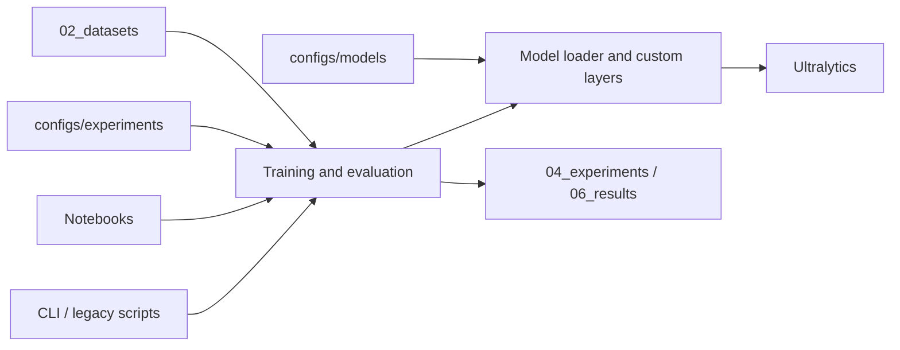

# Project architecture

The project is a research workspace with one reusable Python package. Experiment
inputs are versioned separately from trained weights, generated evidence and
exploratory notebooks. Existing numbered research directories remain in place
because notebooks and saved run arguments refer to their paths.



## Responsibilities

| Location | Responsibility |
| --- | --- |
| `src/drone_detection/cli.py` | Parse commands and dispatch workflows; no model import for help or dry runs. |
| `paths.py` | Resolve repository paths; optional `DRONE_DETECTION_ROOT` override. |
| `config.py` | Read experiment YAML and validate required local inputs. |
| `training.py` | Load a model, run training and record the effective configuration. |
| `evaluation.py` | Existing EXP002 prediction export and best-overlap calculation. |
| `metrics.py` | Pure bounding-box IoU calculation. |
| `models/attention.py` | Canonical GAM implementation, preserved for checkpoint compatibility. |
| `models/loader.py` | Process-local Ultralytics registration and local checkpoint loading. |
| `environment.py` | Explicit environment/GPU inspection command. |
| `configs/experiments/` | Model/weights/data references, hyperparameters and output names. |
| `configs/models/` | Runnable model topology; historical and incomplete definitions are labelled separately. |
| `03_code/` | Compatibility entry points for existing commands and imports. |
| `notebooks/` | Exploration, plots and historical execution evidence. |
| `tests/` | Regression checks with temporary fixtures and CPU model checks. |

Keep reusable logic in `src/drone_detection/`. A new experiment normally needs
one YAML file rather than a copied training script. Keep preprocessing changes
and object-level evaluation protocols explicit: this refactor does not rewrite
the methods preserved in historical notebooks.

## Paths and installation

Use an editable installation in the same environment as the notebook kernel:

```powershell
python -m pip install -e .
```

This installs the package and `drone-detection` command. In an existing environment
with the research dependencies already installed, `--no-deps` avoids changing
those libraries; pip still needs its setuptools build dependency. Without an
installation, set `$env:PYTHONPATH = "$PWD/src"` at the repository root before
using `python -m drone_detection` or running tests. Legacy `03_code` scripts
also locate `src` directly.

CLI paths, experiment YAML paths and model-loader paths are relative to the
repository root. Absolute paths also work. Direct evaluation API parameters use
the supplied `Path` values; use `project_path()` for repository-relative inputs.
The default root comes from the editable checkout, independent of the current
working directory. Set `DRONE_DETECTION_ROOT` before importing the package when
using a wheel or another research checkout. Configs are checkout files, not wheel
package data.

The existing local `02_datasets/DUT_Anti_UAV/data.yaml` still contains its own
absolute dataset `path:`. Update that value when relocating the dataset;
`DRONE_DETECTION_ROOT` resolves the YAML filename, not paths inside that file.
Datasets and weights remain local inputs. The model loader rejects missing files
before calling Ultralytics, rather than relying on implicit downloads.

## Experiment lifecycle

1. Add a model topology under `configs/models/` if it is new.
2. Copy an experiment YAML and choose a distinct `name`.
3. Set local `model`, `data`, optional `pretrained` and `train` options.
4. Run with `--dry-run` to validate files and inspect resolved paths/options.
5. Train explicitly, then evaluate the saved checkpoint with the intended protocol.

`--dry-run` checks configuration structure and file existence; it does not
construct the model, check dataset contents or start training. Shared model
construction is exercised separately by the CPU tests.

`project` defaults to `04_experiments`. Training passes `exist_ok=False` so
Ultralytics chooses a fresh incremented directory when a name already exists.
The actual directory is reported after training, and `experiment.json` records
the resolved model and training options beside Ultralytics' `args.yaml`.
Nested `train` options cannot override names, output paths, pretrained selection,
overwrite protection or resume behavior. Resume orchestration is not provided by
this command. Current custom-model workflows target a single process/GPU;
distributed worker startup would also need custom-module registration.

The baseline YAML points to the existing `notebooks/yolo26s.pt`; P2 and corrected
GAM transfer compatible weights from the existing baseline-5 checkpoint. These
references preserve local provenance while new outputs use separate names.
Training defaults not explicitly supplied still come from Ultralytics 8.4.157;
`requirements.txt` pins this integration version. CUDA/PyTorch installation remains
machine-specific, and the dependency list is not a complete environment lockfile.

## Custom model boundaries

Always use `drone_detection.models.load_model()` for builds or checkpoint loads
that might involve GAM. It registers the class in the current process and adds
the historical `ultralytics.nn.modules.gam.GAM` import alias. New checkpoints use
the stable project module path. No Ultralytics source files are edited.
Existing modifications in the local `.venv` are left in place; the adapter also
supports registration when those modifications are absent.

The old GAM topology adds GAM at layer 23 while Detect consumes layers
`[16, 19, 22]`. Consequently that attention output does not feed detection.
`configs/models/legacy/yolo26s_gam.yaml` preserves this graph, and existing results
and checkpoints keep their original meaning. The corrected definition uses
`[16, 19, 23]` and the new experiment name `YOLO26s_GAM_connected`. It needs its
own training and evaluation; no improved accuracy is claimed. A CPU gradient
check confirms the new attention branch receives detection gradients.

GAM uses an explicit 512 channels at scale `s`. Changing scales requires reviewing
that argument. Inserting GAM shifts Detect's layer index; baseline Detect weights
are not automatically remapped during partial weight transfer.

P2 is copied without topology changes. Mamba's source file is empty, and HEPAN's
backbone and feature references are incomplete. Both remain under
`configs/models/drafts/` with explanations, outside runnable experiment configs.
Original YAML files remain at their old paths for historical notebooks; new work
should edit `configs/models/`.

## Evaluation and historical evidence

The migrated evaluation command retains EXP002 defaults: test JPG images,
confidence 0.25, prediction IoU 0.7, batch chunks of 20, and best overlap against
ground truth. Its CSV is a prediction export, **not** a one-to-one TP/FP/FN or mAP
evaluation. Images without predictions do not get CSV rows. The empty export
retains headers, and an empty/missing image split is an error.

By default it writes `06_results/EXP002_high_resolution/exp002_test_predictions.csv`.
Use `--output-dir` when evaluating another model or preserving an earlier export;
the filename stays `exp002_<split>_predictions.csv` for compatibility.

Existing datasets, checkpoints, generated figures, CSVs and notebook cells were
not moved or regenerated. Root-level research registries remain historical
snapshots; they should not be interpreted as a fresh audit of this refactor.
New generated training artifacts are ignored by Git; already tracked evidence
remains tracked.

## Validation

```powershell
python -m unittest discover -s tests -v
```

Tests cover configuration and path isolation, missing-input behavior, preserving
incremented run directories, import boundaries, prediction export compatibility,
P2 strides, and detection gradients through corrected versus legacy GAM.
They use synthetic CPU inputs and temporary fixtures; no dataset training or
benchmark is part of the test suite.
