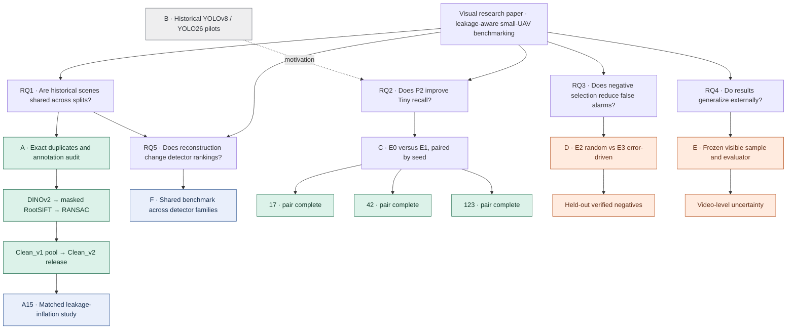
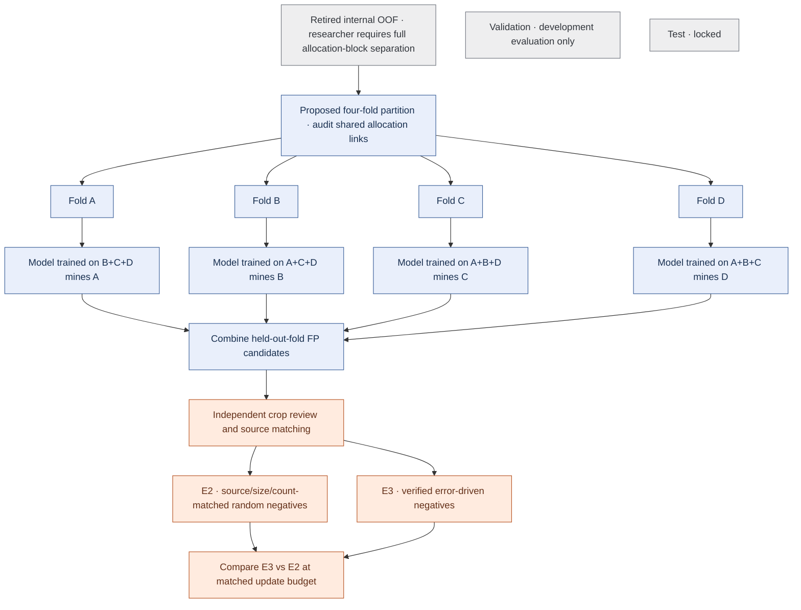

# Research questions and evidence

[Dashboard](RESEARCH_PROGRESS_DASHBOARD.md) · [Master results](RESULTS_MASTER_TABLE.md) · [Scientific claims](SCIENTIFIC_CLAIMS_STATUS.md)

| Research question | Experiments | Current conclusion | Evidence needed | Evidence / design |
| --- | --- | --- | --- | --- |
| RQ1 · Scene dependence | A01–A14, A17–A23 → A15, A16/F | Clean_v1 retained 322 groups spanning the old splits. The released allocation passes the final declared boundary checks. | Separate a measured split effect from exposure and optimization differences using a matched design and an independent population. | [06_results/Gate2_scene_sequence_audit_v1_20261109/complete_cross_split_scene_leakage/leakage_summary.json](../06_results/Gate2_scene_sequence_audit_v1_20261109/complete_cross_split_scene_leakage/leakage_summary.json) · [02_datasets/DUT_Anti_UAV_Clean_v2/gate2_report.json](../02_datasets/DUT_Anti_UAV_Clean_v2/gate2_report.json) · [02_datasets/DUT_Anti_UAV_Clean_v2/dataset_changes.csv](../02_datasets/DUT_Anti_UAV_Clean_v2/dataset_changes.csv) |
| Historical detector questions | B · EXP001–007, local AdamW, historical four-cell matrix | The old P2 pilot moved Tiny recall from 86.81% to 88.61% on historical Validation. Batches, initialization and bins limit interpretation. Uniform box shrink increased FP and FN. | Retain as motivation and error analysis. Report Test exposure and the negative findings. | [06_results/EXP002_object_level_error_analysis/val/summary.csv](../06_results/EXP002_object_level_error_analysis/val/summary.csv) · [06_results/EXP003_object_level_evaluation/EXP003_summary.csv](../06_results/EXP003_object_level_evaluation/EXP003_summary.csv) · [06_results/YOLO26s_baseline_fp_review_20261011/correction.json](../06_results/YOLO26s_baseline_fp_review_20261011/correction.json) · [04_experiments/evaluation/COMPARISON.md](../04_experiments/evaluation/COMPARISON.md) |
| RQ2 · P2 and Tiny recall | C · E0/E1 × 17, 42, 123 | OFFICIAL CONTROLLED. All three pairs completed and replayed. Tiny recall increased by 4.24 ± 1.05 pp (paired mean ± sample SD), with mean FP +27 and FN −40.67. | External confirmation, negative-only evaluation and the planned background-selection study. Three-seed summaries are now complete. | [docs/CONTROLLED_P2_THREE_SEED_RESULTS.md](CONTROLLED_P2_THREE_SEED_RESULTS.md) · [06_results/controlled_yolo26_v3_three_seed_audit_20261120/verification.json](../06_results/controlled_yolo26_v3_three_seed_audit_20261120/verification.json) · [configs/paper/analysis_plan_yolo26_v1.json](../configs/paper/analysis_plan_yolo26_v1.json) |
| RQ3a · Added backgrounds | D · E2−E1 and E3−E1 (secondary) | PLANNED. The older EXP004 mined Train but stopped before fitting. Additional examples and updates may affect both contrasts. | Build independently verified negative sets and a held-out negative-only evaluation population. | [configs/paper/analysis_plan_yolo26_v1.json](../configs/paper/analysis_plan_yolo26_v1.json) · [06_results/EXP004_targeted/status.json](../06_results/EXP004_targeted/status.json) |
| RQ3b · Hard versus random selection | D · E3−E2 (primary), within seed | PLANNED. Matched source frequencies, crop dimensions, count, positives and actual optimizer updates are required to isolate the declared selection procedure. | Freeze the mining design, evaluate dependence and verify both crop bundles before training. | [configs/paper/analysis_plan_yolo26_v1.json](../configs/paper/analysis_plan_yolo26_v1.json) · [docs/CONTROLLED_STUDY_DECISION_20261116.md](CONTROLLED_STUDY_DECISION_20261116.md) |
| RQ4 · External generalization | E-RGPT-STD, E-RGPT-CLEAN → E-LOCK | HISTORICAL EXTERNAL DIAGNOSTIC. Both JSONs report a stride-50 sample. Checkpoint hashes, sample manifest and settings are unbound. | Complete the checklist below and freeze a prospective evaluation with sequence-level uncertainty. | [runs/rgpt_evaluation/standard_model_sampled.json](../runs/rgpt_evaluation/standard_model_sampled.json) · [runs/rgpt_evaluation/clean_v2_model_sampled.json](../runs/rgpt_evaluation/clean_v2_model_sampled.json) · [configs/paper/external_validation_protocol.template.json](../configs/paper/external_validation_protocol.template.json) |
| RQ5 · Performance across families | F-V8, F-11, F-26, F-R18, F-FRCNN (A16) | PLANNED. No matched multi-family ranking on old and reconstructed protocols was located. Historical YOLOv8, YOLO26 and GAM results use different designs. | Select model variants and predefine the split contrast, resource budget, checkpoints, evaluator, paired replicates and uncertainty. | [04_experiments/evaluation/COMPARISON.md](../04_experiments/evaluation/COMPARISON.md) · [08_thesis/ieee_manuscript_20261116/manuscript.md](../08_thesis/ieee_manuscript_20261116/manuscript.md) |

## Leakage-aware benchmarking design

A15 asks how much performance changes under a specified split policy. A16 asks whether the change varies by detector family. The four-cell matrix shows direct historical exposure in both directions. A prospective comparison needs the same retained image pool and label policy, comparable split sizes, matched seeds, public initialization within each family, optimizer/update budget, image size, checkpoint rule and evaluator. Declare whether the estimand is apparent in-split performance or generalization to a common unseen population. Freeze both populations and the unit of uncertainty before interpreting a difference as inflation. No numeric inflation estimate is available.

## Negative selection and measurement

The approved plan specifies 512 independently verified crops per arm. Mining a fully trained detector’s own training images can favor examples it already fits and distort the candidate pool. The four-fold design below is a proposal. Hold out whole training scene groups for discovery. Every Clean_v2 Train image belongs to one conservative allocation block, so allocation-block-disjoint four-fold mining is infeasible on this release. Audit weaker links across proposed folds and document the independence that the design can support. Validation and Test are excluded from mining and crop selection.
[configs/paper/analysis_plan_yolo26_v1.json](../configs/paper/analysis_plan_yolo26_v1.json) · [02_datasets/DUT_Anti_UAV_Clean_v2/allocation_report.json](../02_datasets/DUT_Anti_UAV_Clean_v2/allocation_report.json) · [06_results/dataset_review_clean_v2_20261114/review_statistics.json](../06_results/dataset_review_clean_v2_20261114/review_statistics.json)

E2 and E3 require the same source/size distribution, positive training data, augmentations, initialization, seeds and actual update budget. Report E3−E2 first. The E2−E1 and E3−E1 contrasts measure the combined augmentation and budget effects. Measure FP/image on the declared population. A negative-image false-positive rate needs an independently verified negative-image denominator. False alarms per minute require held-out video and observed duration.

## External validation freeze checklist

All items remain open for the final study. The conversion notebook refers to visible imagery, but its provenance does not bind the historical JSON rows to a specific release or sample. [notebooks/04_AntiUAV_RGBT_to_YOLO_conversion.ipynb](../notebooks/04_AntiUAV_RGBT_to_YOLO_conversion.ipynb) · [configs/paper/external_validation_protocol.template.json](../configs/paper/external_validation_protocol.template.json)

- [ ] **Dataset/version locked** — Reconcile the RGPT path, RGBT notebook name, release, license, provenance and overlap with previous samples.
- [ ] **Modality locked** — Bind each input to a verified visible/RGB stream.
- [ ] **Full or sampling policy locked** — Specify inclusion, absence/occlusion, exclusions and frame stride before seeing results.
- [ ] **Sequence selection locked** — Hash a complete sequence/frame manifest and identify historically exposed samples.
- [ ] **Checkpoint selection locked** — Record Validation-only selection, rule and checkpoint hashes for every arm.
- [ ] **Confidence and NMS locked** — Freeze AP floor, operating confidence, head, NMS and max detections.
- [ ] **Evaluator locked** — Pin implementation identity, environment and raw prediction format.
- [ ] **Metrics locked** — Declare operating-point, AP, false-alarm and aggregation definitions.
- [ ] **Statistical unit locked** — Report per-sequence outcomes and clustered or sequence-level intervals.
- [ ] **No tuning after results observed** — Seal the prospective protocol before inference and retain the exposure log.

## Separate project · radar–PTZ sensor fusion

The research brief proposes the following work. The repository audit located no project-specific radar logs, calibration, controller implementation, association labels, or fusion evaluation. Each stage therefore has proposal status. The detector studies above supply no sensor-fusion result.

| Proposed work | Status | Evidence needed |
| --- | --- | --- |
| Radar measurements, duplicate filtering and spatial clustering | Proposed / unverified | Dated recordings, measurement definitions and reference associations. |
| Range, azimuth, elevation, height and ENU/XYZ coordinates | Proposed / unverified | Sensor coordinate frames and calibrated reference observations. |
| Camera projection and PTZ command generation | Proposed / unverified | Calibration and time-aligned logs for angular error, settling and acquisition time. |
| Visual tracking and sensor association | Proposed / unverified | Annotated tracks, track persistence and association accuracy. |
| Fusion and adaptive reliability weighting | Proposed / unverified | Independent evaluation with latency, FPS, false positives/min and reference outcomes. |

## Publication gates

| Deliverable | Current state | Dependency |
| --- | --- | --- |
| Paper draft | In progress · revision 2 exists | Refresh with all seeds, negative findings, exposure history and current claims after method freeze. |
| Seed-level inference | All three pairs complete and audited | Paired summaries verified. Add external and negative-study evidence. Training-seed variability and sequence uncertainty answer different questions. |
| Leakage/re-benchmark contribution | Reconstruction complete, causal effect and rankings open | A15 and A16/F design, matched runs and independent holdout. |
| External and operational claims | Blocked | Frozen external protocol, independent negatives and a declared timing population. |
[08_thesis/ieee_manuscript_20261116/manuscript.md](../08_thesis/ieee_manuscript_20261116/manuscript.md)

## Current negative-discovery decision

Full allocation-block separation is required. Internal buffered OOF was rejected. The complete external source screen found zero declared allocation crossings, but the fixed-threshold yield was only 1 unverified crop(s). The 512/512 matched bundle remains unavailable. [docs/NEGATIVE_MINING_DESIGN_REVIEW.md](NEGATIVE_MINING_DESIGN_REVIEW.md)

The prospectively amended version-2 source diagnostic at confidence .25 yielded four uncertain crop proposals, including an adjacent-frame pair; the .50 version yielded one. Neither meets the 512-hard-crop requirement. Source-family reservation is a declared engineering heuristic; other families remain unaudited under a revised policy. [Current design review](NEGATIVE_MINING_DESIGN_REVIEW.md)
